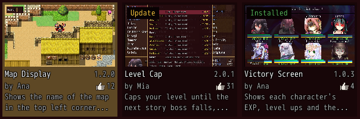
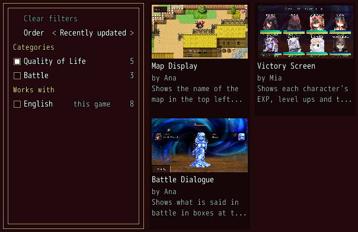
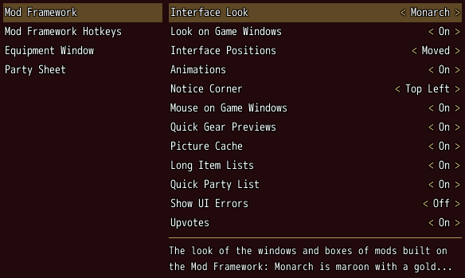
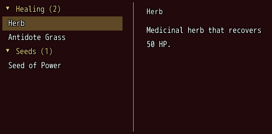

# MGQ Paradox Mod Framework

*The mod other mods of Monster Girl Quest! Paradox RPG run on.*

[](https://github.com/Pauliinchen/MGQ-Mod-Framework/releases/latest)

Install, update and turn your mods on and off from the title screen, set their options and
hotkeys in one place, and play every mod built on the framework in the look you pick.

<p align="center">
  
  
   Mods: the mods on the left, the options of the framework on the right" width="48%">
  
</p>

- **Mods from the title screen:** the Mods box left of the title's commands opens the *Browser*, which installs, updates and removes the mods of the [website](https://mgqonline.org/mods), the *List*, which turns your mods on and off and sets their order, and the *Configuration*, which sets their options and hotkeys before a game starts.
- **One loader for every mod:** each mod loads when its author's tag on the website says, after the mods it needs and in the order you set, and only while it is on. A save remembers its mods and offers to turn on or install the ones missing.
- **Updates without trouble:** an update of the framework or of a mod that runs waits until the game starts again, and *Restart now* starts it for you.
- **Options > Mods:** the options and hotkeys of every mod in the game's own Options, in place of Mod Config Remake; mods made for it keep working.
- **Your interface:** three looks for every mod built on the framework and for the game's own windows, Monarch, Legacy and the game's own window color, and every box moves and resizes while you hold the left **Alt**.
- **The mouse on the game's menus:** point at a row, click to pick it, right-click to go back, and scroll with the wheel.
- **Less lag in the game's menus:** quicker gear previews in the equip screen and the shop, a picture cache that no longer empties itself whole, long item lists that draw only the rows in view, and a party list in the menu that keeps its faces.
- **For modders:** windows, dialogs, HUD boxes, lists, forms, notices, menus and wheels in a few lines of Ruby, with the keys, the mouse and a gamepad working by themselves.

## Requirements

- **Monster Girl Quest! Paradox RPG 3.06**, untranslated or with the English or Russian translation.
- **The community's mod loader:** the `Patch.rb` from [*Patch.rb (enable Type 1 mods)*](https://mgq.miraheze.org/wiki/Paradox_mods#Patch.rb_(enable_Type_1_mods)) on the MGQ wiki, in your `Patch` folder. The Russian translation brings its own `Patch.rb`, which loads the framework too: keep it and skip the wiki one.
- **Windows**, **Linux** with Wine or Proton, or **JoiPlay** on Android with the Android package.

## Install

1. Download the Mod Framework from the [website](https://mgqonline.org/mods), or `MGQ-Mod-Framework-<version>.zip` from the [latest release](https://github.com/Pauliinchen/MGQ-Mod-Framework/releases/latest). On JoiPlay take the Android package, the zip ending in `-android`.
2. Close the game and extract the zip into the folder that contains `Game.exe`.

You then have `!Mod_Framework.rb`, a `Mod_Framework` folder and `Equipment_Window.rb` in your `Patch` folder. The `!` puts the framework first, so it loads before every mod and then loads your mods itself. Your mods stay in the `Patch` folder as before. Your settings go into `Patch\Mod_Framework`, the logs into the `Logs` folder of the game folder.

`Equipment_Window.rb` is the Equipment Window, which replaces the game's equip screen. It comes with the framework as a mod of its own and is on from the start: turn it off in the Mod List, or set *[Equipment Window] Equip Command* in *Options → Mods* to the game's screen. The *Browser* updates and removes it like any other mod.

On Windows and Linux, the first time the game starts with the framework, it sets a mark in `Game.exe` that lets the game use up to 4 GB of memory from the next start. The old program stays beside it as `Game.exe.before-4gb`. See [4 GB for the game](docs/GUIDE.md#4-gb-for-the-game).

**Update:** the framework looks for updates of itself and of your mods as the game starts and at the title, and *Browser* in the title's Mods box counts them. Its own update and that of a mod that runs download into `Patch\Mod_Framework\Waiting` and move into place as the game starts again, which the framework does for you. This is checked on Windows and should work under Wine and Proton too, but is not checked there yet: if an update does not move into place there, extract the framework's zip into the game folder by hand. If the game cannot start, download the framework again from the [website](https://mgqonline.org/mods) and extract it into the game folder; the website keeps every version, so you can also take the one before. Your settings, the mods you turned on and their order are kept. The zip brings `Equipment_Window.rb` too: leave it out if you removed it or updated it in the *Browser*.

**Uninstall:** close the game and delete `!Mod_Framework.rb` and the `Mod_Framework` folder in `Patch`. Keep `Patch\Mod_Framework\Mod_Framework.ini` if you want your settings back after a later install. `Equipment_Window.rb` is a mod of its own: delete it as well, and keep a copy outside `Patch` if you want it back after a later install. Mods built on the framework, the Equipment Window too, cannot run without it: left in `Patch`, each shows an error as the game starts. `Game.exe` keeps its 4 GB mark: to put the old program back, delete `Game.exe` and rename `Game.exe.before-4gb` to `Game.exe`, see [4 GB for the game](docs/GUIDE.md#4-gb-for-the-game).

## Quick start

1. Start the game and press **Left** on the title's commands: the cursor moves into the Mods box.
2. Pick *Browser*, open a mod's page and pick *Install*. Cancel goes back a step at a time and then closes the browser.
3. Pick *List* to turn mods on and off and to move them with **I** and **K**. A change to a mod that runs already counts once the game starts again: the bar at the foot says so, and *Restart now* on it starts the game again.
4. Pick *Configuration* to set your mods' options and hotkeys. In a game they are in *Options → Mods*.

## Hotkeys

| Hotkey | What it does |
|---|---|
| **Y** / **N** | Accept / decline the first offer of the notices, or answer a question box |
| **I** / **K** | Move the mod under the cursor up / down within its tag in the Mod List |
| **Ctrl** + arrow | Jump out of a list to the part beside it; on a gamepad, hold A with the d-pad |

Rebind them in *Options → Mods → Mod Framework Hotkeys*, or at the title in *Configuration*. The game's cancel key as you bound it in F1, and numpad **0**, close every window of the framework and of the mods built on it.

## For modders

A mod built on the framework describes its screens with components, as MudBlazor does on the web, and the framework lays them out, draws them in the player's look, moves the focus and renders again when the data changes. This is a whole mod, a Purse command in the game's menu that opens a window with the party's gold:

```ruby
module Purse_Check
  UI = Mod_Framework::UI

  # A window with the party's gold.
  class PurseWindow < UI::Component
    def render
      window "Purse", width: 200 do
        text "#{UI::Game.gold} G", align: :end
        button "OK", on_click: :close
      end
    end
  end

  UI.patch "Window_MenuCommand" do |menu|
    menu.after("#formation") { command "Purse", id: :purse_check, on_click: -> { UI.open(PurseWindow) } }
  end
end
```

Every part and call has a page with examples, pictures and every param; the [UI components](docs/ui/README.md) index tells what each is for. Start with [Component](docs/ui/component.md) (params, state and events) and [Mod](docs/ui/mod.md) (your files, tags, title mods, the restart, installs and updates). The [Equipment Window](Samples/Equipment_Window.rb) is a whole mod built on it. Set your mod's tag and what it needs on its page of the website, and tell your players there that it needs the Mod Framework.

### Components

<!-- components -->
- **Your mod:** [Component](docs/ui/component.md) · [Mod](docs/ui/mod.md) · [Options](docs/ui/options.md) · [Hotkeys](docs/ui/hotkeys.md) · [Settings](docs/ui/settings.md) · [Hooks](docs/ui/hooks.md)
- **Roots:** [Window](docs/ui/window.md) · [Dialog](docs/ui/dialog.md) · [HUD](docs/ui/hud.md) · [Popover](docs/ui/popover.md) · [Wheel](docs/ui/wheel.md)
- **Layout:** [Stack](docs/ui/stack.md) · [Container](docs/ui/container.md) · [Grid](docs/ui/grid.md) · [Paper](docs/ui/paper.md) · [Card](docs/ui/card.md) · [Drop zone](docs/ui/drop_zone.md) · [Aside](docs/ui/aside.md) · [Divider](docs/ui/divider.md) · [Slides](docs/ui/slides.md) · [Drawer](docs/ui/drawer.md) · [Group](docs/ui/group.md) · [Expansion panels](docs/ui/expansion_panels.md)
- **Navigation:** [Tabs](docs/ui/tabs.md) · [Menu](docs/ui/menu.md) · [Breadcrumbs](docs/ui/breadcrumbs.md)
- **Buttons and forms:** [Button](docs/ui/button.md) · [Text field](docs/ui/text_field.md) · [Autocomplete](docs/ui/autocomplete.md) · [Numeric field](docs/ui/numeric_field.md) · [Checkbox](docs/ui/checkbox.md) · [Switch](docs/ui/switch.md) · [Slider](docs/ui/slider.md) · [Rating](docs/ui/rating.md) · [Color picker](docs/ui/color_picker.md) · [Radio group](docs/ui/radio_group.md) · [Toggle group](docs/ui/toggle_group.md) · [Form](docs/ui/form.md) · [Select](docs/ui/select.md) · [Hotkey field](docs/ui/hotkey_field.md) · [Options list](docs/ui/options_list.md)
- **Display:** [Text](docs/ui/text.md) · [Field](docs/ui/field.md) · [Image](docs/ui/image.md) · [Icon](docs/ui/icon.md) · [Avatar](docs/ui/avatar.md) · [Badge](docs/ui/badge.md) · [Chip set](docs/ui/chip_set.md) · [Timeline](docs/ui/timeline.md) · [Alert](docs/ui/alert.md) · [Progress](docs/ui/progress.md) · [Arrow](docs/ui/arrow.md) · [Tooltip](docs/ui/tooltip.md) · [Key help](docs/ui/key_help.md) · [Help line](docs/ui/help_line.md) · [Header](docs/ui/header.md) · [Slot row](docs/ui/slot_row.md) · [Stat grid](docs/ui/stat_grid.md) · [Lines](docs/ui/lines.md)
- **On the map:** [Marker](docs/ui/marker.md) · [Bubble](docs/ui/bubble.md) · [HUD](docs/ui/hud.md#over-a-characters-head)
- **Services:** [Confirm](docs/ui/confirm.md) · [Message](docs/ui/message.md) · [Number](docs/ui/numeric_field.md#the-number-box-uinumber) · [Task](docs/ui/task.md) · [Menu](docs/ui/menu.md#a-menu-of-your-own-uimenu) · [Needed mods](docs/ui/needed_mods.md) · [Replace window](docs/ui/replace_window.md) · [Replace scene](docs/ui/replace_scene.md) · [Patch](docs/ui/patch.md)
- **Notices:** [Toast](docs/ui/toast.md)
- **Your own drawing:** [Drawn](docs/ui/drawn.md)
- **Lists:** [List](docs/ui/list.md) · [Log](docs/ui/log.md) · [Table](docs/ui/table.md) · [Pagination](docs/ui/pagination.md) · [Page view](docs/ui/page_view.md)
- **Game parts:** [Command](docs/ui/command.md) · [Game data](docs/ui/game_data.md)
- **Looks:** [Colors](docs/ui/colors.md) · [Themes](docs/ui/themes.md)
<!-- /components -->

## Documentation

- [Player guide](docs/GUIDE.md): the Mods box, the Mod List, the Mod Configuration, the mod browser, updates, the looks and [troubleshooting](docs/GUIDE.md#troubleshooting).
- [UI components](docs/ui/README.md): for modders, every part and call of the framework.
- [Developer notes](docs/DEVELOPER.md): building, testing and how the framework works inside.

## Disclaimer

The MGQ Paradox Mod Framework is an unofficial fan project. It is not affiliated with or endorsed by Torotoro Resistance, the creators of Monster Girl Quest!, or the English translation team. It contains no game or translation files.
