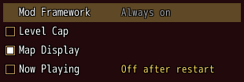
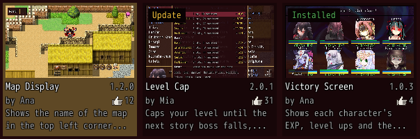
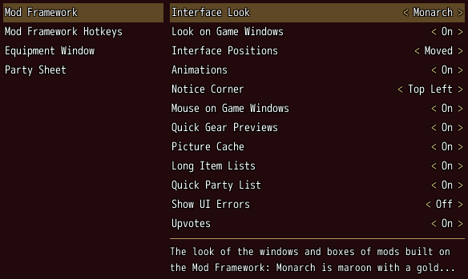

# Player guide

Everything the MGQ Paradox Mod Framework does, for players. To install it, see the [README](../README.md).

- [Hotkeys](#hotkeys)
- [The title's Mods box](#the-titles-mods-box)
- [The Mod List](#the-mod-list)
- [The Mod Configuration](#the-mod-configuration)
- [The mod browser](#the-mod-browser)
- [Updates](#updates)
- [A save's mods](#a-saves-mods)
- [Options > Mods](#options--mods)
- [Interface](#interface)
- [Notices](#notices)
- [Platforms](#platforms)
- [4 GB for the game](#4-gb-for-the-game)
- [Logs](#logs)
- [Troubleshooting](#troubleshooting)

## Hotkeys

| Hotkey | What it does |
|---|---|
| **Y** / **N** | Accepts / declines the first offer of the notices, and answers a question box (see [Notices](#notices)). |
| **I** / **K** | Moves the mod under the cursor in the Mod List one place up / down within its tag, so it loads earlier / later. |
| **Ctrl** | Held with an arrow, moves from a list to the part beside it that way, such as from the Mod List to the bar at its foot. On a gamepad, hold A with the d-pad. |

This guide names the default hotkeys. To bind others, open *Options → Mods → Mod Framework Hotkeys* in a game, or *Configuration* at the title, confirm the hotkey's row (*Accept Notification*, *Decline Notification*, *Move Up*, *Move Down* or *Jump Out of a List*) and press the new key; **Esc** keeps the old one.

- Keys the framework's windows use themselves can't be bound: the arrows, Enter, Space, Esc, Tab, Page Up, Page Down, Home, End, the Menu key, the left Alt, numpad 0, and the keys F1 binds to confirm, cancel, L and R (Z, X, Q and W unless you changed them). Neither can a key another hotkey already uses.
- The hotkeys of your mods are bound the same way, under each mod's name.
- Your hotkeys are kept in the framework's settings, so they hold in every save.

**Closing.** Every window of the framework and of the mods built on it closes with the game's cancel key as you bound it in *F1* (**X** and **Esc** unless you changed them), with numpad **0** and with a gamepad's cancel. A question that has no cancel in the game closes too, and the mod asks again later. While you type into a text field, **Esc** and numpad **0** leave the field.

**The keys in a window.** The arrows move between the parts, confirm presses or goes into a box, and cancel steps back the way you came; on the part a window opened on, cancel closes it. **Tab** steps the tabs, **Q** and **W** turn a window's pages, such as the characters of an equipment window, and **Page Up** and **Page Down** page a list. A list wraps from its last row to its first like the game's own.

## The title's Mods box

The Mods box stands left of the title's commands with *Browser*, *List* and *Configuration*. **Left** on the title's commands moves the cursor into it, on the command you used last, and **Right** goes back; the two share one cursor. Cancel does nothing there, as on the title's commands. Mods may add rows of their own below the three.

- The number on *Browser* counts the updates waiting.
- A dot on *List* tells that a mod failed to load, misses a mod it needs, or does not work with another mod that is on.

## The Mod List

*List* opens the Mod List: your mods under the tags their authors gave them on the website, each tag in the order its mods load.

- **On and off:** confirm on a mod, or a click on the box at the start of its row, turns it on or off. The framework's own row is always on. Turning off a mod that others need, or turning on one that does not work with a mod that is on, asks first; turning on a mod whose requirement is off offers to turn that on too.
- **Order:** **I** and **K** move the mod under the cursor up and down within its tag, as dragging its row with the mouse does. Within a tag mods load after the mods they need, then as their authors advise, then by name, unless you move them; a mod moved against its author's advice says so on its row.
- **Details:** **Right** shows the mod's description and what it needs; **Left** or cancel goes back to the list.
- **The restart bar:** a change to a mod that already runs counts once the game starts again. A bar at the foot says so, and *Restart now* on it starts the game again. **Ctrl** with **Down** reaches it from the list.
- Cancel on the list closes the Mod List.

A mod's tag says when it loads, and only its author sets it: *Framework* mods load as the game starts, *Title* mods add to the title screen, *Default* mods load as you start a new game or load a save, and *Data* mods, which change the game's data, load right after them. A mod the website does not know is Default.

The Equipment Window, which replaces the game's equip screen, comes with the framework as a Default mod of its own and is on from the start. It opens where the game's equip screen would. Turn it off here like any mod, or set *[Equipment Window] Equip Command* in *Options → Mods* to the game's screen.

## The Mod Configuration

*Configuration* opens the Mod Configuration, laid out as *Options → Mods* in a game: the mods on the left, and on the right the options of the mod under the cursor, then its hotkeys under "Hotkeys".

- The left lists the framework and the mods loaded at the title first, then the other mods that are on.
- A mod that loads only in a game shows only its hotkeys here, so you can bind them before a game starts; its options are in the game's *Options → Mods*, since they are kept in each save.
- Confirm or **Right** goes into the rows, cancel comes back to the mods, and cancel there closes it.

## The mod browser

*Browser* lists the mods of [mgqonline.org](https://mgqonline.org/mods) as cards with their screenshots, three across and two down, or as rows; *List view* and *Card view* switch them, and the browser opens the next time as you left it.

- **Moving around:** **Up** and **Down** pick the bar at the top or the mods, confirm moves inside, and cancel goes back out and, from there, closes the browser. In the bar, **Left** and **Right** reach *Mods*, *Collections*, the view, *Update all* and *Refresh*; **Tab**, or a gamepad's **L** and **R**, switch *Mods* and *Collections* from anywhere.
- **Search:** **Down** from the bar's buttons types into *Search*, which looks through the names, summaries, authors and keywords; **Enter** keeps it and cancel clears it.
- **Filters:** **Right** from the search reaches *Filters*, which opens the filters at the left of the mods, the cards two across beside them, and shuts them again. *Clear filters* clears every pick, **Left** and **Right** step the order (recently updated, newest, most downloaded, most upvoted or by name) and the platform, and confirm ticks a category, a game a mod works with, a language or a keyword, each with how many mods have it. The mods narrow at once, the bar says how many show of all, and *Filters* counts your picks.
- **A mod's page:** confirm or a click on a mod opens its page: a big screenshot, its description, or the changes of the version you have, and what to check before installing it: whether it is safe to add to or remove from a running save, the mods it does not work with, its known issues, options, hotkeys, the games and languages it is made for, its credits, license and links. Cancel or *Back* goes back to the mods.
- **Install, update, remove:** the page's buttons install, update or remove the mod and open its pages in your web browser. A mod that needs another not installed asks to install both. Installing a mod that does not work with one that is on asks first and installs it turned off. A box in the middle shows the install with a bar of how far it came and closes by itself, or stays with why nothing changed. A mod tagged Data has no *Install* or *Update*: you install it and its updates by hand from its page on the website, and *Update all*, the number on *Browser*, a collection's install and a save's install leave it out. A mod that is not running installs and updates at once; one that runs asks whether to start the game again, and *Later* leaves it for the next start.
- **Collections:** a collection's *Install* installs and turns on every mod of it in its order, then asks whether to turn your other mods off.
- **Upvotes:** cards and pages show each mod's upvotes. *Upvote* on a mod's page upvotes a mod this game installed or updated with the browser, and pressing it again takes the upvote back; upvote a mod you put into the `Patch` folder yourself on its page of the website. Mods are only upvoted, never voted down.

The game upvotes without an account, with an install key: a random number it makes once and keeps in `Patch\Mod_Framework\Install.ini`. It sends the key only to mgqonline.org with its downloads and upvotes, and never shows or logs it. Turn *Upvotes* off under *Mod Framework* in the options, and the website forgets the key with its upvotes.

The browser never removes the framework itself; see [Uninstall](../README.md#install) in the README.

## Updates

The framework looks for updates of itself and of your mods as the game starts and at the title; the number on *Browser* counts them, and *Update all* installs them.

- A mod that is not running updates at once.
- The framework's update brings only the framework's own files. The Equipment Window that came with it updates as a mod of its own, so a newer copy you installed stays.
- An update of the framework, or of a mod that runs already, downloads into `Patch\Mod_Framework\Waiting` and takes its place as the game starts again. The framework's own update asks first, then starts the game again for you; for a mod, *Restart now* does, or the next start.
- A mod may need another mod at a newer version, such as an online mod whose server asks for its latest release. The game then names the update, and *Update and restart* installs it and starts the game again.
- Once mods loaded as you started or loaded a game, going back to the title (*To Title*, a game over, F12) starts the game again, so you return to a title without them.
- The game starts again by starting its own `Game.exe` once more, with the options it was started with, such as `console` or `test`. This is checked on Windows; on Linux with Wine or Proton it should work too but is not checked yet, see [Platforms](#platforms). On JoiPlay it closes instead: start it again yourself.

**If the game cannot start** after an update, download the framework again from [mgqonline.org/mods](https://mgqonline.org/mods) and extract it into the game folder. The website keeps every version, so you can also take the version before the one that does not start.

## A save's mods

A save remembers the mods it was made with. When you load a save whose mods are turned off or missing now, a window over the save list names each of them and what happens to it ("turns on", "installs", "not on the site"), and the mods you have in another version after them.

- Its first button does all it can: *Turn on and load*, *Install and load* or *Install, turn on and load*. In a game it reads *Restart and load*: the game starts again and loads the save.
- A mod the website does not have you get from its author and put into the `Patch` folder; the window says so.
- *Load anyway* loads the save with the mods you have on, and *Back* or cancel goes back to the save list.

A mod may also ask for the mods a place of its own needs, such as an online world, in a window of the same kind.

## Options > Mods

In a game, open *Options* and then *Mods* (a tab in the translation's options, a row in the untranslated game's): your mods with options or hotkeys on the left, the options of the mod under the cursor on the right, then its hotkeys under "Hotkeys". Confirm or **Right** goes into the rows, cancel comes back to the mods, and cancel there closes it. **Up** and **Down** pick a row, **Left** and **Right** or a click on a value's arrows change it, and confirm moves it on or presses a button. A hotkey row waits for the next key you press after confirm; **Esc** keeps the old hotkey.

Under *Mod Framework*:

- **Interface Look:** Monarch, Legacy or Game's Default, see [Interface](#interface).
- **Look on Game Windows:** whether the game's own windows wear the look too.
- **Interface Positions:** *Default* puts every window and box you moved back where it starts.
- **Animations:** whether the windows and pages slide and fade, or land where they go at once.
- **Notice Corner:** the corner the notices of every mod show in.
- **Mouse on Game Windows:** whether the mouse works the game's own lists and menus.
- **Quick Gear Previews**, **Picture Cache**, **Long Item Lists** and **Quick Party List:** the fixes of the lag in the game's own menus, each On until you turn it off.
- **Show UI Errors:** Off unless you turn it on; while On, a mistake in a mod's windows also shows "UI error in <mod>. See the log."
- **Upvotes:** whether the mod browser can upvote mods.

Under *Mod Framework Hotkeys* are the framework's [hotkeys](#hotkeys). Mods made for Mod Config Remake show their rows here too; the Remake is no longer needed.

Your settings are kept in `Patch\Mod_Framework\Mod_Framework.ini`, the same in every save. Updates keep this file.

## Interface

**Look.** *Interface Look* sets the colors of every window, box and frame of the mods built on the framework, and of the game's own windows:

- **Monarch** (the default): dark maroon with a gold edge in a black rim, and gold titles.
- **Legacy**: black glass with a thin grey edge.
- **Game's Default**: the game's own windows in the game's *Window Color* (*Options → Window Color*), and the mods' boxes in the same colors.
- Mods may add looks of their own to the row.

With Monarch or Legacy the game's Window Color has no effect. *Look on Game Windows* Off keeps the game's own windows in its Window Color, and only the mods' windows and boxes wear the look. Texts are outlined in black in every look.

**The mouse.** The mouse works every window of the framework: hover, click, double click, drag and the wheel, which scrolls the list or text it points at. On the game's own lists and menus, point at a row to move the cursor, click to pick it, right-click to go back and scroll with the wheel, while *Mouse on Game Windows* is On. A right click on some parts opens a menu of what you can do with them.

**Moving and resizing.** Hold the left **Alt** and every box you can move gets an outline with its name:

- Drag inside a box to move it.
- Drag its edge or corner to resize it, where it lets you.
- Double-click a box to put it back where it starts.
- While **Alt** is held, the mouse only moves and resizes; clicks don't reach the boxes.
- A box keeps its place in every save; *Interface Positions → Default* puts every box back, those of every mod.

## Notices

The notices of every mod share one corner, the *Notice Corner* in *Options → Mods*: toasts, which slide in and fade out by themselves, and offers, such as an invite, with *Accept* and *Decline*. **Y** and **N** answer the first offer, or click its buttons. Notices show above every window, and while a corner runs out of room they get smaller first.

## Platforms

- **Windows:** everything works.
- **Linux** with Wine or Proton, on the Steam Deck too: the same download. Starting the game again after an update and the [4 GB change](#4-gb-for-the-game) are checked on Windows and should work here too, but are not checked yet. If an update does not take its place, close the game, download the framework from [mgqonline.org/mods](https://mgqonline.org/mods) and extract its zip into the game folder by hand.
- **JoiPlay** on Android: install the Android package, the zip ending in `-android`, the same way. A tap is a left click and Back a right click, and a text field opens the phone's keyboard while you type. Hotkeys and **Alt** need a keyboard plugged into the phone. The game cannot start itself again there: where it would, it tells you so and closes, and you start it again.

The framework's windows need its `ModFramework.dll`. Where the DLL cannot run, such as the PC download on JoiPlay, the game's own windows still wear the Monarch look, but nothing can be changed: no settings are kept, the mouse does not work the game's windows, the Mods box does not show, and the windows of mods built on the framework do not open. *Options → Mods* does not open then; the options of your mods that the game's own options can show go there instead.

## 4 GB for the game

The game is a 32-bit program, which Windows gives 2 GB of memory unless its program says it can
use 4 GB. A long session with many mods can need more than 2 GB, and then the game closes without a
message. So the first time the game starts with the framework on Windows or Linux, the framework
tries to set that mark in your `Game.exe`; from the next start on the game can use up to 4 GB. You
do nothing. Your old program stays beside it as `Game.exe.before-4gb`, and the log tells what
happened. Where the game folder cannot be written to, `Game.exe` stays as it is. This is checked
on Windows; under Wine and Proton it should work too but is not checked yet.

While Windows 11's Smart App Control is on, or still in its evaluation mode, the framework leaves
`Game.exe` as it is, since Windows would block the changed program. The game then keeps using up to
2 GB, and the log says the change was skipped. The framework tries again at every start, so once
Smart App Control is off, it sets the mark at the next start.

To undo it, close the game, delete `Game.exe` and rename `Game.exe.before-4gb` to `Game.exe`. The
framework leaves it that way from then on.

## Logs

The framework writes what it does into the `Logs` folder of the game folder, one log per day you played, named after the day, such as `Mod Framework 2026-11-07.log`, and `Mod Framework boot.log` when it could not start at all. Starting the game deletes the framework's logs of earlier days, so attach the log of the day something went wrong when you report a problem.

## Troubleshooting

| Message or problem | What to do |
|---|---|
| The game does not start after an update | Download the framework again from [mgqonline.org/mods](https://mgqonline.org/mods) and extract it into the game folder; you can also take the version before. Your settings stay. |
| "\<mods> did not load." | The mods named failed as the game started; the others loaded all the same. The Mod List tells why on each mod's row, and the log has the details. Update the mod, or turn it off. |
| "Some files are in Patch\Patch and do not load." | A zip was extracted into the `Patch` folder instead of the game folder, so its files sit in a second `Patch` folder inside it, where they do not load. Delete the folder the message names (for `Patch\<folder>\Patch` the whole `Patch\<folder>`), then extract the zip again into the game folder, the one with `Game.exe`. |
| A dot on *List* in the title's Mods box | A mod failed to load, misses a mod it needs, or does not work with another mod that is on. The Mod List names it on its row. |
| "Mods cannot be installed from the game here." | The framework's DLL cannot run on this system. Install mods by hand: extract them into the game folder. |
| "Nothing changed: \<why>" | An install, an upvote or a change in the Mod List did not go through, and the line says why. When the site could not be reached, your internet connection is down, or something such as a firewall keeps the game from reaching mgqonline.org. When your changes could not be saved, close programs that may hold files in `Patch\Mod_Framework` and try again. |
| "Mod Framework: your settings cannot be saved. Restart the game." | The settings file could not be read, such as while another program held it. Start the game again. |
| "The game closes now. Start it again to use your changed mods." | The game cannot start itself again here, such as on JoiPlay. Start it again yourself. |
| "UI error in \<mod>. See the log." | A mod's window went wrong. Send that mod's author the log of the day. Turn the message off with *Show UI Errors*. |
| Windows blocks `Game.exe`, or an antivirus removes it | Put back the program from before, as [4 GB for the game](#4-gb-for-the-game) tells. |
| A save asks to turn on or install mods | It was made with mods that are off or missing now, see [A save's mods](#a-saves-mods). |
