<!-- nav -->
[Mod Framework](../../README.md) › **UI components**

**Sections:** [Your mod](#your-mod) · [Roots](#roots) · [Layout](#layout) · [Navigation](#navigation) · [Buttons and forms](#buttons-and-forms) · [Display](#display) · [On the map](#on-the-map) · [Services](#services) · [Notices](#notices) · [Your own drawing](#your-own-drawing) · [Lists](#lists) · [Game parts](#game-parts) · [Calls and content of a component of your own](#calls-and-content-of-a-component-of-your-own) · [Looks](#looks) · [Shrink to fit](#shrink-to-fit) · [Room and borders](#room-and-borders) · [Params every part takes](#params-every-part-takes)
<!-- /nav -->

# UI components

The parts of the Mod Framework's UI layer, one page each, named `<componentName>.md` after the
name a modder writes in markup, such as `text_field.md`. Every page tells what the part is for,
shows short examples of its variants, and lists its params, events and keys. Those tables are
written from the framework's declarations, and so are the links at the head and foot of every
page, the picture grid of each section below and the list of the components in the repository's
README. They follow the entries written in the comment under each section's heading, one line
`- [Name](page.md): what it is` each; a grid shows each page's first picture.

Every example is markup inside a component's `render`:

```ruby
module Camp_Notes
  UI = Mod_Framework::UI

  class NotesWindow < UI::Component
    def render
      window "Camp notes" do
        text "The example goes here."
      end
    end
  end
end
```

Open it with `UI.open(Camp_Notes::NotesWindow)`. [Component](component.md) explains components,
params, state and events.

**Pictures.** Each example is marked with a comment such as `<!-- example: button-variants -->`,
followed by a picture line such as `` (a `.gif` for a part that
moves). The in-game test suite runs every example as its page writes it, in the Monarch look, crops
it to the part and keeps the picture as a reference; once approved, it is copied into `images`.

## Your mod

The calls beyond the parts, each on a page of its own:

<!-- entries
- [Component](component.md): `UI::Component`, `UI.open`, `UI.show`, params, state, events and when a component renders again
- [Mod](mod.md): a mod's files in `Patch`, its tag and load order, title mods, the restart, installing and updating, versions and logs
- [Options](options.md): `Options.add`, `Options.keep`, `Options.value`, the rows in Options > Mods and the Mod Configuration
- [Hotkeys](hotkeys.md): `Hotkeys.define`, the keys every window knows and the ones a mod cannot take
- [Settings](settings.md): `Settings.setting`, `store`, `forget` and `readable?`
- [Hooks](hooks.md): `Hooks.before`, `after`, `around`, `Run.on_start`, `on_reset` and `on_close`
-->
<!-- grid -->
- [Component](component.md): `UI::Component`, `UI.open`, `UI.show`, params, state, events and when a component renders again
- [Mod](mod.md): a mod's files in `Patch`, its tag and load order, title mods, the restart, installing and updating, versions and logs
- [Options](options.md): `Options.add`, `Options.keep`, `Options.value`, the rows in Options > Mods and the Mod Configuration
- [Hotkeys](hotkeys.md): `Hotkeys.define`, the keys every window knows and the ones a mod cannot take
- [Settings](settings.md): `Settings.setting`, `store`, `forget` and `readable?`
- [Hooks](hooks.md): `Hooks.before`, `after`, `around`, `Run.on_start`, `on_reset` and `on_close`
<!-- /grid -->

## Roots

<!-- entries
- [Window](window.md): `window`
- [Dialog](dialog.md): `dialog`
- [HUD](hud.md): `hud`
- [Popover](popover.md): `popover`
- [Wheel](wheel.md): `wheel`, choices around the player that the arrows point at
-->
<!-- grid -->
<table>
<tr>
<td align="center" valign="top" width="33%"><a href="window.md">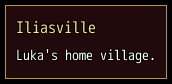</a><br><a href="window.md"><b>Window</b></a><br><code>window</code></td>
<td align="center" valign="top" width="33%"><a href="dialog.md">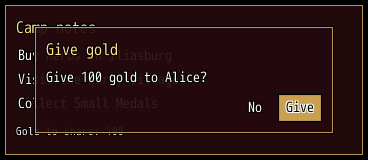</a><br><a href="dialog.md"><b>Dialog</b></a><br><code>dialog</code></td>
<td align="center" valign="top" width="33%"><a href="hud.md">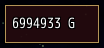</a><br><a href="hud.md"><b>HUD</b></a><br><code>hud</code></td>
</tr>
<tr>
<td align="center" valign="top" width="33%"><a href="popover.md">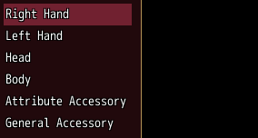</a><br><a href="popover.md"><b>Popover</b></a><br><code>popover</code></td>
<td align="center" valign="top" width="33%"><a href="wheel.md">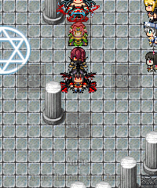</a><br><a href="wheel.md"><b>Wheel</b></a><br><code>wheel</code>, choices around the player that the arrows point at</td>
</tr>
</table>
<!-- /grid -->

## Layout

<!-- entries
- [Stack](stack.md): `stack`
- [Container](container.md): `container`, its parts in the middle at a most width, with gutters
- [Grid](grid.md): `grid`, `grid_item`, items side by side in twelve columns, each spanning its share
- [Paper](paper.md): `paper`
- [Card](card.md): `card`, `card_header`, `card_media`, `card_content`, `actions`, a framed card with a head, a picture, its text and buttons
- [Drop zone](drop_zone.md): `drop_container`, `drop_zone`, areas whose items the player drags from one to another
- [Aside](aside.md): `aside`
- [Divider](divider.md): `divider`
- [Slides](slides.md): `slides`, `slide`
- [Drawer](drawer.md): `drawer`, `drawer_header`
- [Group](group.md): `group`, a titled section with a note beside its title
- [Expansion panels](expansion_panels.md): `expansion_panels`, `expansion_panel`, panels whose titles fold them open and shut
-->
<!-- grid -->
<table>
<tr>
<td align="center" valign="top" width="33%"><a href="stack.md">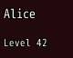</a><br><a href="stack.md"><b>Stack</b></a><br><code>stack</code></td>
<td align="center" valign="top" width="33%"><a href="container.md"><b>Container</b></a><br><code>container</code>, its parts in the middle at a most width, with gutters</td>
<td align="center" valign="top" width="33%"><a href="grid.md">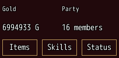</a><br><a href="grid.md"><b>Grid</b></a><br><code>grid</code>, <code>grid_item</code>, items side by side in twelve columns, each spanning its share</td>
</tr>
<tr>
<td align="center" valign="top" width="33%"><a href="paper.md">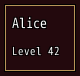</a><br><a href="paper.md"><b>Paper</b></a><br><code>paper</code></td>
<td align="center" valign="top" width="33%"><a href="card.md">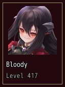</a><br><a href="card.md"><b>Card</b></a><br><code>card</code>, <code>card_header</code>, <code>card_media</code>, <code>card_content</code>, <code>actions</code>, a framed card with a head, a picture, its text and buttons</td>
<td align="center" valign="top" width="33%"><a href="drop_zone.md">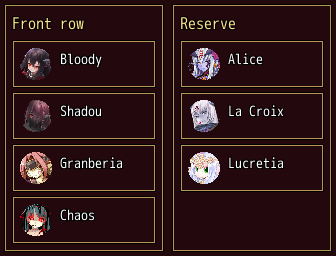</a><br><a href="drop_zone.md"><b>Drop zone</b></a><br><code>drop_container</code>, <code>drop_zone</code>, areas whose items the player drags from one to another</td>
</tr>
<tr>
<td align="center" valign="top" width="33%"><a href="aside.md">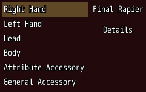</a><br><a href="aside.md"><b>Aside</b></a><br><code>aside</code></td>
<td align="center" valign="top" width="33%"><a href="divider.md">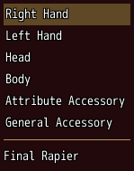</a><br><a href="divider.md"><b>Divider</b></a><br><code>divider</code></td>
<td align="center" valign="top" width="33%"><a href="slides.md">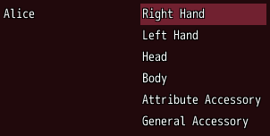</a><br><a href="slides.md"><b>Slides</b></a><br><code>slides</code>, <code>slide</code></td>
</tr>
<tr>
<td align="center" valign="top" width="33%"><a href="drawer.md">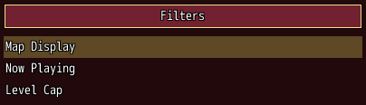</a><br><a href="drawer.md"><b>Drawer</b></a><br><code>drawer</code>, <code>drawer_header</code></td>
<td align="center" valign="top" width="33%"><a href="group.md">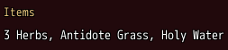</a><br><a href="group.md"><b>Group</b></a><br><code>group</code>, a titled section with a note beside its title</td>
<td align="center" valign="top" width="33%"><a href="expansion_panels.md">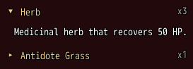</a><br><a href="expansion_panels.md"><b>Expansion panels</b></a><br><code>expansion_panels</code>, <code>expansion_panel</code>, panels whose titles fold them open and shut</td>
</tr>
</table>
<!-- /grid -->

## Navigation

<!-- entries
- [Tabs](tabs.md): `tabs`, `tab`, `tabs_header`
- [Menu](menu.md): `menu`, a button that opens a menu of items, and `UI.menu`
- [Breadcrumbs](breadcrumbs.md): `breadcrumbs`, the way to the place shown, as links the player follows back
-->
<!-- grid -->
<table>
<tr>
<td align="center" valign="top" width="33%"><a href="tabs.md">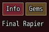</a><br><a href="tabs.md"><b>Tabs</b></a><br><code>tabs</code>, <code>tab</code>, <code>tabs_header</code></td>
<td align="center" valign="top" width="33%"><a href="menu.md">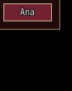</a><br><a href="menu.md"><b>Menu</b></a><br><code>menu</code>, a button that opens a menu of items, and <code>UI.menu</code></td>
<td align="center" valign="top" width="33%"><a href="breadcrumbs.md">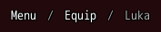</a><br><a href="breadcrumbs.md"><b>Breadcrumbs</b></a><br><code>breadcrumbs</code>, the way to the place shown, as links the player follows back</td>
</tr>
</table>
<!-- /grid -->

## Buttons and forms

<!-- entries
- [Button](button.md): `button`
- [Text field](text_field.md): `text_field`
- [Autocomplete](autocomplete.md): `autocomplete`, a text field with the matches of what is typed under it
- [Numeric field](numeric_field.md): `numeric_field`, a number typed, or stepped within its bounds by its arrows, and `UI.number`
- [Checkbox](checkbox.md): `checkbox`
- [Switch](switch.md): `switch`
- [Slider](slider.md): `slider`, a number slid between its bounds by Left and Right, a click or a drag
- [Rating](rating.md): `rating`, stars the player fills from the left
- [Color picker](color_picker.md): `color_picker`, a color picked from swatches or set by sliders of its red, green and blue
- [Radio group](radio_group.md): `radio_group`, `radio`, radios of which the player picks one
- [Toggle group](toggle_group.md): `toggle_group`, `toggle_item`, joined buttons the player turns on
- [Form](form.md): `form`, and `required:` and `validate:` on every input
- [Select](select.md): `select`, `select_item`
- [Hotkey field](hotkey_field.md): `hotkey_field`
- [Options list](options_list.md): `options_list`
-->
<!-- grid -->
<table>
<tr>
<td align="center" valign="top" width="33%"><a href="button.md">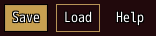</a><br><a href="button.md"><b>Button</b></a><br><code>button</code></td>
<td align="center" valign="top" width="33%"><a href="text_field.md">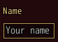</a><br><a href="text_field.md"><b>Text field</b></a><br><code>text_field</code></td>
<td align="center" valign="top" width="33%"><a href="autocomplete.md">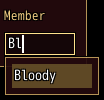</a><br><a href="autocomplete.md"><b>Autocomplete</b></a><br><code>autocomplete</code>, a text field with the matches of what is typed under it</td>
</tr>
<tr>
<td align="center" valign="top" width="33%"><a href="numeric_field.md">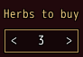</a><br><a href="numeric_field.md"><b>Numeric field</b></a><br><code>numeric_field</code>, a number typed, or stepped within its bounds by its arrows, and <code>UI.number</code></td>
<td align="center" valign="top" width="33%"><a href="checkbox.md">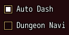</a><br><a href="checkbox.md"><b>Checkbox</b></a><br><code>checkbox</code></td>
<td align="center" valign="top" width="33%"><a href="switch.md">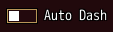</a><br><a href="switch.md"><b>Switch</b></a><br><code>switch</code></td>
</tr>
<tr>
<td align="center" valign="top" width="33%"><a href="slider.md">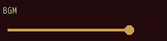</a><br><a href="slider.md"><b>Slider</b></a><br><code>slider</code>, a number slid between its bounds by Left and Right, a click or a drag</td>
<td align="center" valign="top" width="33%"><a href="rating.md">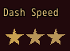</a><br><a href="rating.md"><b>Rating</b></a><br><code>rating</code>, stars the player fills from the left</td>
<td align="center" valign="top" width="33%"><a href="color_picker.md">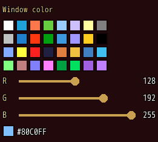</a><br><a href="color_picker.md"><b>Color picker</b></a><br><code>color_picker</code>, a color picked from swatches or set by sliders of its red, green and blue</td>
</tr>
<tr>
<td align="center" valign="top" width="33%"><a href="radio_group.md">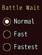</a><br><a href="radio_group.md"><b>Radio group</b></a><br><code>radio_group</code>, <code>radio</code>, radios of which the player picks one</td>
<td align="center" valign="top" width="33%"><a href="toggle_group.md">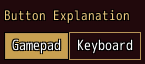</a><br><a href="toggle_group.md"><b>Toggle group</b></a><br><code>toggle_group</code>, <code>toggle_item</code>, joined buttons the player turns on</td>
<td align="center" valign="top" width="33%"><a href="form.md">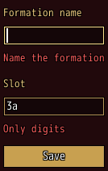</a><br><a href="form.md"><b>Form</b></a><br><code>form</code>, and <code>required:</code> and <code>validate:</code> on every input</td>
</tr>
<tr>
<td align="center" valign="top" width="33%"><a href="select.md">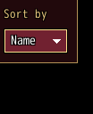</a><br><a href="select.md"><b>Select</b></a><br><code>select</code>, <code>select_item</code></td>
<td align="center" valign="top" width="33%"><a href="hotkey_field.md">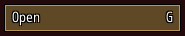</a><br><a href="hotkey_field.md"><b>Hotkey field</b></a><br><code>hotkey_field</code></td>
<td align="center" valign="top" width="33%"><a href="options_list.md">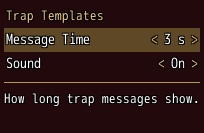</a><br><a href="options_list.md"><b>Options list</b></a><br><code>options_list</code></td>
</tr>
</table>
<!-- /grid -->

## Display

<!-- entries
- [Text](text.md): `text`
- [Field](field.md): `field`, a value after its caption
- [Image](image.md): `image`
- [Icon](icon.md): `icon`, an icon on its own, such as a mark in a head
- [Avatar](avatar.md): `avatar`, a character's face or map sprite in a circle or a square
- [Badge](badge.md): `badge`, a count, a short text or a dot over the corner of the parts it holds
- [Chip set](chip_set.md): `chip_set`, `chip`, chips that show facts, such as tags
- [Timeline](timeline.md): `timeline`, `timeline_item`, entries in the order things happened, such as story points
- [Alert](alert.md): `alert`
- [Progress](progress.md): `progress`
- [Arrow](arrow.md): `arrow`
- [Tooltip](tooltip.md): `tooltip`
- [Key help](key_help.md): `key_help`
- [Help line](help_line.md): `help_line`, what the part the player is on does
- [Header](header.md): `header`, an icon, a title, marks after it and a line under it
- [Slot row](slot_row.md): `slot_row`, a row of icon slots to pick, such as skills or gems
- [Stat grid](stat_grid.md): `stat_grid`, name and value rows that color what rose or fell
- [Lines](lines.md): `lines`, lines that show as many as their room holds, alone or in groups
-->
<!-- grid -->
<table>
<tr>
<td align="center" valign="top" width="33%"><a href="text.md">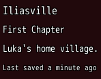</a><br><a href="text.md"><b>Text</b></a><br><code>text</code></td>
<td align="center" valign="top" width="33%"><a href="field.md">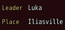</a><br><a href="field.md"><b>Field</b></a><br><code>field</code>, a value after its caption</td>
<td align="center" valign="top" width="33%"><a href="image.md">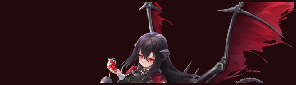</a><br><a href="image.md"><b>Image</b></a><br><code>image</code></td>
</tr>
<tr>
<td align="center" valign="top" width="33%"><a href="icon.md">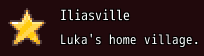</a><br><a href="icon.md"><b>Icon</b></a><br><code>icon</code>, an icon on its own, such as a mark in a head</td>
<td align="center" valign="top" width="33%"><a href="avatar.md">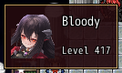</a><br><a href="avatar.md"><b>Avatar</b></a><br><code>avatar</code>, a character's face or map sprite in a circle or a square</td>
<td align="center" valign="top" width="33%"><a href="badge.md">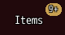</a><br><a href="badge.md"><b>Badge</b></a><br><code>badge</code>, a count, a short text or a dot over the corner of the parts it holds</td>
</tr>
<tr>
<td align="center" valign="top" width="33%"><a href="chip_set.md">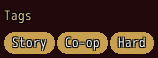</a><br><a href="chip_set.md"><b>Chip set</b></a><br><code>chip_set</code>, <code>chip</code>, chips that show facts, such as tags</td>
<td align="center" valign="top" width="33%"><a href="timeline.md">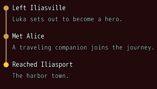</a><br><a href="timeline.md"><b>Timeline</b></a><br><code>timeline</code>, <code>timeline_item</code>, entries in the order things happened, such as story points</td>
<td align="center" valign="top" width="33%"><a href="alert.md">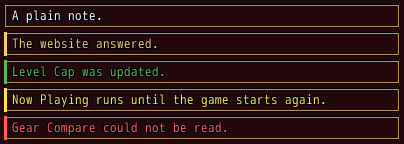</a><br><a href="alert.md"><b>Alert</b></a><br><code>alert</code></td>
</tr>
<tr>
<td align="center" valign="top" width="33%"><a href="progress.md">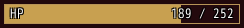</a><br><a href="progress.md"><b>Progress</b></a><br><code>progress</code></td>
<td align="center" valign="top" width="33%"><a href="arrow.md">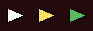</a><br><a href="arrow.md"><b>Arrow</b></a><br><code>arrow</code></td>
<td align="center" valign="top" width="33%"><a href="tooltip.md">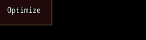</a><br><a href="tooltip.md"><b>Tooltip</b></a><br><code>tooltip</code></td>
</tr>
<tr>
<td align="center" valign="top" width="33%"><a href="key_help.md">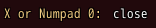</a><br><a href="key_help.md"><b>Key help</b></a><br><code>key_help</code></td>
<td align="center" valign="top" width="33%"><a href="help_line.md">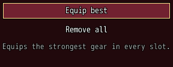</a><br><a href="help_line.md"><b>Help line</b></a><br><code>help_line</code>, what the part the player is on does</td>
<td align="center" valign="top" width="33%"><a href="header.md">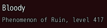</a><br><a href="header.md"><b>Header</b></a><br><code>header</code>, an icon, a title, marks after it and a line under it</td>
</tr>
<tr>
<td align="center" valign="top" width="33%"><a href="slot_row.md">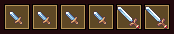</a><br><a href="slot_row.md"><b>Slot row</b></a><br><code>slot_row</code>, a row of icon slots to pick, such as skills or gems</td>
<td align="center" valign="top" width="33%"><a href="stat_grid.md"></a><br><a href="stat_grid.md"><b>Stat grid</b></a><br><code>stat_grid</code>, name and value rows that color what rose or fell</td>
<td align="center" valign="top" width="33%"><a href="lines.md"></a><br><a href="lines.md"><b>Lines</b></a><br><code>lines</code>, lines that show as many as their room holds, alone or in groups</td>
</tr>
</table>
<!-- /grid -->

## On the map

<!-- entries
- [Marker](marker.md): `marker`, an arrow at the screen's edge toward what lies off it
- [Bubble](bubble.md): `bubble`, `Mod_Framework.bubble`, a speech bubble over a map character that holds any parts
- [HUD](hud.md#over-a-characters-head): `hud follow:`, a box over a map character
-->
<!-- grid -->
<table>
<tr>
<td align="center" valign="top" width="33%"><a href="marker.md"></a><br><a href="marker.md"><b>Marker</b></a><br><code>marker</code>, an arrow at the screen's edge toward what lies off it</td>
<td align="center" valign="top" width="33%"><a href="bubble.md"></a><br><a href="bubble.md"><b>Bubble</b></a><br><code>bubble</code>, <code>Mod_Framework.bubble</code>, a speech bubble over a map character that holds any parts</td>
<td align="center" valign="top" width="33%"><a href="hud.md#over-a-characters-head"></a><br><a href="hud.md#over-a-characters-head"><b>HUD</b></a><br><code>hud follow:</code>, a box over a map character</td>
</tr>
</table>
<!-- /grid -->

## Services

<!-- entries
- [Confirm](confirm.md): `UI.confirm`, a yes or no question
- [Message](message.md): `UI.message`, a message with an OK button
- [Number](numeric_field.md#the-number-box-uinumber): `UI.number`, the number box
- [Task](task.md): `UI.task`, a wait on work that ends later
- [Menu](menu.md#a-menu-of-your-own-uimenu): `UI.menu`, a menu at a spot, the pointer or a part
- [Needed mods](needed_mods.md): `Mods.ask_needed`, the dialog that makes ready the mods a place needs
- [Replace window](replace_window.md): `UI.replace_window`, a component of your own in the place of a game window
- [Replace scene](replace_scene.md): `UI.replace_scene`, a component of your own in the place of a game scene
- [Patch](patch.md): `UI.patch`, changes to another mod's window, a framework screen or a game window
-->
<!-- grid -->
<table>
<tr>
<td align="center" valign="top" width="33%"><a href="confirm.md"></a><br><a href="confirm.md"><b>Confirm</b></a><br><code>UI.confirm</code>, a yes or no question</td>
<td align="center" valign="top" width="33%"><a href="message.md"></a><br><a href="message.md"><b>Message</b></a><br><code>UI.message</code>, a message with an OK button</td>
<td align="center" valign="top" width="33%"><a href="numeric_field.md#the-number-box-uinumber"></a><br><a href="numeric_field.md#the-number-box-uinumber"><b>Number</b></a><br><code>UI.number</code>, the number box</td>
</tr>
<tr>
<td align="center" valign="top" width="33%"><a href="task.md"><b>Task</b></a><br><code>UI.task</code>, a wait on work that ends later</td>
<td align="center" valign="top" width="33%"><a href="menu.md#a-menu-of-your-own-uimenu"></a><br><a href="menu.md#a-menu-of-your-own-uimenu"><b>Menu</b></a><br><code>UI.menu</code>, a menu at a spot, the pointer or a part</td>
<td align="center" valign="top" width="33%"><a href="needed_mods.md"></a><br><a href="needed_mods.md"><b>Needed mods</b></a><br><code>Mods.ask_needed</code>, the dialog that makes ready the mods a place needs</td>
</tr>
<tr>
<td align="center" valign="top" width="33%"><a href="replace_window.md"></a><br><a href="replace_window.md"><b>Replace window</b></a><br><code>UI.replace_window</code>, a component of your own in the place of a game window</td>
<td align="center" valign="top" width="33%"><a href="replace_scene.md"></a><br><a href="replace_scene.md"><b>Replace scene</b></a><br><code>UI.replace_scene</code>, a component of your own in the place of a game scene</td>
<td align="center" valign="top" width="33%"><a href="patch.md"></a><br><a href="patch.md"><b>Patch</b></a><br><code>UI.patch</code>, changes to another mod's window, a framework screen or a game window</td>
</tr>
</table>
<!-- /grid -->

## Notices

<!-- entries
- [Toast](toast.md): `Mod_Framework.toast`, `UI.toasts`, `UI.offers`, the notice stack
-->
<!-- grid -->
<table>
<tr>
<td align="center" valign="top" width="33%"><a href="toast.md"></a><br><a href="toast.md"><b>Toast</b></a><br><code>Mod_Framework.toast</code>, <code>UI.toasts</code>, <code>UI.offers</code>, the notice stack</td>
</tr>
</table>
<!-- /grid -->

## Your own drawing

<!-- entries
- [Drawn](drawn.md): `UI::Drawn`, a component that measures and draws itself, such as a bar drawn by hand
-->
<!-- grid -->
<table>
<tr>
<td align="center" valign="top" width="33%"><a href="drawn.md"></a><br><a href="drawn.md"><b>Drawn</b></a><br><code>UI::Drawn</code>, a component that measures and draws itself, such as a bar drawn by hand</td>
</tr>
</table>
<!-- /grid -->

## Lists

<!-- entries
- [List](list.md): `list`
- [Log](log.md): `log`, colored rows that wrap, the newest at the bottom, such as a chat
- [Table](table.md): `table`, `column`, items in rows under the titles of their columns
- [Pagination](pagination.md): `pagination`, numbered pages to pick one from
- [Page view](page_view.md): `page_view`, `page_head`, `page_pane`, a head, items in groups that fold and a reading pane
-->
<!-- grid -->
<table>
<tr>
<td align="center" valign="top" width="33%"><a href="list.md"></a><br><a href="list.md"><b>List</b></a><br><code>list</code></td>
<td align="center" valign="top" width="33%"><a href="log.md"></a><br><a href="log.md"><b>Log</b></a><br><code>log</code>, colored rows that wrap, the newest at the bottom, such as a chat</td>
<td align="center" valign="top" width="33%"><a href="table.md"></a><br><a href="table.md"><b>Table</b></a><br><code>table</code>, <code>column</code>, items in rows under the titles of their columns</td>
</tr>
<tr>
<td align="center" valign="top" width="33%"><a href="pagination.md"></a><br><a href="pagination.md"><b>Pagination</b></a><br><code>pagination</code>, numbered pages to pick one from</td>
<td align="center" valign="top" width="33%"><a href="page_view.md"></a><br><a href="page_view.md"><b>Page view</b></a><br><code>page_view</code>, <code>page_head</code>, <code>page_pane</code>, a head, items in groups that fold and a reading pane</td>
</tr>
</table>
<!-- /grid -->

## Game parts

They read the game's own data. `UI::Equip` tells what a screen shows of a character's gear (`UI::Equip.item(actor, slot)`,
`UI::Equip.slot_rows(actor)`, `UI::Equip.stats(item)`, `UI::Equip.compare(worn, item)`, `UI::Equip.socketed?(item)`, ...), and a render that reads it renders again once the gear changes;
[Game data](game_data.md) lists every call of `UI::Equip` and `UI::Game`. They only read: a mod
changes the gear through the game's own methods, as the Equipment Window does, which builds every
screen of its own from the general parts above and these readers.

<!-- entries
- [Command](command.md): `command`
- [Game data](game_data.md): `UI::Equip` and `UI::Game`, what the party, a character's gear and an item's gems hold
-->
<!-- grid -->
<table>
<tr>
<td align="center" valign="top" width="33%"><a href="command.md"></a><br><a href="command.md"><b>Command</b></a><br><code>command</code></td>
<td align="center" valign="top" width="33%"><a href="game_data.md"><b>Game data</b></a><br><code>UI::Equip</code> and <code>UI::Game</code>, what the party, a character's gear and an item's gems hold</td>
</tr>
</table>
<!-- /grid -->

## Calls and content of a component of your own

A component class declares the calls of its handle with `action :pulse`: `part(:gems).pulse([0])`
in the render that holds it runs the component's public method `pulse`. Every part's handle also takes `focus`: `part(:search).focus` moves the
focus onto that part, such as back onto a bar after Enter in its search. `param :note, content: :text` takes markup or a text, which
`children :note` places; a text shows as one line of small text.

### Moving the focus into a component

`part(:id)` finds the parts and components your own render wrote, not the parts inside another
component, which belong to it. To move the focus into a component, call `focus` on its handle: the
part inside it that held the focus last, else its first part that takes the keys, takes it, much
as `FocusAsync` on a MudBlazor input's reference. So the fields of a form need not focus
themselves:

```ruby
class NoteForm < UI::Component
  def render
    window "Notes" do
      note_field id: :note_card                # a component of your own holding a text_field
      button "Write a note", on_click: -> { part(:note_card).focus }
    end
  end
end
```

A component that wants another part to take the focus declares `action :focus` and a public
method `focus` that moves it there, such as `part(:note_text).focus`; its own call wins.

### Live data

A component's own params take plain values, never a lambda. Give it what the value comes from and
read the value in its `render`, where the framework sees it change:

```ruby
class MemberBar < UI::Component
  param :actor

  def render
    stack row: true do
      text "Lv #{UI::Game.level(actor)}"                       # renders again on a level up
      progress value: -> { UI::Game.hp_rate(actor) }, max: 1   # a live param: only the bar redraws
    end
  end
end
```

Written `member_bar actor: $game_party.leader`. A value read through `UI::Game` renders the
component again once that part of the game changes; a lambda on a built-in's live param (marked
"yes" under Live in its table) is read while it shows, every few frames. For data the framework
cannot see, declare `watch { MyMod.party_serial }` in the class: the component renders again once
the answer changes. The params every part takes, such as `visible:` and `tooltip:`, take lambdas
on your component as on a built-in.

## Looks

<!-- entries
- [Colors](colors.md): `UI.color`, the colors every color param and text code takes, plain or moving
- [Themes](themes.md): Interface Look, `UI.preset`, `UI.icon`, `UI.defaults`, the text on fills and a look pinned with `theme:`
-->
<!-- grid -->
<table>
<tr>
<td align="center" valign="top" width="33%"><a href="colors.md"></a><br><a href="colors.md"><b>Colors</b></a><br><code>UI.color</code>, the colors every color param and text code takes, plain or moving</td>
<td align="center" valign="top" width="33%"><a href="themes.md"></a><br><a href="themes.md"><b>Themes</b></a><br>Interface Look, <code>UI.preset</code>, <code>UI.icon</code>, <code>UI.defaults</code>, the text on fills and a look pinned with <code>theme:</code></td>
</tr>
</table>
<!-- /grid -->

## Shrink to fit

A part can name compact forms that it takes once its window runs short of room, instead of being
cut. `compact:` gives each form by the step it comes in at; the window tries step 1, then 2 and so
on, and at each step every part shows the form of the highest step it names up to it, until what
the window holds fits. A form is the part's own params with the form's merged over them:

```ruby
header name, icon: icon, subtitle: "Equipped", compact: { 3 => { dense: true } }
slot_row gems, compact: { 2 => { visible: false } }
lines effects, grow: 1, compact: { 1 => { most_rows: 1 } }
```

In a short window the effect lines first ask for one row (they still show what their room
holds), then the gems leave, then the header takes one row. The window keeps the step it reached
while it keeps its size, so nothing comes back whole as the content gets smaller; at a new size it
starts over from the full forms. A form cannot change `id:`, which names the full form. The
Equipment Window's comparison is built this way.

A part whose content changes, such as a comparison that follows a list's cursor, would still step
on once the cursor reaches a taller item. `compact_for:` gives it copies that never show, each
the part's own params with an entry's merged over them; the window picks its step as for the
tallest of the part and its copies, so it opens at the step the tallest needs and keeps it as the
cursor moves:

```ruby
compare actor: actor, slot: slot, picked: row, height: :fill,
        compact_for: UI::Equip.room(rows, UI::Equip.item(actor, slot)).map { |item| { picked: item } }
```

Each copy is a whole part to render, so name only the few contents that likely need the most
room; `UI::Equip.room` picks those of a list of items, here for a comparison of your own named
`Compare`. A copy cannot change `id:` or `key:`. The Equipment Window's item dialog sizes its
comparison this way.

## Room and borders

Every part takes `margin:`, `padding:`, `border:`, `border_width:` and `background:`, as MudBlazor's
spacing classes and borders do. From the outside in a part has its margin, its border, its padding,
then its fixed pieces, such as a title row or a scrollbar, and then what it holds. Its size
(`width:`, `height:`, `min_size:`, `max_size:`) counts its border and its padding, not its margin.

- `margin:` and `padding:` take units of 4 px, also half units such as 0.5: one number for every
  side, `[vertical, horizontal]` or `[top, right, bottom, left]`. A margin adds to the `spacing:` of
  the stack it lies in; nothing of the part draws there, and a click there reaches what lies
  around it. A padding replaces the part's own room, such as the 6 px inside a card's frame.
- `padding_shrinks: true` lets the padding give way, down to none on each side, before what the
  part holds narrows once the part reaches its `max_size:` or the room it gets: a
  `hud max_size: [320, nil], padding: [0.5, 2], padding_shrinks: true` keeps 8 px of padding at
  each side of a short text, while a long text at 320 px takes that room as well.
- `border:` draws a line along the inside of the part's edge, `border_width:` pixels thick: a
  color, `:shade` for a darker shade of the part's own color, `:theme` for the theme's frame, or
  `false` for none, such as a card without its frame.
- `background:` fills the part under what it draws: a color, also see-through as `[r, g, b, a]`,
  `:theme` for the look's own back, `false` for none, or `{ color: ..., fade: [:right, 48] }`, which
  thins it to nothing over its last 48 pixels toward the right.

<!-- example: room-and-borders -->
```ruby
stack row: true do
  card padding: 1, margin: [0, 2] do
    text "Less room inside"
  end
  card border: :primary, border_width: 1, background: [0, 0, 0, 170] do
    text "Its own border and plate"
  end
end
```


## Params every part takes

A component of your own takes them too, besides its own params, and hands them to the part at the
top of its `render`.

<!-- generated: common -->
| Param | Takes | Default | Live | About |
|---|---|---|---|---|
| `id:` | a Symbol or a text |  |  | its public name, which other mods' UI.patch selects; unique within the mod |
| `class:` | a Symbol or an Array of Symbols |  |  | names for selectors |
| `key:` | any value |  |  | who it is among siblings of its type, so a part made in a loop keeps its state |
| `visible:` | true, false | `true` | yes | false takes no room |
| `disabled:` | true, false | `false` | yes | greyed out and takes no input: a press buzzes and the keys skip it; its tooltip still shows |
| `tooltip:` | a text |  | yes | shows on hover and on key focus |
| `help:` | a text |  |  | a line for the help line |
| `width:` | px, `:fill`, `:content` | `:content` |  | pixels; :fill takes the free room |
| `height:` | px, `:fill`, `:content` | `:content` |  | pixels; :fill takes the free room |
| `min_size:` | [width, height] |  |  | the least size |
| `max_size:` | [width, height] |  |  | the largest size |
| `grow:` | a whole number | `0` |  | share of the free room in a stack |
| `align_self:` | `:start`, `:center`, `:end`, `:stretch` |  |  | where it sits across its stack |
| `autofocus:` | true, false | `false` |  | the focus starts on it as its window opens, not on the first part that takes the keys, and lands on it as the keys go into a part around it, such as confirm into a page view's pane |
| `context_menu:` | an Array of choices, each a text or { text:, on_click:, disabled:, tooltip: }, or a lambda without arguments answering them |  |  | the choices a right click, the Menu key or a gamepad's confirm held opens on it, each a text or { text:, on_click:, disabled:, tooltip: }, or a lambda answering them |
| `on_focus:` | a lambda, a method name or nil |  |  | runs as the keys or a click move the focus onto it, such as to change a key help or a help text by the part in use |
| `on_blur:` | a lambda, a method name or nil |  |  | runs as the focus leaves it |
| `compact:` | { 1 => { dense: true } }: the params of each compact form by the step it comes in at, from 1 |  |  | its compact forms, tried in order as its window runs short of room: at each step every part takes the form of the highest step it names up to it, until what the window holds fits; the window keeps its step while it keeps its size |
| `compact_for:` | [{ picked: item }]: the params of each copy |  |  | copies of it that never show, each with these params over its own, such as [{ picked: tallest_item }]: its window picks the step of the compact forms as for the tallest of the part and its copies, so the step stays as what the part shows changes |
| `pulse:` | any value |  | yes | any value; each time it changes, the part pulses once, turning see-through and fading back, such as gold an event gave; not as it first shows, nor with Animations off |
| `outline:` | a color name such as :primary or :rainbow, "#RRGGBB", [r, g, b] or a game text color such as 2 |  | yes | the outline of its texts and of everything inside it; black by default |
| `contrast:` | true, false | `false` | yes | true writes the texts of it and of everything inside it that lie on a fill, such as a filled button's, in text_dark or text_light, whichever reads better on the fill, a dark text with text_light round it; text_color: and outline: set by hand win |
| `theme:` | :game, or a preset's name such as "Legacy" |  |  | the look of it and everything inside it, whose color names resolve in that preset: :game for the look of the game's own windows, their skin, or the player's pick while Look on Game Windows is On, with its rows and its texts without typo: in the game's own font size; or a preset's name; the player's pick by default |
| `margin:` | units of 4 px, also half units such as 0.5, for every side, or as [vertical, horizontal] or [top, right, bottom, left] |  |  | room kept around it, outside its size, where nothing of it draws and it takes no clicks; it adds to the spacing: of what it lies in; on a window, a dialog or a hud the room from the screen's edge and the parts beside it |
| `padding:` | units of 4 px, also half units such as 0.5, for every side, or as [vertical, horizontal] or [top, right, bottom, left] |  |  | room between its border and what it holds, in place of the part's own room; a title row, a scrollbar and the room of a mark, an icon, a badge or an arrow stay; by default the part's own room |
| `padding_shrinks:` | true, false | `false` |  | true lets its padding give way, down to none on each side, before what it holds narrows once it reaches its max_size: or the room it gets, such as a strip whose text takes the whole max width |
| `border:` | `:shade`, `:theme`, `false`, a color name such as :primary or :rainbow, "#RRGGBB", [r, g, b] or a game text color such as 2 |  | yes | a line along the inside of its edge, in that color: :shade a darker shade of its own color (its color:, the first of colors:), :theme the theme's frame, false none; by default the theme's frame on a paper, card, hud, popover and text field, the theme's edge on a progress bar, none elsewhere; while the focus or the pointer lights a part by its edge, the light shows instead |
| `border_width:` | a whole number |  |  | how thick its border is, in pixels, inside its size; with :theme the theme's rim takes the outer pixel and its edge the rest; by default the part's own, 1 where it draws none |
| `background:` | a color name such as :primary, "#RRGGBB", [r, g, b] or see-through [r, g, b, a], or a game text color such as 2; `:theme`, `false`, or { color:, fade: [side, pixels] } |  | yes | fills its size under everything it draws, inside its border: a color, :theme for the look's own back, false for none, or { color:, fade: [:right, 48] }, which thins it from its alpha to nothing over its last pixels toward that side; by default the theme's back on a paper, card, hud and popover, the field color on a text field, the well on a progress bar and an avatar, none elsewhere; on a window or a dialog with the game's frame it paints the frame's back, which takes no fade |
<!-- /generated -->
