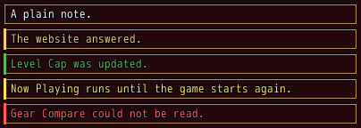
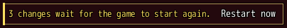
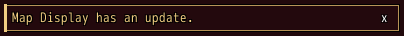
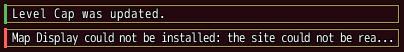
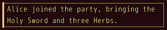

<!-- nav -->
[Mod Framework](../../README.md) › [UI components](README.md) › [Display](README.md#display)
<!-- /nav -->

# Alert

`alert` is a notice on a plate across its parent, such as a change that waits for the game to
start again. Its severity colors its text and a bar down its left edge. The buttons it holds stand
after its text. A text too long for its room is cut, and the whole text becomes its tooltip, unless `most_lines:` lets it wrap.

## Examples

### Severities

<!-- example: alert-severity -->
```ruby
alert "A plain note."
alert "The website answered.", severity: :info
alert "Level Cap was updated.", severity: :success
alert "Now Playing runs until the game starts again.", severity: :warning
alert "Gear Compare could not be read.", severity: :error
```


### A restart bar

<!-- example: alert-restart -->
```ruby
alert "3 changes wait for the game to start again.", severity: :warning do
  button "Restart now", on_click: -> { restart }
end
```


### Closed by the player

<!-- example: alert-closeable -->
```ruby
alert "Map Display has an update.", severity: :info, dense: true, closeable: true,
                                    visible: update_shown, on_close: -> { self.update_shown = false }
```


The close mark tells `on_close`; the alert stays until you hide it, here by its state.

### Toasts in the plain text color

<!-- example: alert-text-color -->
```ruby
alert "Level Cap was updated.", severity: :success, dense: true, text_color: :text
alert "Map Display could not be installed: the site could not be reached.", severity: :error, dense: true, text_color: :text
```


The framework's toasts look like this: `text_color:` colors the text in a color of its own, and
the bar down the left edge keeps the color of the severity.

### A text in more lines

<!-- example: alert-lines -->
```ruby
alert "Alice joined the party, bringing the Holy Sword and three Herbs.", severity: :info,
                                                                         most_lines: 2
```


`most_lines:` breaks the text into lines that fit, at most that many; a longer text ends in "..."
and its whole text becomes its tooltip. Without it the text keeps to one line. The framework's
toasts wrap this way.

### An icon for each severity

```ruby
Mod_Framework::UI.defaults :severity_icons, warning: 56, error: 49
```

An alert shows no icon unless it names one. `UI.defaults :severity_icons` gives the severities
of your mod's alerts and toasts an icon each, here the game's exclamation mark to warnings and its
red cross to errors. An alert's own `icon:` wins, and other mods' alerts stay as they are.

## Params, events and keys

Every part also takes [the params every part takes](README.md#params-every-part-takes).

<!-- generated: alert -->
A notice on a plate across its parent in the color of its severity, such as a change that waits for the game to start again, with the buttons it holds after its text.

Written `alert text, ...` with a `do ... end` block of markup.

| Param | Takes | Default | Live | About |
|---|---|---|---|---|
| `text:` | a text |  | yes | what it says; cut to its room, the whole text becomes its tooltip |
| `severity:` | `:normal`, `:info`, `:success`, `:warning`, `:error` | `:normal` |  | its color: the text's and a bar down its left edge; :normal draws the plain text without a bar |
| `icon:` | an IconSet index, a name UI.icon gave one, or { file: "Graphics/Pictures/x" } |  |  | an icon before its text |
| `text_color:` | a color name such as :primary or :rainbow, "#RRGGBB", [r, g, b] or a game text color such as 2 |  |  | its text's color instead of its severity's, which keeps the bar, such as :text for a toast in the plain text color |
| `dense:` | true, false | `false` |  | lower, with less room above and below its text |
| `most_lines:` | a whole number |  |  | its text breaks into lines that fit, at most this many; the last ends in ... and the whole text becomes its tooltip; without it one line cut to its room |
| `closeable:` | true, false | `false` |  | a close mark at its end that tells on_close; hide it there |

| Event | Tells |
|---|---|
| `on_close` | nothing; the player clicked its close mark or pressed it |

**Keys:** none of its own: the keys reach its buttons and its close mark

**Pad:** as the keys

**Mouse:** a click on its close mark tells on_close
<!-- /generated -->

<!-- nav -->
---

← [Timeline](timeline.md) · [All components](README.md) · [Progress](progress.md) →
<!-- /nav -->
