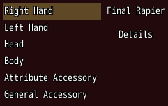

<!-- nav -->
[Mod Framework](../../README.md) › [UI components](README.md) › [Layout](README.md#layout)
<!-- /nav -->

# Aside

`aside` holds parts beside the rest that only the mouse uses, such as a summary beside a list. The
keys pass over it, so the arrows keep moving through the list while the pointer can still hover
and click what the aside shows.

## Examples

### A summary beside a list

<!-- example: aside-summary -->
```ruby
stack row: true do
  list slots, bind_index: :slot, on_submit: -> { pick }
  aside do
    text slot_text, typo: :subtitle1
    button "Details", variant: :text, on_click: -> { self.details = true }
  end
end
```


## Params, events and keys

Every part also takes [the params every part takes](README.md#params-every-part-takes).

<!-- generated: aside -->
Parts beside the rest that only the mouse uses, such as a summary beside a list; the keys never enter it.

Written `aside ...` with a `do ... end` block of markup.

**Keys:** none: the keys pass over it and what it holds

**Mouse:** as its parts
<!-- /generated -->

<!-- nav -->
---

← [Drop zone](drop_zone.md) · [All components](README.md) · [Divider](divider.md) →
<!-- /nav -->
