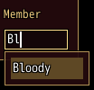
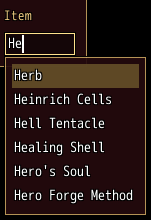

<!-- nav -->
[Mod Framework](../../README.md) › [UI components](README.md) › [Buttons and forms](README.md#buttons-and-forms)
<!-- /nav -->

# Autocomplete

`autocomplete` is a text field with a list of matches under it, as MudBlazor's autocomplete. As the
player types, it offers the items that hold the whole text typed anywhere, ignoring case, by the
same rule as a [text field](text_field.md)'s `completions:`. Up and Down light a match; Enter, Tab
or a click takes it, which becomes the field's text and tells `on_complete`. The first cancel hides
the matches and stops typing, as in every text field.

- `items:` is an Array, narrowed as the player types, or a lambda of the text that answers its own
  matches, such as names looked up somewhere else.
- `bind:` keeps the text in a state, both ways, as a text field's does.

## Examples

### A member of the party

<!-- example: autocomplete-member -->
```ruby
autocomplete "Member", bind: :member_name, placeholder: "Name",
             items: UI::Game.members.map { |actor| actor.name },
             on_complete: ->(name) { self.member_name = name }
```


### Matches of your own

<!-- example: autocomplete-items -->
```ruby
autocomplete "Item", bind: :item_name,
             items: ->(text) { $game_party.items.map { |item| item.name }.select { |name| name.start_with?(text) } }
```


## Params, events and keys

Every part also takes [the params every part takes](README.md#params-every-part-takes).

<!-- generated: autocomplete -->
A text field with a list of matches under it, as MudBlazor's autocomplete: the items that hold the text typed anywhere, ignoring case; Up and Down light one, and confirm, Tab or a click takes it.

Written `autocomplete label, ...`.

| Param | Takes | Default | Live | About |
|---|---|---|---|---|
| `label:` | a text |  | yes | a caption above it, as MudBlazor draws an input's label |
| `bind:` | the name of a state |  |  | a state that holds its text, both ways |
| `items:` | an Array of words, or a lambda of the word typed answering them |  |  | what it offers: an Array, narrowed to the items that hold the text anywhere, ignoring case, or a lambda of the text answering its own matches |
| `placeholder:` | a text |  | yes | a dim text it shows while it is empty, also while the player types, such as "Search" |
| `max_length:` | a whole number |  |  | the most characters it takes, 10,000 when not given |
| `required:` | any value |  |  | true, or the error to show, such as "Name the formation": an empty value is an error, "Required" by default |
| `validate:` | a lambda of one item, or its method name |  |  | a lambda of its value answering the error to show, or nil while the value is fine, such as ->(name) { "Too short" if name.size < 3 }; a method name calls that method of the component |

| Event | Tells |
|---|---|
| `on_change` | its text, as the player typed it |
| `on_complete` | the match taken, which is its text now, and its place among the matches |
| `on_submit` | its text, as Enter gave it with no match lit |

**Keys:** typing as in a text field; Up and Down light a match, Enter or Tab takes it; the first cancel hides the matches and stops typing

**Pad:** A opens the game's letter pages, titled by its label: or else the caption of the field it sits in; B as cancel

**Mouse:** a click puts the caret there and types; a click on a match takes it
<!-- /generated -->

<!-- nav -->
---

← [Text field](text_field.md) · [All components](README.md) · [Numeric field](numeric_field.md) →
<!-- /nav -->
