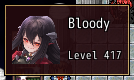
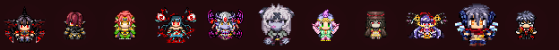
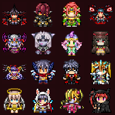
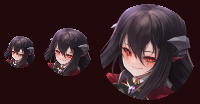
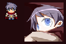
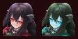

<!-- nav -->
[Mod Framework](../../README.md) › [UI components](README.md) › [Display](README.md#display)
<!-- /nav -->

# Avatar

`avatar` shows a character's picture in a circle or a square, as MudBlazor's avatar. One call names
the character, the picture and the shape:

- `character:` is an actor, a database actor such as `$data_actors[1]`, an actor's id,
  `:party_leader`, `:party_member` with `index:` (0 is the leader), or a map sprite by its file and
  place, such as `{ sprite: "Main01_cip", index: 0 }`. The party's places follow the party: when
  the player puts another character in front, an avatar of `:party_leader` shows the new leader at
  once. An id looks the character up in the game's actors, which adds them to the save, so for
  someone outside the party give the database actor.
- `face:` names a face of a face file instead, by the file in Graphics/Faces and the face's place
  in it, such as `face: [$game_message.face_name, $game_message.face_index]` for the speaker of a
  message. One of `character:` and `face:` is needed. `hue:` draws the face in a hue, from 0 to
  359, as the game draws a face in a hue.
- `image: :face` shows the face portrait; `image: :sprite` the map sprite, standing and facing
  down, scaled by whole steps so its pixels stay sharp. A character without the picture asked
  for shows the plate alone, as a map sprite does under `image: :face`, and so does a picture
  file this game does not have, such as another player's sprite from a mod; the log names that
  file once.
- `shape: :circle` (the default) or `shape: :box`, on a plate in the theme's well color;
  `background: false` drops the plate. In a square a face shrinks whole in one smooth stretch, as
  the game's windows shrink a face; in a circle it is cut row by row to the circle.
- `size:` is `:small` (32 px), `:medium` (48 px, the default) or `:large` (96 px, the face's own).
  `width:` and `height:` set any other side; with two different sides the avatar is a square of
  the shorter one in the middle.
- `scale: :auto` scales the avatar to the room it gets: its square follows the width it gets, such
  as a grid item's, and the face or the sprite fills the square at any size, larger or smaller,
  keeping its proportions. `sampling: :sharp` takes each pixel's nearest pixel, so a sprite's pixel
  art stays crisp, and `sampling: :smooth` blends them; a sprite scales sharp and a face smooth
  unless you say.

A list's rows take an avatar in a cell, before its text: see
[Players with their leaders](list.md#players-with-their-leaders).

The game gives its characters no small icon of their own: its save files and saved formations show
the map sprite, which `image: :sprite` draws.

## Examples

### The party leader's box on the map

<!-- example: avatar-leader-box -->
```ruby
hud id: :leader_box, anchor: :top_left do
  stack row: true do
    avatar character: :party_leader, image: :face, shape: :box
    stack do
      text UI::Game.leader.name
      text "Level #{UI::Game.level(UI::Game.leader)}", typo: :caption
    end
  end
end
```


### The party as map sprites

<!-- example: avatar-sprites -->
```ruby
stack row: true do
  UI::Game.members.each do |actor|
    avatar character: actor, image: :sprite, key: actor.id
  end
end
```


### The party scaled to a grid's items

<!-- example: avatar-auto-scale -->
```ruby
grid do
  UI::Game.members.each do |actor|
    grid_item xs: 3, key: actor.id do
      avatar character: actor, image: :sprite, shape: :box, scale: :auto
    end
  end
end
```


### Three sizes

<!-- example: avatar-sizes -->
```ruby
stack row: true do
  avatar character: :party_leader, size: :small
  avatar character: :party_leader
  avatar character: :party_leader, size: :large
end
```


### Characters outside the party

<!-- example: avatar-outside-party -->
```ruby
stack row: true do
  avatar character: { sprite: "Main01_cip", index: 0 }, image: :sprite, shape: :box, width: 28, height: 28
  avatar character: $data_actors[1], shape: :box, width: 64, height: 64
end
```


Another player's leader, of whom the game knows only the map sprite, and Luka from the database,
as a page about the story shows him whether or not he is in the party.

### A face from its face file, without the plate

<!-- example: avatar-face -->
```ruby
leader = UI::Game.leader
stack row: true do
  avatar face: [leader.face_name, leader.face_index], shape: :box, background: false
  avatar face: [leader.face_name, leader.face_index], hue: 180, shape: :box, background: false
end
```


A face known by its file alone, such as the speaker of a line in battle, with no plate behind it,
and the same face in the hue 180.

## Params, events and keys

Every part also takes [the params every part takes](README.md#params-every-part-takes).

<!-- generated: avatar -->
A character's picture in a circle or a square, as MudBlazor's avatar: the face or the map sprite of an actor, of the party's leader or of a member, or a face of a face file.

Written `avatar ...`.

| Param | Takes | Default | Live | About |
|---|---|---|---|---|
| `character:` | any value |  |  | who it shows: an actor, a database actor (RPG::Actor), an actor's id, :party_leader, :party_member with index:, or a map sprite by its file and place, such as { sprite: "Main01_cip", index: 0 }; the party's places follow the party as it changes; it or face: is needed |
| `face:` | [file, index]: a face file of Graphics/Faces and the face's place in it, from 0 |  |  | a face of a face file in Graphics/Faces instead of a character, by the file and its place in it, as a message names its speaker's face by $game_message.face_name and face_index |
| `hue:` | a whole number | `0` |  | the hue a face draws in, from 0 to 359, as the game draws a face in a hue; 0 its own colors |
| `index:` | a whole number | `0` |  | with character: :party_member, the member's place in the party, 0 the leader |
| `image:` | `:face`, `:sprite` | `:face` |  | :face shows the face portrait, :sprite the map sprite standing and facing down; a character without that picture shows the plate alone |
| `shape:` | `:circle`, `:box` | `:circle` |  | a circle or a square; in a square a face shrinks whole in one smooth stretch, as the game's windows shrink a face, in a circle row by row |
| `size:` | `:small`, `:medium`, `:large` | `:medium` |  | its side: :small 32 px, :medium 48 px, :large 96 px, the face's own |
| `scale:` | `:auto` |  |  | :auto scales it to the room it gets: its square follows the width it gets, such as a grid item's, and its picture fills the square at any size, larger or smaller, keeping its proportions; without it a sprite scales by whole steps |
| `sampling:` | `:sharp`, `:smooth` |  |  | with scale: :auto, how its pixels scale: :sharp takes each pixel's nearest pixel, so pixel art stays crisp, :smooth blends them; :sharp for a sprite, :smooth for a face |

| Event | Tells |
|---|---|
| `on_click` | nothing; it was clicked |

**Keys:** none

**Mouse:** a click tells on_click
<!-- /generated -->

<!-- nav -->
---

← [Icon](icon.md) · [All components](README.md) · [Badge](badge.md) →
<!-- /nav -->
