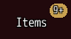
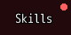
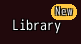

<!-- nav -->
[Mod Framework](../../README.md) › [UI components](README.md) › [Display](README.md#display)
<!-- /nav -->

# Badge

`badge` puts a count, a short text or a dot over the top right corner of the parts it holds, as
MudBlazor's badge. The badge is a pill in its `color:`, primary by default, its text in the plain
text color with the black outline, or with `contrast: true` in the dark or the light text color,
whichever reads better on it. A count shows "9+" above 9 and nothing at
0; `nil` shows nothing too. The badge keeps the room of its upper half above and right of what it
holds, so it never covers a neighbour, and the pointer and the keys pass through it to what it
holds.

Buttons, tabs, commands and list rows also take `badge:` themselves, which draws the count at
their end on a dark plate, as the mod browser's Filters button does; see [Button](button.md).

## Examples

### A count

<!-- example: badge-count -->
```ruby
badge content: $game_party.items.size do
  button "Items", on_click: -> { SceneManager.call(Scene_Item) }
end
```


`content:` takes a lambda too, `content: -> { $game_party.items.size }`, read while the badge shows.

### A dot

<!-- example: badge-dot -->
```ruby
badge dot: true, color: :error do
  button "Skills", on_click: -> { SceneManager.call(Scene_Skill) }
end
```


### A short text

<!-- example: badge-text -->
```ruby
badge content: "New", color: :secondary do
  button "Library", on_click: -> { open_library }
end
```


## Params, events and keys

Every part also takes [the params every part takes](README.md#params-every-part-takes).

<!-- generated: badge -->
A count, a short text or a dot over the top right corner of the parts it holds, as MudBlazor's badge, such as the count of unread letters on a button.

Written `badge ...` with a `do ... end` block of markup.

| Param | Takes | Default | Live | About |
|---|---|---|---|---|
| `content:` | any value |  | yes | a count, "9+" above 9 and nothing at 0, or a short text such as "New"; nil shows nothing |
| `dot:` | true, false | `false` |  | a dot instead of the content, such as for something new without a count |
| `color:` | a color name such as :primary or :rainbow, "#RRGGBB", [r, g, b] or a game text color such as 2 |  |  | the badge's color; the theme's primary color by default |

**Keys:** none: the keys reach the parts it holds

**Mouse:** the pointer passes through the badge to the parts it holds
<!-- /generated -->

<!-- nav -->
---

← [Avatar](avatar.md) · [All components](README.md) · [Chip set](chip_set.md) →
<!-- /nav -->
