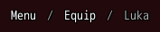
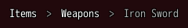

<!-- nav -->
[Mod Framework](../../README.md) › [UI components](README.md) › [Navigation](README.md#navigation)
<!-- /nav -->

# Breadcrumbs

`breadcrumbs` shows the way to the place shown, as MudBlazor's breadcrumbs: each place on the way is
a link the player follows back, and the last, the place shown, stands at the end as dim text that
takes no focus. Use it over a page that lies some steps deep, such as a character's gear reached
from the menu.

- Left and Right move among the links; confirm or a click follows one and tells `on_click` its
  `data:`, or its text without one.
- Give `items:` anew as the player goes deeper or back, such as from a state: the way follows.

## Examples

### The way to a page

<!-- example: breadcrumbs-way -->
```ruby
breadcrumbs items: [{ text: "Menu", data: :menu }, { text: "Equip", data: :equip }, { text: "Luka" }],
            on_click: ->(place) { self.page = place }
```


### Another separator

<!-- example: breadcrumbs-separator -->
```ruby
breadcrumbs items: [{ text: "Items", data: :items }, { text: "Weapons", data: :weapons }, { text: "Iron Sword" }],
            separator: ">", on_click: ->(place) { self.page = place }
```


`separator:` stands between two places, `"/"` by default. A place with `icon:` shows it before its
text, and one with `disabled: true` is greyed out and cannot be followed; its tooltip still shows.

## Params, events and keys

Every part also takes [the params every part takes](README.md#params-every-part-takes).

<!-- generated: breadcrumbs -->
The way to the place shown, as MudBlazor's breadcrumbs: links the player follows back, and the place shown at the end, such as Menu / Equip / Luka.

Written `breadcrumbs ...`.

| Param | Takes | Default | Live | About |
|---|---|---|---|---|
| `items:` | an Array |  | yes | the places from the first to the one shown, each { text:, data:, icon:, disabled:, tooltip: }; the last is the place shown and takes no click |
| `separator:` | a text | `"/"` |  | what stands between two places |

| Event | Tells |
|---|---|
| `on_click` | the data: of the place the player followed, its text without data: |

**Keys:** Left and Right move among the links; confirm follows one; the place shown takes no focus

**Pad:** the d-pad's Left and Right move, A follows

**Mouse:** a click follows a link
<!-- /generated -->

<!-- nav -->
---

← [Menu](menu.md) · [All components](README.md) · [Button](button.md) →
<!-- /nav -->
