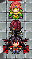
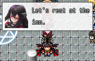
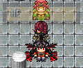

<!-- nav -->
[Mod Framework](../../README.md) › [UI components](README.md) › [On the map](README.md#on-the-map)
<!-- /nav -->

# Bubble

`bubble` is a speech bubble over a map character that holds any parts: a line, a face, an icon or a
bar. It is filled in its color (white by default) with a dark edge and a tail toward the character,
a little see-through while what it holds draws whole, and at most 240 pixels wide (`width:` sets the widest). It fades in as it
shows and out as it goes. Its plain text draws
in the plain text color with the black outline, or with `contrast: true` in the dark or the light
text color, whichever reads best on the fill. It
lies above the map's pictures, also over a CG, follows the character while it shows and hides while
the character is gone, see-through or on another map. It never takes the keys or the pointer.
Show the component whose `render` describes it with `UI.show`; give each bubble that shows at the
same time its own `id:`.

## Examples

### A speech bubble in one line

<!-- example: bubble-speech -->
```ruby
Mod_Framework.bubble $game_player, "Ouch!", seconds: 2
```


`Mod_Framework.bubble` shows a bubble that holds its text, wrapped in the small font and cut after
three lines (`most_lines:`). It works from an event's Script command and never waits, so the event
goes on at once. Its seconds are real time, counted while the game is in front; without
`seconds:` it stays until the map changes. Give an event's id on this map instead of a character,
`side: :bottom` to put it under the character, `color:` for its fill, and `key:` to replace an
earlier bubble. Outside the map it shows as a [toast](toast.md).

```ruby
Mod_Framework.bubble 12, "Help me!", side: :top, key: :help_12     # event 12 on this map
```

### A face and a line

<!-- example: bubble-face -->
```ruby
bubble follow: :player, seconds: 3 do
  stack row: true do
    image face: UI::Game.leader, width: 48, height: 48
    text "Let's rest at the inn.", typo: :body2, wrap: true, width: 120
  end
end
```


### A bar over a character

<!-- example: bubble-bar -->
```ruby
bubble follow: :player, color: :plate, id: :leader_hp do
  progress value: -> { (UI::Game.hp_rate(UI::Game.leader) * 100).round }, label: "HP", width: 100
end
```


`color:` takes any color name. Here the
bubble follows the player; give an event or its id on this map to put it over the event. It
stays until you hide it with the handle `UI.show` answers.

## Params, events and keys

Every part also takes [the params every part takes](README.md#params-every-part-takes).

<!-- generated: bubble -->
A speech bubble that follows a map character and holds any parts, such as a line, a face or a bar. UI.show shows a component whose top part is one.

Written `bubble ...` with a `do ... end` block of markup.
Opened by `UI.show`.

| Param | Takes | Default | Live | About |
|---|---|---|---|---|
| `follow:` | :player, a map character such as an event, a sprite, or an event's id on this map |  |  | the map character it lies beside, above the map's pictures; it hides while the character is gone, see-through or on another map, and shows over a CG; bubbles over one tile stack upward in the order they opened |
| `side:` | `:top`, `:bottom`, `:middle` | `:top` |  | with follow:, over the character's head, under its feet or on it |
| `flip:` | true, false | `false` |  | with follow:, it takes the other side where its own leaves the screen |
| `on_screen:` | true, false | `false` |  | with follow:, it slides back onto the screen whole at the screen's edges |
| `color:` | a color name such as :primary or :rainbow, "#RRGGBB", [r, g, b] or a game text color such as 2 |  |  | its fill; white by default |
| `seconds:` | any value |  |  | the seconds of real time it shows, counted while the game is in front; then it closes with :script; without it, it shows until hidden |
| `hide_while:` | a lambda answering true while it hides, true, false, or :top_message |  |  | asked every frame: while it answers true it fades out without closing; :top_message hides it while the game's message shows at the top of the screen |
| `if:` | a lambda answering true or why not, or :map_free |  |  | asked every frame; anything but true closes it, the answer its reason |
| `z:` | a whole number |  |  | which bubble lies above which among the parts that follow characters, 0 by default |

| Event | Tells |
|---|---|
| `on_open` | once it shows |
| `on_close` | why it closed: :cancel, :button, :hotkey, :script, :scene, :outside or the gate's answer |

**Keys:** none

**Mouse:** none: the pointer passes through it
<!-- /generated -->

<!-- nav -->
---

← [Marker](marker.md) · [All components](README.md) · [Confirm](confirm.md) →
<!-- /nav -->
