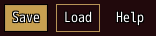
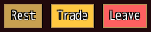
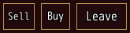
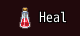
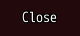
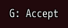
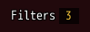
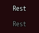

<!-- nav -->
[Mod Framework](../../README.md) › [UI components](README.md) › [Buttons and forms](README.md#buttons-and-forms)
<!-- /nav -->

# Button

`button` is something the player presses. Confirm or a click presses it. A button whose
`on_click:` is `:close`, `:back` or `:forward` repeats a key the player has anyway, so the keys skip
it and only the mouse uses it.

## Examples

### Filled, outlined and text

<!-- example: button-variants -->
```ruby
stack row: true do
  button "Save", variant: :filled, on_click: -> { save }
  button "Load", variant: :outlined, on_click: -> { load }
  button "Help", variant: :text, on_click: -> { help }
end
```


### Colors

<!-- example: button-colors -->
```ruby
stack row: true do
  button "Rest", variant: :filled, color: :primary, on_click: -> { rest }
  button "Trade", variant: :filled, color: :secondary, on_click: -> { trade }
  button "Leave", variant: :filled, color: :error, on_click: -> { leave }
end
```


A filled button's text is the plain text color with the black outline in every color.
`contrast: true` writes it in the dark or the light text color instead, whichever reads better on
the fill, with the outline that goes with it; `text_color:` sets a color by hand. See
[Themes](themes.md#text-on-fills).

### Sizes

<!-- example: button-sizes -->
```ruby
stack row: true do
  button "Sell", variant: :outlined, size: :small, on_click: -> { sell }
  button "Buy", variant: :outlined, on_click: -> { buy }
  button "Leave", variant: :outlined, size: :large, on_click: -> { leave }
end
```


`size:` follows MudBlazor's sizes: `:small` draws in the small font with less room around its text,
such as a button beside a list's row; `:large` in the large font with more room. `:medium` is the
default.

### With an icon

<!-- example: button-icon -->
```ruby
# Once, as the mod loads:
UI.icon :potion, 3059

# In render:
button "Heal", icon: :potion, on_click: -> { heal }
```


`icon:` takes an IconSet index, a name your mod gave an icon with `UI.icon` as it loads, or a
picture file as `{ file: "Graphics/Pictures/arrow" }`, as every part's `icon:` does. The framework
names no icons itself.

### Closing the window

<!-- example: button-close -->
```ruby
button "Close", on_click: :close
```


### With its hotkey

<!-- example: button-hotkey -->
```ruby
# Once, as the mod loads:
Mod_Framework::Hotkeys.define(:my_mod_accept, :key => "G", :name => "[My Mod] Accept")

# In render:
button "Accept", hotkey: :my_mod_accept, show_key: true, on_click: -> { accept }
```


### A count on the button

<!-- example: button-badge -->
```ruby
button "Filters", badge: picks.size, on_click: -> { self.filters_open = !filters_open }
```


The mod browser's Filters button counts the filters picked. `badge:` shows a count at the button's
end on a dark plate, "9+" above 9, or a dot for `true`. At 0 it shows nothing but keeps its room,
so the button keeps its width as the count comes and goes. `badge_color:` colors it (gold).

### Disabled

<!-- example: button-disabled -->
```ruby
button "Rest", on_click: -> { rest }
button "Rest", disabled: true, on_click: -> { rest }
```


A disabled button is greyed out, the keys skip it, and a press only buzzes. Its tooltip still shows
on hover.

## Params, events and keys

Every part also takes [the params every part takes](README.md#params-every-part-takes).

<!-- generated: button -->
A button the player presses.

Written `button text, ...`.

| Param | Takes | Default | Live | About |
|---|---|---|---|---|
| `text:` | a text |  | yes | what it says |
| `variant:` | `:filled`, `:outlined`, `:text` | `:text` |  | its look, which the theme draws in its color: :filled a plate in it, :outlined its edge in it, :text its text in it; each lights while the pointer, a press or the focus is on it |
| `color:` | a color name such as :primary or :rainbow, "#RRGGBB", [r, g, b] or a game text color such as 2 |  |  | its color, a color name of its theme's palette or one a mod added |
| `text_color:` | a color name such as :primary or :rainbow, "#RRGGBB", [r, g, b] or a game text color such as 2 |  |  | its text's color, which wins over the theme's, such as the text on a :filled plate |
| `hotkey:` | the name of a hotkey of Mod_Framework::Hotkeys |  |  | a hotkey of Mod_Framework::Hotkeys that presses it; quiet while anything types, while a window above holds the game's buttons, while it is hidden, off the hotkey's scenes, and where a screen uses the game's button its key is bound to |
| `show_key:` | true, false | `false` |  | draws its hotkey's key before its text, "Y: Accept", anew after the player binds another |
| `icon:` | an IconSet index, a name UI.icon gave one, or { file: "Graphics/Pictures/x" } |  | yes | an icon drawn before its text |
| `badge:` | a whole number, `true`, `false` |  |  | a count at its end on a dark plate, such as the filters picked: "9+" above 9 and nothing at 0, or a dot for true; it keeps its room at 0, so the button never changes its width |
| `badge_color:` | a color name such as :primary or :rainbow, "#RRGGBB", [r, g, b] or a game text color such as 2 | `:gold` |  | the color of its badge's count or dot |
| `size:` | `:small`, `:medium`, `:large` | `:medium` |  | its size, as MudBlazor's: :small in the small font with less room around it, such as beside a list's row; :large in the large font with more room |

| Event | Tells |
|---|---|
| `on_click` | nothing; it was pressed. on_click: :close closes the root with the reason :button, on_click: :submit sends the form it lies in |

**Keys:** confirm presses it, and so does its hotkey; the keys skip a button without on_click and one whose on_click is :close, :back or :forward, as those repeat a key

**Pad:** A presses it

**Mouse:** a click presses it
<!-- /generated -->

<!-- nav -->
---

← [Breadcrumbs](breadcrumbs.md) · [All components](README.md) · [Text field](text_field.md) →
<!-- /nav -->
