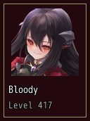
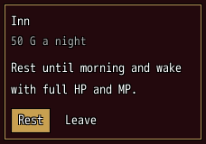
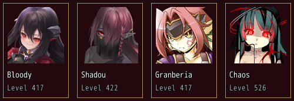

<!-- nav -->
[Mod Framework](../../README.md) › [UI components](README.md) › [Layout](README.md#layout)
<!-- /nav -->

# Card

`card` is a framed card, as MudBlazor's card. It holds, in a column, a `card_header` (a title and a
subtitle), a `card_media` (a picture across the card), a `card_content` (what the card tells) and
`actions` (a row of buttons at its foot); each is optional.

- With `clickable: true` the card is one part: the arrows stop on it, and confirm or a click
  anywhere on it presses it and tells `on_click`, as the cards of a list do.
- With `enter: true`, for a card that holds several actions, the arrows stop on the card whole;
  confirm goes inside to its actions and cancel comes back out, as a `paper` the keys enter.
- Without either, the keys reach its actions as any buttons.

A list of many items, such as the mods of the mod browser, is a [list](list.md) with
`look: :cards`, which draws only the rows in sight. Cards suit a few items, each laid out as you
like, such as the members of the party in a [grid](grid.md).

`padding:` changes the room inside its frame, 6 pixels by default, such as `padding: 1` for 4, and
`border: false` drops the frame.

## Examples

### A card the player picks

<!-- example: card-member -->
```ruby
actor = UI::Game.leader
card clickable: true, width: 120, on_click: -> { pick(actor) } do
  card_media face: actor, height: 96, fit: :contain
  card_header actor.name, subtitle: "Level #{UI::Game.level(actor)}"
end
```


### A card with actions

<!-- example: card-actions -->
```ruby
card enter: true, width: 220 do
  card_header "Inn", subtitle: "50 G a night"
  card_content do
    text "Rest until morning and wake with full HP and MP.", wrap: true
  end
  actions do
    button "Rest", variant: :filled, on_click: -> { rest }
    button "Leave", on_click: -> { leave }
  end
end
```


### Cards in a grid

<!-- example: card-grid -->
```ruby
grid spacing: 3 do
  $game_party.battle_members.each do |actor|
    grid_item xs: 3, key: actor.id do
      card clickable: true, on_click: -> { pick(actor) } do
        card_media face: actor, height: 96, fit: :contain
        card_header actor.name, subtitle: "Level #{UI::Game.level(actor)}"
      end
    end
  end
end
```


The arrows move from card to card, Up and Down to the card in the same column of the row above or
below.

## Params, events and keys

Every part also takes [the params every part takes](README.md#params-every-part-takes).

<!-- generated: card -->
A framed card, as MudBlazor's card: a card_header, a card_media, a card_content and actions in a column. With clickable: true it is one part that confirm or a click presses, such as a card of a party member to pick; with enter: true the keys stop on it whole and confirm goes in to its actions.

Written `card ...` with a `do ... end` block of markup.

| Param | Takes | Default | Live | About |
|---|---|---|---|---|
| `clickable:` | true, false | `false` |  | one key stop that confirm or a click anywhere on it presses, telling on_click, what it holds taking neither the keys nor the pointer |
| `enter:` | true, false | `false` |  | for a card with several actions: the arrows stop on it whole; confirm goes inside onto the action picked there last, cancel inside comes back out |

| Event | Tells |
|---|---|
| `on_click` | nothing; with clickable: true, confirm or a click on it pressed it |
| `on_enter` | nothing; with enter: true, the focus went inside it |
| `on_leave` | nothing; with enter: true, the focus came out of it |

**Keys:** with clickable: true, the arrows stop on it as one part and confirm presses it; with enter: true, the arrows stop on it whole, confirm goes in and cancel comes back out; else the keys reach its actions as any buttons

**Pad:** as the keys

**Mouse:** with clickable: true, a click anywhere on it presses it; else a click on an action presses it
<!-- /generated -->

<!-- generated: card_header -->
The head of a card: its title, and a subtitle under it in small dim text.

Written `card_header title, ...`.
It goes inside `card`.

| Param | Takes | Default | Live | About |
|---|---|---|---|---|
| `title:` | a text |  | yes | what the card is, such as a character's name |
| `subtitle:` | a text |  | yes | a line under the title, such as the character's level |
<!-- /generated -->

<!-- generated: card_media -->
A picture across a card: a picture file, a character's face or their portrait, filling the card's width.

Written `card_media ...`.
It goes inside `card`.

| Param | Takes | Default | Live | About |
|---|---|---|---|---|
| `file:` | a text |  |  | a picture file of the game or of your mod, such as "Graphics/Pictures/bg010" |
| `face:` | any value |  |  | a character whose face shows |
| `portrait:` | any value |  |  | a character whose Library portrait shows |
| `fit:` | `:cover`, `:contain`, `:fill` | `:cover` |  | :cover fills its room and cuts what sticks out, :contain shows all of it, :fill stretches it |
| `blur:` | true, false | `false` |  | draws a picture file blurred, such as a screenshot that spoils the story |

**Keys:** none

**Mouse:** none
<!-- /generated -->

<!-- generated: card_content -->
What a card tells, its parts in a column, such as texts and fields.

Written `card_content ...` with a `do ... end` block of markup.
It goes inside `card`.
<!-- /generated -->

<!-- generated: actions -->
The buttons at the foot of a card, in a row, as MudBlazor's card actions.

Written `actions ...` with a `do ... end` block of markup.
It goes inside `card`.
<!-- /generated -->

<!-- nav -->
---

← [Paper](paper.md) · [All components](README.md) · [Drop zone](drop_zone.md) →
<!-- /nav -->
