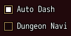
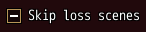
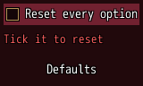

<!-- nav -->
[Mod Framework](../../README.md) › [UI components](README.md) › [Buttons and forms](README.md#buttons-and-forms)
<!-- /nav -->

# Checkbox

`checkbox` is a box the player ticks, such as a rule to turn on. Its label stands beside the box, as
MudBlazor draws it, and confirm or a click ticks it. Bind it to a state and the state keeps whether
it is ticked.

## Examples

### Bound to a state

<!-- example: checkbox-bind -->
```ruby
checkbox "Auto Dash", bind: :dash
checkbox "Dungeon Navi", bind: :navi
```


### Three states

<!-- example: checkbox-tri-state -->
```ruby
checkbox "Skip loss scenes", bind: :skip_loss, tri_state: true
```


With `tri_state: true` a click goes from off to on, then to neither, which the state holds as nil
and the box shows as a bar, and back to off, such as the game's own choice of seeing every loss
scene, skipping those seen, or asking each time.

### Required

<!-- example: checkbox-required -->
```ruby
form on_submit: -> { reset_options } do
  checkbox "Reset every option", bind: :sure, required: "Tick it to reset"
  button "Defaults", on_click: :submit
end
```


A required box must be ticked. Its error shows under it, as on every input; see [Form](form.md).

## Params, events and keys

Every part also takes [the params every part takes](README.md#params-every-part-takes).

<!-- generated: checkbox -->
A box the player ticks, with its label beside it, such as a rule to turn on; with tri_state: true it may also hold neither.

Written `checkbox label, ...`.

| Param | Takes | Default | Live | About |
|---|---|---|---|---|
| `label:` | a text |  | yes | its text beside its mark, as MudBlazor draws a checkbox's label |
| `bind:` | the name of a state |  |  | a state that holds whether it is ticked, both ways: true, false, or nil for neither with tri_state: |
| `tri_state:` | true, false | `false` |  | a click goes from off to on, to neither (nil, a bar across the box) and back to off |
| `required:` | any value |  |  | true, or the error to show, such as "Name the formation": an empty value is an error, "Required" by default |
| `validate:` | a lambda of one item, or its method name |  |  | a lambda of its value answering the error to show, or nil while the value is fine, such as ->(name) { "Too short" if name.size < 3 }; a method name calls that method of the component |

| Event | Tells |
|---|---|
| `on_change` | true or false as the player ticked it, or nil for neither with tri_state: |

**Keys:** confirm ticks it

**Pad:** A ticks it

**Mouse:** a click ticks it
<!-- /generated -->

<!-- nav -->
---

← [Numeric field](numeric_field.md) · [All components](README.md) · [Switch](switch.md) →
<!-- /nav -->
