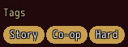
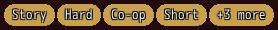
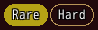
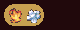

<!-- nav -->
[Mod Framework](../../README.md) › [UI components](README.md) › [Display](README.md#display)
<!-- /nav -->

# Chip set

`chip_set` is a wrapping row of chips that show facts, such as a mod's or a world's tags. Each chip
is a `chip`: an oval with round ends, lower than a button and in a smaller font, as MudBlazor draws
a chip. Its `color:` fills it, the theme's primary color without one, and its text is the plain
text color with the black outline (with `contrast: true` the dark or the light text, whichever
reads better on the fill); `variant: :outlined` draws only its edge and text in the
color, `variant: :text` only its text. It shows as many chips as one row holds (`most: :fit`) or
`most:` chips, and a last chip "+3 more" stands for the others and names them in its tooltip.
`label:` is a caption above it.

Chips only show: they take no focus, no click, no key and no digit, and the pointer only shows their
tooltips. A filter the player turns on and off is a [toggle group](toggle_group.md), a
[checkbox](checkbox.md) or a [switch](switch.md).

## Examples

### Tags

<!-- example: chip_set-tags -->
```ruby
chip_set label: "Tags" do
  world_tags.each { |tag| chip tag, key: tag }
end
```


### At most four

<!-- example: chip_set-most -->
```ruby
chip_set most: 4 do
  tags.each { |tag| chip tag, key: tag }
end
```


The tooltip of "+3 more" names the chips left out.

### In a color

<!-- example: chip_set-color -->
```ruby
UI.color :legendary, [181, 162, 21]
# In render:
chip_set do
  chip "Rare", color: :legendary
  chip "Hard", variant: :outlined
end
```


### Several icons in one chip

<!-- example: chip_set-icons -->
```ruby
chip_set do
  chip icons: [3, 4].map { |element| UI::Game.element_icon(element) }, tooltip: [3, 4].map { |element| UI::Game.element_name(element) }.join(", ")
end
```


`icons:` puts several icons side by side in one chip, such as the elements a weapon strikes with,
which `UI::Equip.elements(item)` tells.

## Params, events and keys

Every part also takes [the params every part takes](README.md#params-every-part-takes).

<!-- generated: chip_set -->
A wrapping row of chips that only show, such as a mod's tags; each chip is a chip. A filter the player turns on and off is a checkbox, a switch or a toggle_group.

Written `chip_set ...` with a `do ... end` block of markup.

| Param | Takes | Default | Live | About |
|---|---|---|---|---|
| `label:` | a text |  | yes | a caption above it, as MudBlazor draws an input's label |
| `most:` | a whole number, `:fit` | `:fit` |  | the most chips it shows, or :fit for as many as one row of its width holds; a last chip "+3 more" stands for the others and names them in its tooltip |

**Keys:** none: the chips take no focus

**Pad:** none

**Mouse:** the pointer shows a chip's tooltip; a click does nothing
<!-- /generated -->

### Chip

<!-- generated: chip -->
One chip of a chip_set.

Written `chip text, ...`.
It goes inside `chip_set`.

| Param | Takes | Default | Live | About |
|---|---|---|---|---|
| `text:` | a text |  |  | what it says |
| `icon:` | an IconSet index, a name UI.icon gave one, or { file: "Graphics/Pictures/x" } |  |  | an icon; a chip of an icon alone shows it in its middle |
| `icons:` | an Array |  |  | several icons side by side in place of icon:, such as the elements a weapon strikes with |
| `variant:` | `:filled`, `:outlined`, `:text` | `:filled` |  | its look, which the theme draws in its color: :filled the chip in it, :outlined its edge and text in it, :text its text in it |
| `color:` | a color name such as :primary or :rainbow, "#RRGGBB", [r, g, b] or a game text color such as 2 |  |  | its color, which fills it; the theme's primary color without one |
<!-- /generated -->

<!-- nav -->
---

← [Badge](badge.md) · [All components](README.md) · [Timeline](timeline.md) →
<!-- /nav -->
