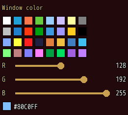
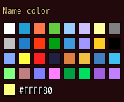
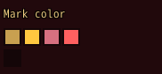

<!-- nav -->
[Mod Framework](../../README.md) › [UI components](README.md) › [Buttons and forms](README.md#buttons-and-forms)
<!-- /nav -->

# Color picker

`color_picker` is a color the player picks, as MudBlazor's color picker: swatches to pick from,
sliders of the color's red, green and blue under them, and a swatch of the color with its
`"#RRGGBB"`. Its first value, `label:`, is a caption above it, as on every input. Bind it to a state
and the state keeps the color as `"#RRGGBB"`, which every color param and `UI.color` take.

- The arrows step over the swatches and confirm or a click picks one; the picked swatch is framed.
  Resting on a swatch shows its `"#RRGGBB"`.
- Each slider steps its part of the color by Left and Right, a click on its track or a drag of its
  knob, as a [slider](slider.md) does. A color no swatch holds frames none.
- The state may also be set to any color a color param takes, such as `2` or `:primary`; the
  picker shows it, and the state gets `"#RRGGBB"` once the player picks.

## Examples

### Bound to a state

<!-- example: color_picker-bind -->
```ruby
color_picker "Window color", bind: :window_color
```


The swatches are the game's 32 text colors, as `\C[n]` shows them in a message.

### Swatches alone

<!-- example: color_picker-swatches -->
```ruby
color_picker "Name color", bind: :name_color, sliders: false
```


### Colors of your own

<!-- example: color_picker-palette -->
```ruby
color_picker "Mark color", bind: :mark_color, palette: [:primary, :secondary, :tertiary, :error], sliders: false
```


`palette:` takes any colors a color param takes. A color name is picked as the `"#RRGGBB"` it has
in the player's look.

## Params, events and keys

Every part also takes [the params every part takes](README.md#params-every-part-takes).

<!-- generated: color_picker -->
A color the player picks from swatches or sets by sliders of its red, green and blue, as MudBlazor's color picker, such as the color of the windows.

Written `color_picker label, ...`.

| Param | Takes | Default | Live | About |
|---|---|---|---|---|
| `label:` | a text |  | yes | a caption above it, as MudBlazor draws an input's label |
| `bind:` | the name of a state |  |  | a state that holds the color as "#RRGGBB", both ways; it may also be set to any color a color param takes |
| `palette:` | an Array |  |  | the colors of its swatches, each any color a color param takes; the game's 32 text colors, as \C[n] shows them, by default |
| `sliders:` | true, false | `true` |  | sliders of the color's red, green and blue show under the swatches |
| `required:` | any value |  |  | true, or the error to show, such as "Name the formation": an empty value is an error, "Required" by default |
| `validate:` | a lambda of one item, or its method name |  |  | a lambda of its value answering the error to show, or nil while the value is fine, such as ->(name) { "Too short" if name.size < 3 }; a method name calls that method of the component |

| Event | Tells |
|---|---|
| `on_change` | the color as "#RRGGBB", as the player picked a swatch or moved a slider |

**Keys:** the arrows step over the swatches and confirm picks one; Left and Right step a slider, Up and Down move on

**Pad:** the d-pad steps over the swatches and A picks one; Left and Right step a slider

**Mouse:** a click picks a swatch; a click on a slider's track or a drag of its knob sets that part of the color; resting on a swatch shows its "#RRGGBB"
<!-- /generated -->

<!-- nav -->
---

← [Rating](rating.md) · [All components](README.md) · [Radio group](radio_group.md) →
<!-- /nav -->
