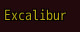
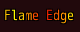
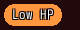
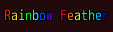
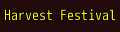
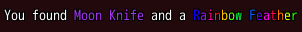
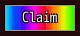

<!-- nav -->
[Mod Framework](../../README.md) › [UI components](README.md) › [Looks](README.md#looks)
<!-- /nav -->

# Colors

Every color param of every part, such as `color:`, `text_color:` and `badge_color:`, takes a color
name: a role of the player's look, such as `:primary` or `:error`, a basic color, such as `:red`,
or a name your mod gives a color with `UI.color`. Name a color once, as your mod loads, and use it
everywhere: in params and in the text codes of a text, `\C[legendary]`. A color may also move:
across the letters of a text, or across a button's plate, as rainbow names do.

## Examples

### A color of your own

<!-- example: colors-named -->
```ruby
UI.color :legendary, [181, 162, 21]
# In render:
text "Excalibur", color: :legendary
```


### Colors that slide across the letters

<!-- example: colors-slide -->
```ruby
UI.color :fire, slide: [:red, :yellow]
# In render:
text "Flame Edge", color: :fire
```


### A pulse

<!-- example: colors-pulse -->
```ruby
UI.color :alarm, pulse: [:yellow, :orange, :error]
# In render:
chip_set { chip "Low HP", color: :alarm }
```


A pulse goes through its colors in turn and from the last back to the first, the whole part in one
color at a time.

### The rainbow

<!-- example: colors-rainbow -->
```ruby
text "Rainbow Feather", color: :rainbow
```


### The rainbow's colors in a pulse

<!-- example: colors-rainbow-pulse -->
```ruby
UI.color :festival, pulse: UI::RAINBOW
# In render:
text "Harvest Festival", color: :festival
```


`UI::RAINBOW` holds the rainbow's colors, red, yellow, green, cyan, blue and magenta, for a slide
or a pulse of your own; `:rainbow` is `slide: UI::RAINBOW`.

### In a text code

<!-- example: colors-codes -->
```ruby
UI.color :epic, [163, 53, 238]
# In render:
text "You found \\C[epic]Moon Knife\\C[0] and a \\C[rainbow]Rainbow Feather", escapes: true
```


### A filled part

<!-- example: colors-fill -->
```ruby
button "Claim", variant: :filled, color: :rainbow, on_click: -> { claim }
```


## Naming a color

`UI.color` takes a name and a color. Call it once, as your mod loads, outside `render`. Names are
shared by every mod, so give a rare name your mod's prefix, such as `:gear_compare_up`; a name
another mod gave first is refused. Your mod may load before the framework's DLL started: the name
waits and is added once the DLL starts, before anything is drawn, so the load order does not matter.

| Call | What it names |
|---|---|
| `UI.color :legendary, [181, 162, 21]` | a plain color: `[r, g, b]`, `[r, g, b, a]` or `"#B5A215"` |
| `UI.color :rare, "#FFC040", "Legacy" => "#FFD878"` | a plain color, with a color of its own in some looks |
| `UI.color :banner, :primary` | the color another name has, in whichever look the player picked |
| `UI.color :fire, slide: [:red, :yellow]` | two colors or more that move across the letters, left to right |
| `UI.color :alarm, pulse: [:yellow, :orange, :error]` | two colors or more that the whole part goes through in turn, then back to the first |
| `UI.color :festival, pulse: UI::RAINBOW` | the rainbow's colors, for a slide or a pulse |
| `UI.color :glow, ->(letter, frame) { UI.hue(letter * 30 + frame) }` | your own effect: a lambda of the letter and the frame that answers a color |

A lambda runs once for eight letters over a whole cycle as your mod loads, so a filled part can
pick a text that reads on all its colors. A lambda that fails draws in the text color, and the
framework's log names it once.

A slide or a pulse takes `speed:`, how far it moves each frame, 3 by default (a whole cycle in two
seconds); `speed: 6` moves twice as fast. Its colors may be any colors or color names that do not
move themselves, and they follow the player's look. `UI.hue(degrees)` gives a color of the color
wheel: 0 red, 60 yellow, 120 green, 180 cyan, 240 blue and 300 magenta.

Built in are `:rainbow`, a slide through `UI::RAINBOW`, and the basic colors `:red`, `:orange`,
`:yellow`, `:green`, `:cyan`, `:blue`, `:purple`, `:magenta`, `:pink`, `:white`, `:black` and
`:grey`.

## How moving colors draw

- A text in a moving color draws letter by letter, each letter a step further on.
- A plate, an edge, a line or a gauge in a slide draws in bands about a letter wide, the colors
  moving across it from left to right. A pulse colors the whole part alike.
- A part in a moving color draws anew every 3 frames, and only while it shows.
- On a filled part with `contrast: true`, the text takes the dark or the light text color,
  whichever stays readable on every color the plate moves through. While the pointer, a press or the focus lights it, each
  band lightens 5 % toward white, as any filled part does.

## Text codes

A text with `escapes: true`, a list row and every other part that draws the game's text codes
take a color name in `\C[...]`: `\C[legendary]`, `\C[primary]` or `\C[rainbow]`. The game's color
numbers keep working: `\C[2]` takes the window skin's color, and a number past 31 takes the color
the game gives it, so a number another mod adds, such as `\C[706]`, still works. A
name nobody gave draws in the text color, and the framework's log names it once, with the nearest
name that exists.

The game's own windows take the same names in their text codes, such as an item's name, the shop
and the messages, in the colors of the look the window wears. There a moving color draws in the
color it has as the window draws its text, and keeps it: the game draws a message or an item list
only once, so its text does not move. A command badge in a moving color moves, since its row draws
anew every 3 frames while the window shows.

## Drawing on a bitmap of your own

A mod that draws on a bitmap itself, such as a name on a game window with `change_color` or a mark
filled with `fill_rect`, reads a color with `UI.color_now`: the `Color` a color name or a role has
in the player's look right now, a moving color in this frame. Ask it each time you draw, since the
player may pick another look while the game runs, and never keep a copy:

```ruby
window.change_color(UI.color_now(:own))            # the player's own name
bitmap.fill_rect(0, 0, 8, 8, UI.color_now(:error))  # a mark in the look's error color
window.change_color(UI.color_now(:ally, window))    # in the look the game window wears
```

It takes a role such as `:text`, `:dim`, `:success`, `:warning`, `:error`, `:own` or `:ally`, a color
name a mod gave, `"#RRGGBB"` or `[r, g, b]`, and answers a copy you may change. With a game window
it reads the look that window wears, which is the game's own skin while Look on Game Windows is Off.
A name nobody gave raises with the nearest name that exists.

<!-- nav -->
---

← [Game data](game_data.md) · [All components](README.md) · [Themes](themes.md) →
<!-- /nav -->
