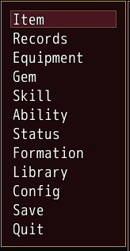
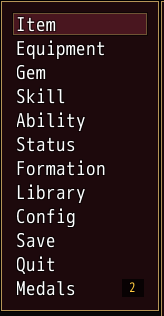
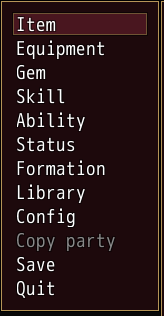

<!-- nav -->
[Mod Framework](../../README.md) › [UI components](README.md) › [Game parts](README.md#game-parts)
<!-- /nav -->

# Command

`command` is a command of one of the game's command windows, such as the menu's. A `UI.patch` of
that window adds it before, after or among the game's own commands; it works only there.

## Examples

### A command in the menu

<!-- example: command-menu -->
```ruby
UI.patch "Window_MenuCommand" do |t|
  t.after "#item" do
    command "Records", id: :records, on_click: -> { UI.open(RecordsWindow) }
  end
end
```


### Shown only while it applies

<!-- example: command-gate -->
```ruby
UI.patch "Window_MenuCommand" do |t|
  t.append do
    command "Medals", id: :medals, if: -> { UI::Game.switch(12) }, badge: -> { new_medals }, on_click: -> { open_medals }
  end
end
```


### Before a command of the game, opening a box

<!-- example: command-before -->
```ruby
UI.patch "Window_MenuCommand" do |t|
  t.before "#save" do
    command "Copy party", id: :copy_party, disabled: -> { !party_full? },
                          on_click: -> { UI.message(copy_party, title: "Copy party") }
  end
end
```


The game's window takes the keys again once the box or window the command opened closes, or at
once when it opened none; the command needs no code for it. A command of the title goes the same
way into `"Window_TitleCommand"`, such as `t.after "#continue"`.

## Params, events and keys

<!-- generated: command -->
A command of a game command window, such as the menu's, which a UI.patch of the window adds with before, after, prepend or append; it works only there. Its id: is its symbol, which other patches name as #id.

Written `command text, ...`.

| Param | Takes | Default | Live | About |
|---|---|---|---|---|
| `text:` | a text |  | yes | what it says |
| `if:` | a lambda answering true or why not, or :map_free |  |  | asked each time the window makes its list; while it answers false the command takes no line |
| `icon:` | a whole number |  |  | an IconSet index drawn before its text |
| `badge:` | any value |  | yes | a count above 0 on a plate at the end of its row, "9+" above 9; true shows a dot |
| `badge_color:` | a color name such as :primary or :rainbow, "#RRGGBB", [r, g, b] or a game text color such as 2 |  |  | the badge's color, :gold by default |

| Event | Tells |
|---|---|
| `on_click` | nothing; the player picked it. The window takes the keys again once the windows its handler opened closed |

**Keys:** as the game's own commands: confirm picks it

**Pad:** as the keys

**Mouse:** a click picks it
<!-- /generated -->

<!-- nav -->
---

← [Page view](page_view.md) · [All components](README.md) · [Game data](game_data.md) →
<!-- /nav -->
