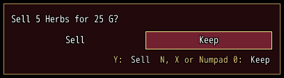
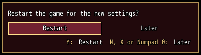

<!-- nav -->
[Mod Framework](../../README.md) › [UI components](README.md) › [Services](README.md#services)
<!-- /nav -->

# Confirm

`UI.confirm` asks the player a yes or no question in the question box, a small dialog above every
other screen. "No" is lit first, so a press of confirm out of habit never says yes. Left and Right
move the focus between the choices, confirm answers the lit choice, the Accept hotkey (Y) answers yes, and the Decline
hotkey (N) and cancel answer no. The box names those keys as the player bound them. One question
shows at a time: while one is open, `UI.confirm` answers false and asks nothing. A change of the
scene answers no.

The block runs once, in the frame after the answer, with true for yes and false for no, so the
press that answered never reaches the screen under the box.

## Examples

### A question

<!-- example: confirm-ask -->
```ruby
button "Sell", on_click: -> { UI.confirm("Sell 5 Herbs for 25 G?", yes: "Sell", no: "Keep") { |yes| sell_herbs(5) if yes } }
```


### Yes lit first

<!-- example: confirm-lit -->
```ruby
button "Restart", on_click: -> { UI.confirm("Restart the game for the new settings?", yes: "Restart", no: "Later", lit: :yes) { |yes| restart if yes } }
```


Light yes first only where saying yes is what the player came for, such as a restart they asked
for.

### Taking a question back

```ruby
@question = UI.confirm("Make Alice the leader?", yes: "Lead", no: "Not now") { |yes| lead(alice) if yes }
# Alice left the party:
@question.close("Alice left the party") if @question && @question.open?
```

`UI.confirm` answers a handle: `open?` tells whether the question still waits, `close(reason)`
answers it no from outside and logs the reason, and `id` tells the box's place id.

### Changing the box: UI.patch

The question box is a dialog of the UI layer, so [UI.patch](patch.md)
reaches it by its id and the ids of its parts: `#confirm_box` (or the `id:` the question gives),
`#confirm_box_question`, `#confirm_box_yes`, `#confirm_box_no` and `#confirm_box_keys`, the key
line. A mod that asks with its own `id:` gives every other mod one box to change without touching
the questions of the rest:

```ruby
UI.confirm("Burn the old notes?", yes: "Burn", no: "Keep", id: :camp_burn) { |yes| burn_notes if yes }

# Another mod adds a line under that question:
UI.patch "#camp_burn" do |box|
  box.after "#camp_burn_question" do
    text "The notes of the last three nights are gone for good.", typo: :caption, color: :warning
  end
end
```

## Params

| Param | Takes | Default | About |
|---|---|---|---|
| `yes:` | a text | `"Yes"` | the yes choice's text |
| `no:` | a text | `"No"` | the no choice's text |
| `lit:` | `:no`, `:yes` | `:no` | the choice lit as the box opens |
| `id:` | a Symbol | `:confirm_box` | the box's place id, under which the player's Alt-moved place is kept |

**Keys:** Left and Right move the light; confirm answers the lit choice; the Accept hotkey answers
yes; the Decline hotkey, cancel and Numpad 0 answer no; every other hotkey is quiet while it is open

**Pad:** the d-pad moves the light; A answers it; B answers no

**Mouse:** the pointer lights a choice and a click answers it; Alt-drag moves the box and changes
its width

<!-- nav -->
---

← [Bubble](bubble.md) · [All components](README.md) · [Message](message.md) →
<!-- /nav -->
