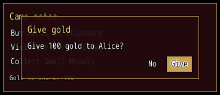
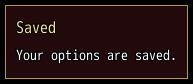

<!-- nav -->
[Mod Framework](../../README.md) › [UI components](README.md) › [Roots](README.md#roots)
<!-- /nav -->

# Dialog

`dialog` is a window over whatever opened it, such as a choice over your mod's window. The windows
under it keep their look but take no input while it is open, and it closes with the window that
opened it.

## Examples

### Over the window that opened it

<!-- example: dialog-over -->
```ruby
dialog "Give gold", width: 300 do
  text "Give 100 gold to Alice?"
  stack row: true, justify: :end do
    button "No", on_click: :close
    button "Give", variant: :filled, on_click: -> { give; close }
  end
end
```


### In a corner

<!-- example: dialog-corner -->
```ruby
dialog "Saved", anchor: :bottom_right do
  text "Your options are saved."
end
```


### Standing in for its window

With `cover: true` a dialog takes the place of the window whose handler opened it and hides that
window until it closes, so a dialog as large as its window does not show it through, as the
Equipment Window's item dialog does over its window. Given a game window or its class
name, such as `cover: "Window_Config"`, it lies exactly over that game window instead, as a
[window](window.md#over-a-game-window-in-its-place) does.

## Params, events and keys

Every part also takes [the params every part takes](README.md#params-every-part-takes).

<!-- generated: dialog -->
A window over whatever opened it; the windows under it keep their look but take no input while it is open.

Written `dialog title, ...` with a `do ... end` block of markup.
Opened by `UI.open`.

| Param | Takes | Default | Live | About |
|---|---|---|---|---|
| `at:` | [x, y] |  | yes | an exact spot [x, y] on the screen instead of its zone, rarely needed; a lambda is read every frame, and it jumps to a new spot the frame the answer changes |
| `movable:` | true, false | `true` |  | false keeps the player from moving it with Alt |
| `shown_in:` | scene classes or patterns of their names |  |  | the only scenes it shows in; elsewhere it fades out without closing and keeps its place |
| `place_name:` | a text |  |  | the name the player sees for its stored place |
| `if:` | a lambda answering true or why not, or :map_free |  |  | asked every frame; anything but true closes it, the answer its reason |
| `z:` | a whole number |  |  | which root lies above which within the band of its layer, 0 by default |
| `anchor:` | `:top_left`, `:top`, `:top_right`, `:left`, `:center`, `:right`, `:bottom_left`, `:bottom`, `:bottom_right` | `:center` |  | the zone of the screen it sits in; a dialog without one sits over the window that opened it |
| `dock:` | `:left`, `:right`, `:top`, `:bottom` |  |  | the edge of the screen it takes the whole length of, such as a full-height side window |
| `beside:` | a selector, such as "#gear_compare_score", or a game window's class name, such as "Window_Gold" |  |  | the part it sits next to: a game window's class name, or another window's #id |
| `side:` | `:top`, `:bottom`, `:left`, `:right` | `:right` |  | the side of beside: it sits on; the other side where that has no room |
| `hotkey:` | the name of a hotkey of Mod_Framework::Hotkeys |  |  | a hotkey of Mod_Framework::Hotkeys that closes it again, with the reason :hotkey; by default the hotkey its component class declares with hotkey :name, which opens it too |
| `shoulders:` | `:tabs_or_page`, `:tabs` | `:tabs_or_page` |  | what a gamepad's shoulders do: :tabs_or_page steps the tabs in view, else on_page, else the focused list's page; :tabs only steps the tabs |
| `title:` | a text |  | yes | the title bar's text |
| `closable:` | true, false | `true` |  | the game's cancel key and Numpad 0 close it |
| `resizable:` | `false`, `true`, `:width`, `:height` | `false` |  | the player resizes it with Alt |
| `close_outside:` | true, false | `false` |  | a click outside closes it |
| `captures:` | `true`, `false`, `:typing` | `true` |  | it holds the game's buttons while open; :typing only while a text field inside it types, such as a chat whose log stays on the screen while the player walks |
| `menu:` | true, false | `false` |  | opened outside the game's menu, it opens in a menu scene of its own over the blurred map, which waits behind it, and the game goes back as it closes; opened in a menu it opens in place |
| `on_button:` | { z: -> { ... } }: a lambda or a method name, or nil, for each of the game's buttons :a, :x, :y and :z it takes |  |  | what the game's buttons :a, :x, :y and :z (Shift, A, S and D on the keyboard) do while the focus is on it or inside it, such as { z: -> { open_filter } }; only where a screen mirrors the game's own |
| `button_help:` | { z: "Filter" }: what each button of on_button: does, for the key help |  |  | what each button of on_button: does, which the key help names, such as { z: "Filter" }; nil leaves a button out, such as on a row it does nothing on |
| `cover:` | true, false, a game window, or its class name such as "Window_Config" | `false` |  | true: it lies over the window that opened it at that window's place, such as a dialog as large as the window it stands in for; a game window or its class name, such as "Window_Config": it lies exactly over that game window, its place and size, such as Options > Mods over the game's options list; either window hides until it closes |

| Event | Tells |
|---|---|
| `on_open` | once it shows |
| `on_close` | why it closed: :cancel, :button, :hotkey, :script, :scene, :outside or the gate's answer |
| `on_page` | Q or W, or a gamepad's shoulder without tabs in view, reached it from the focus upward: -1 for the page before, 1 for the next |
| `on_submit` | a list inside it without on_submit: picked an item, nearest first: the item |
| `on_cancel` | cancel reached it, or a click outside with close_outside:; answering false keeps it open without the cancel sound, such as to ask first or to buzz while something runs |

**Keys:** as window

**Pad:** as window

**Mouse:** as window
<!-- /generated -->

<!-- nav -->
---

← [Window](window.md) · [All components](README.md) · [HUD](hud.md) →
<!-- /nav -->
