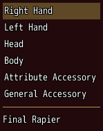
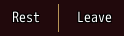

<!-- nav -->
[Mod Framework](../../README.md) › [UI components](README.md) › [Layout](README.md#layout)
<!-- /nav -->

# Divider

`divider` is a thin line between parts: across a column, or upright between the parts of a row
with `vertical: true`.

## Examples

### Across a column

<!-- example: divider-column -->
```ruby
list slots, bind_index: :slot
divider
text slot_summary
```


### Upright in a row

<!-- example: divider-row -->
```ruby
stack row: true do
  button "Rest", on_click: -> { rest }
  divider vertical: true
  button "Leave", on_click: -> { leave }
end
```


### A color and a thickness

<!-- example: divider-gold -->
```ruby
divider color: :gold, thickness: 2
```


## Params, events and keys

Every part also takes [the params every part takes](README.md#params-every-part-takes).

<!-- generated: divider -->
A thin line between parts: across a column, or upright in a row with vertical: true.

Written `divider ...`.

| Param | Takes | Default | Live | About |
|---|---|---|---|---|
| `vertical:` | true, false | `false` |  | true draws it upright, between parts of a row |
| `color:` | a color name such as :primary or :rainbow, "#RRGGBB", [r, g, b] or a game text color such as 2 | `:edge` |  | its color |
| `thickness:` | a whole number | `1` |  | how many pixels thick it is |

**Keys:** none

**Mouse:** none
<!-- /generated -->

<!-- nav -->
---

← [Aside](aside.md) · [All components](README.md) · [Slides](slides.md) →
<!-- /nav -->
