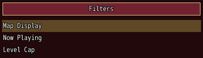
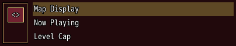
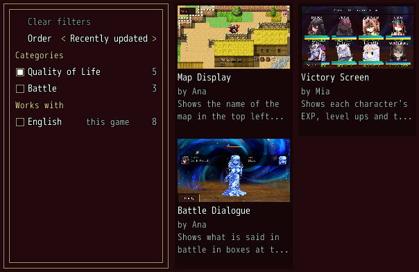

<!-- nav -->
[Mod Framework](../../README.md) › [UI components](README.md) › [Layout](README.md#layout)
<!-- /nav -->

# Drawer

`drawer` is a panel at the left or right of what it lies in that opens and closes, such as the
filters beside a list of mods. Bind it to a state that says whether it is open; a button you place
opens it. Its `drawer_header` stays at its top.

## Examples

### Beside the rest

<!-- example: drawer-persistent -->
```ruby
stack row: true do
  drawer bind: :filters_open do
    toggle_group "Order", bind: :order do
      toggle_item "Newest", value: :newest
      toggle_item "Name", value: :name
    end
  end
  stack grow: 1 do
    button "Filters", on_click: -> { self.filters_open = !filters_open }
    list mods, bind: :mod
  end
end
```


While it is shut it takes no room. Open, it is 240 pixels wide unless `width:` says otherwise, and
the keys reach it as any part beside the list: Left from the list's left edge goes into it.

### A strip while shut

<!-- example: drawer-mini -->
```ruby
stack row: true do
  drawer bind: :filters_open, variant: :mini do
    drawer_header do
      button "<>", on_click: -> { self.filters_open = !filters_open }
    end
    text "Updates only"
  end
  list mods, bind: :mod, grow: 1
end
```


### Over the rest

<!-- example: drawer-temporary -->
```ruby
stack row: true do
  drawer bind: :filters_open, variant: :temporary, width: 200 do
    text "Updates only"
    button "Clear", on_click: -> { clear_filters }
  end
  stack grow: 1 do
    button "Filters", on_click: -> { self.filters_open = true }
    list mods, bind: :mod
  end
end
```


It lies over the parts beside it and takes the keys while open. Cancel or a click outside closes
it, turns its state false, tells `on_change(false)` and gives the focus back where it was.

### A list of filters

<!-- example: drawer-filter-list -->
```ruby
stack row: true do
  drawer bind: :filters_open, width: 240 do
    paper enter: true, height: :fill do
      list [{ text: "Clear filters", disabled: true },
            { text: "Order", value: "Recently updated" },
            { text: "Categories", heading: true },
            { text: "Quality of Life", check: true, right: "5", right_color: :dim },
            { text: "Battle", check: false, right: "3", right_color: :dim },
            { text: "Works with", heading: true },
            { text: "English", check: false, note: "this game", right: "8", right_color: :dim }],
           height: :fill, rows_shown: :fill, on_submit: ->(row) { pick(row) }, on_side: ->(row, step) { step_order(step) }
    end
  end
  list mods, look: :cards, columns: filters_open ? 2 : 3, text: :name, grow: 1,
             picture: ->(mod) { { file: mod.shot } }, lines: ->(mod) { ["by #{mod.author}", mod.summary] }
end
```


The mod browser's filter drawer: one list in a box the keys enter, so the list stands alone and
needs no key help. A row with `value:` steps by Left and Right, a heading is passed over, and a
row's `check:` box fills or clears on confirm, its count at the right; a row turned off, such as
Clear filters with nothing picked, is greyed.

## Params, events and keys

Every part also takes [the params every part takes](README.md#params-every-part-takes).

<!-- generated: drawer -->
A panel at the left or right of what it lies in that opens and closes, such as the filters beside a list; a button the owner places opens it. Its drawer_header stays at its top.

Written `drawer ...` with a `do ... end` block of markup.

| Param | Takes | Default | Live | About |
|---|---|---|---|---|
| `side:` | `:left`, `:right` | `:left` |  | the side of what it lies in it opens at |
| `open:` | true, false | `false` |  | it opens as this turns true and closes as it turns false |
| `bind:` | the name of a state |  |  | a state that holds whether it is open, both ways, instead of open: |
| `variant:` | `:persistent`, `:temporary`, `:mini` | `:persistent` |  | :persistent stands beside the rest and takes no room while shut; :mini keeps a narrow strip with its drawer_header while shut; :temporary lies over the rest and takes the keys while open |

| Event | Tells |
|---|---|
| `on_change` | whether it is open now, after cancel or a click outside closed a :temporary drawer |

**Keys:** an open drawer's parts take the keys as the parts beside them do: Left from the left edge of the rest enters an open :left drawer; a :temporary drawer takes the focus as it opens, and cancel closes it and gives the focus back

**Pad:** as the keys

**Mouse:** a click outside a :temporary drawer closes it

**Places:** `drawer_header`
<!-- /generated -->

<!-- generated: drawer_header -->
The top of a drawer, which a :mini drawer keeps while shut, such as the button that opens it.

Written `drawer_header ...` with a `do ... end` block of markup.
It goes inside `drawer`.
<!-- /generated -->

<!-- nav -->
---

← [Slides](slides.md) · [All components](README.md) · [Group](group.md) →
<!-- /nav -->
