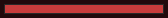

<!-- nav -->
[Mod Framework](../../README.md) › [UI components](README.md) › [Your own drawing](README.md#your-own-drawing)
<!-- /nav -->

# Drawn

`UI::Drawn` is a component that draws itself, for a look no part has, such as a bar drawn by hand.
A class `< UI::Drawn` declares params and state like any component and, instead of `render`:

- `measure(width, height)` answers its width and height for the room its parent gives (`nil`
  before the first layout); a side `nil` takes what the layout gives. It is asked again whenever it
  renders or that room changes.
- `draw(bitmap, rect)` draws on the game's picture inside `rect`, its place there. Other parts
  share the picture, so draw only inside `rect`.
- `role` tells how the keys and the pointer treat it: `:none` (the default) passes them over;
  `:button` is a key stop that confirm or a click presses, which calls its `pressed`; `:slider` is
  a key stop whose `places` Left and Right step through from its `place`, which calls `moved(place)`.

It draws again whenever it would render again: when its state changes or the caller gives it new
params. Read the game's values in the caller's render, such as `UI::Game.hp_rate`, and hand them in
as params, so it draws again as they change. A `draw` that fails is logged once with your file and
line.

## Examples

### An HP bar drawn by hand

<!-- example: drawn-hp-bar -->
```ruby
class HpBar < UI::Drawn
  param :rate, 1.0

  def measure(width, height)
    [width, 10]
  end

  def draw(bitmap, rect)
    bitmap.fill_rect(rect, Color.new(40, 40, 40))
    bitmap.fill_rect(rect.x + 1, rect.y + 1, ((rect.width - 2) * rate).round, rect.height - 2, Color.new(200, 60, 60))
  end
end
# In render:
hp_bar rate: UI::Game.hp_rate(UI::Game.leader), width: 160
```


### A part the player presses

```ruby
class RestButton < UI::Drawn
  event :rest

  def measure(width, height)
    [64, 24]
  end

  def role
    :button
  end

  def pressed
    emit :rest
  end
end
```

`rest_button on_rest: -> { rest_party }` then takes confirm and a click like a button.

<!-- nav -->
---

← [Toast](toast.md) · [All components](README.md) · [List](list.md) →
<!-- /nav -->
