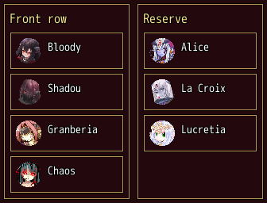

<!-- nav -->
[Mod Framework](../../README.md) › [UI components](README.md) › [Layout](README.md#layout)
<!-- /nav -->

# Drop zone

`drop_zone` is a framed area of items the player drags into the other drop zones of its
`drop_container`, as MudBlazor's drop zone and drop container. Each zone takes its `items:` and a
block that shows one item; without a block the item's name shows. The container tells `on_drop`
the item, the zone it came from, the zone it goes to and its place there, counted from 0 among that
zone's other items. Move the item there in your own data; the zones show it there on the next
render.

- With the keys or a pad: confirm on an item picks it up. Up and Down move it along its zone, and
  past the zone's first or last place into the zone before or after; Left and Right move it to the
  zone beside. A line in the theme's primary color marks where it would go. Confirm puts it down;
  cancel puts it back.
- With the mouse: drag an item and let go over a zone. Let go anywhere else and it goes back.
- `row: true` lays a zone's items side by side; Left and Right then move an item along it, and Up
  and Down to the zone before or after.

## Examples

### The party's formation

<!-- example: drop_zone-formation -->
```ruby
drop_container on_drop: ->(actor, from, to, place) { move(actor, to, place) } do
  stack row: true do
    drop_zone :front, title: "Front row", items: front, width: 160 do |actor|
      stack row: true do
        avatar character: actor, size: :small
        text actor.name
      end
    end
    drop_zone :reserve, title: "Reserve", items: reserve, width: 160 do |actor|
      stack row: true do
        avatar character: actor, size: :small
        text actor.name
      end
    end
  end
end
```


The component around it keeps the two rows and moves a member:

```ruby
class Formation < UI::Component
  state(:front) { $game_party.battle_members }
  state(:reserve) { $game_party.members - $game_party.battle_members }

  def move(actor, to, place)
    rows = { :front => front - [actor], :reserve => reserve - [actor] }
    rows[to].insert(place, actor)
    self.front = rows[:front]
    self.reserve = rows[:reserve]
  end
end
```

It changes only what the window shows; the game's own formation screen stays as it is.

## Params, events and keys

Every part also takes [the params every part takes](README.md#params-every-part-takes).

<!-- generated: drop_container -->
Drop zones between which the player drags their items, as MudBlazor's drop container, such as a front row and a reserve of the party.

Written `drop_container ...` with a `do ... end` block of markup.

| Event | Tells |
|---|---|
| `on_drop` | the item, the zone it came from, the zone it goes to and its place there, from 0 among that zone's other items; move it there in your data, which shows it there |

**Keys:** confirm on an item picks it up; the arrows move it along its zone and past the zone's ends, or across, into the zone before or after; confirm puts it down, cancel puts it back

**Pad:** as the keys

**Mouse:** drag an item and let go over a zone; let go elsewhere and it goes back
<!-- /generated -->

<!-- generated: drop_zone -->
A framed area of items the player drags into other drop zones of its drop_container, as MudBlazor's drop zone; its block shows one item, which it takes, else the item's name shows.

Written `drop_zone zone, ...` with a `do ... end` block of markup.

| Param | Takes | Default | Live | About |
|---|---|---|---|---|
| `zone:` | any value |  |  | what the zone is, which on_drop tells, such as :front |
| `title:` | a text |  |  | the title at its top, such as "Front row" |
| `items:` | an Array | `[]` |  | its items, in order, such as the members of the front row |
| `row:` | true, false | `false` |  | its items side by side; Left and Right then move an item along it, Up and Down to the zone before or after |
<!-- /generated -->

<!-- nav -->
---

← [Card](card.md) · [All components](README.md) · [Aside](aside.md) →
<!-- /nav -->
