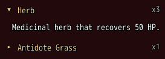
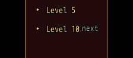

<!-- nav -->
[Mod Framework](../../README.md) › [UI components](README.md) › [Layout](README.md#layout)
<!-- /nav -->

# Expansion panels

`expansion_panels` lays panels under each other whose titles fold them open and shut, such as the
parts of a long text or what each level of a job brings. Each `expansion_panel` has a title, a note
at the title's right and the parts it shows while open. Up and Down step the titles and the parts of
the open panels; confirm or a click on a title folds its panel.

## Examples

### Several open

<!-- example: expansion_panels-multi -->
```ruby
expansion_panels do
  expansion_panel "Herb", note: "x3", open: true do
    text "Medicinal herb that recovers 50 HP.", wrap: true
  end
  expansion_panel "Antidote Grass", note: "x1" do
    text "Cures poison."
  end
end
```


`open:` opens a panel as it turns true and shuts it as it turns false; between, the player folds
it.

### One at a time

<!-- example: expansion_panels-single -->
```ruby
expansion_panels multi: false do
  expansion_panel "Level 5", bind: :level_5_open, on_fold: ->(open) { say("Level 5 #{open ? 'opened' : 'shut'}") } do
    text "Warrior learns Power Charge."
  end
  expansion_panel "Level 10", note: "next" do
    text "Warrior learns Falcon Slash."
  end
end
```


With `multi: false` a panel that opens shuts the others, and each of them tells `on_fold(false)`.
`bind:` holds whether a panel is open, both ways.

## Params, events and keys

Every part also takes [the params every part takes](README.md#params-every-part-takes).

<!-- generated: expansion_panels -->
Panels under each other that their titles fold open and shut, such as the parts of a long text; with multi: false one is open at a time.

Written `expansion_panels ...` with a `do ... end` block of markup.

| Param | Takes | Default | Live | About |
|---|---|---|---|---|
| `multi:` | true, false | `true` |  | several may be open; false shuts the others as one opens |
| `spacing:` | `0`, `1`, `2`, `3`, `4`, `5`, `6` | `1` |  | room between two panels, 4 px a unit |

**Keys:** Up and Down step the titles and the parts of the open panels; confirm on a title folds its panel

**Pad:** as the keys

**Mouse:** a click on a title folds its panel

**Places:** each `expansion_panel` by its id
<!-- /generated -->

### Expansion panel

<!-- generated: expansion_panel -->
One panel of expansion_panels: a title that folds it, and the parts it shows while open.

Written `expansion_panel title, ...` with a `do ... end` block of markup.
It goes inside `expansion_panels`.

| Param | Takes | Default | Live | About |
|---|---|---|---|---|
| `title:` | a text |  | yes | its title, after the mark of whether it is open |
| `note:` | a text |  | yes | a short dim text at its title's right, such as "3 left" |
| `open:` | true, false | `false` |  | it opens as this turns true and shuts as it turns false; the player folds it between |
| `bind:` | the name of a state |  |  | a state that holds whether it is open, both ways, instead of open: |

| Event | Tells |
|---|---|
| `on_fold` | whether it is open now, as the player folded it, or as another opened while its panels hold one at a time |
<!-- /generated -->

<!-- nav -->
---

← [Group](group.md) · [All components](README.md) · [Tabs](tabs.md) →
<!-- /nav -->
