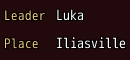
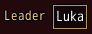

<!-- nav -->
[Mod Framework](../../README.md) › [UI components](README.md) › [Display](README.md#display)
<!-- /nav -->

# Field

`field` is a value with its caption before it, which the player reads but does not change, such as
who leads a party. The caption stands small in the theme's system color; what the field holds
follows it.

## Examples

### Captions that line up

<!-- example: field-captions -->
```ruby
field "Leader", caption_width: ["Leader", "Place"] do
  text "Luka"
end
field "Place", caption_width: ["Leader", "Place"] do
  text "Iliasville"
end
```


`caption_width:` takes pixels, or the captions that should line up, of which the widest sets the
width.

### On a plate

<!-- example: field-plate -->
```ruby
field "Leader", plate: true do
  text "Luka"
end
```


With `plate: true` the value lies on the darker plate a text field has, so read-only values line up
with the fields of a form.

## Params, events and keys

Every part also takes [the params every part takes](README.md#params-every-part-takes).

<!-- generated: field -->
A value with its caption before it, which the player reads but does not change, such as who leads the party.

Written `field label, ...` with a `do ... end` block of markup.

| Param | Takes | Default | Live | About |
|---|---|---|---|---|
| `label:` | a text |  | yes | its caption, small in the theme's system color |
| `caption_width:` | pixels, or an Array of texts of which the widest sets it |  |  | the caption's width: pixels, or the captions that should line up, of which the widest sets it |
| `plate:` | true, false | `false` |  | the value lies on the darker plate a text field has, so it lines up with the fields of a form |

**Keys:** none of its own

**Mouse:** none of its own
<!-- /generated -->

<!-- nav -->
---

← [Text](text.md) · [All components](README.md) · [Image](image.md) →
<!-- /nav -->
