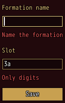
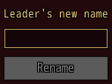
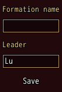

<!-- nav -->
[Mod Framework](../../README.md) › [UI components](README.md) › [Buttons and forms](README.md#buttons-and-forms)
<!-- /nav -->

# Form

`form` holds inputs that are sent together, such as the name of a party formation to save. Every
input takes `required:` and `validate:`, inside a form or not; an input with either shows its error
under it, in the theme's error color, as MudBlazor's inputs do.

- `required: true` makes an empty value an error: an empty text, nothing picked, an unticked box.
  The error says "Required", or the text `required:` gives instead.
- `validate:` is a lambda of the input's value that answers the error to show, or nil while the
  value is fine.
- The player sends the form with confirm in its last input that confirms (a text field or a numeric
  field), or with a button whose `on_click:` is `:submit`. Confirm in an earlier one moves on to
  the next of them.
- Sending checks every input and shows each error. With none, `on_submit` hears it; otherwise the
  buzzer plays and the first input with an error takes the focus.

Inputs that are hidden or disabled do not count.

## Examples

### A formation to save

<!-- example: form-formation -->
```ruby
form on_submit: -> { save_formation } do
  text_field "Formation name", bind: :name, required: "Name the formation"
  text_field "Slot", bind: :slot, validate: ->(slot) { "Only digits" if slot =~ /\D/ }
  button "Save", variant: :filled, on_click: :submit
end
```


### A button that waits for the form

<!-- example: form-valid -->
```ruby
form bind_valid: :ready, on_submit: -> { $game_party.leader.name = name } do
  text_field "Leader's new name", bind: :name, required: true
  button "Rename", variant: :filled, disabled: !ready, on_click: :submit
end
```


`bind_valid:` names a state the form writes whether every input in it is fine now, without showing
the errors, so a button can stay off until then.

### Errors only as it is sent

<!-- example: form-submit -->
```ruby
form validate_on: :submit, on_submit: -> { save_formation } do
  text_field "Formation name", bind: :name, required: true
  text_field "Leader", bind: :leader, validate: ->(leader) { "Too short" if leader.size < 3 }
  button "Save", on_click: :submit
end
```


With `validate_on: :submit` the errors show only as the form is sent, not while the player types.

## Params, events and keys

Every part also takes [the params every part takes](README.md#params-every-part-takes).

<!-- generated: form -->
Inputs that are sent together: each checks its required: and validate: and shows its error under it, and the form tells on_submit only once all of them are fine.

Written `form ...` with a `do ... end` block of markup.

| Param | Takes | Default | Live | About |
|---|---|---|---|---|
| `bind_valid:` | the name of a state |  |  | a state the form writes whether every input in it is fine now, such as to turn a button off |
| `validate_on:` | `:change`, `:submit` | `:change` |  | :change checks an input and shows its error as the player changes it; :submit only as the form is sent |
| `spacing:` | `0`, `1`, `2`, `3`, `4`, `5`, `6` | `2` |  | room between its parts, 4 px a unit |

| Event | Tells |
|---|---|
| `on_submit` | nothing; the player sent the form and every input in it is fine |

**Keys:** confirm in its last input that confirms (a text field or a numeric field) sends it, as does a button with on_click: :submit; confirm in another of those moves on to the next of them; an input with an error stops the sending with the buzzer and takes the focus

**Pad:** as the keys

**Mouse:** a click on a button with on_click: :submit sends it
<!-- /generated -->

<!-- nav -->
---

← [Toggle group](toggle_group.md) · [All components](README.md) · [Select](select.md) →
<!-- /nav -->
