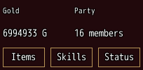
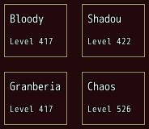
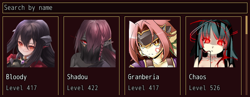

<!-- nav -->
[Mod Framework](../../README.md) › [UI components](README.md) › [Layout](README.md#layout)
<!-- /nav -->

# Grid

`grid` lays its items side by side in twelve columns, as MudBlazor's grid. Each `grid_item` spans its
`xs:` of them: `xs: 6` takes half a row, `xs: 4` a third, `xs: 3` a quarter. An item that no longer
fits a row starts the next, and the items of a row are as high as its tallest. The columns share
the grid's width, so the items keep their shares as the window gets wider or narrower.

- The arrows move between the items: Left and Right along the lines, Up and Down to the item in the
  line above or below that spans the column where the focused item starts. Out of the grid's first
  or last line, Up and Down go to the part above or below; from there back into the grid they land
  on its item nearest across.
- A grid of cards (or papers) wraps like a list: a fresh press at an edge goes to the other end, Up
  and Down in the same column, Right on the last card to the first; a held arrow stops there. The
  jump key held with an arrow leaves the grid. With `leave_ends: true` Up on its first line and Down
  on its last move the focus to the part above or below instead, such as a search field over the
  cards; Left and Right still wrap.
- `spacing:` is the room between the items, across and down, from the theme's spacing as in a
  `stack`.

## Examples

### Halves and thirds

<!-- example: grid-spans -->
```ruby
grid do
  grid_item xs: 6 do
    text "Gold", typo: :caption
    text "#{UI::Game.gold} G"
  end
  grid_item xs: 6 do
    text "Party", typo: :caption
    text "#{UI::Game.members.size} members"
  end
  grid_item(xs: 4) { button "Items", variant: :outlined, on_click: -> { SceneManager.call(Scene_Item) } }
  grid_item(xs: 4) { button "Skills", variant: :outlined, on_click: -> { SceneManager.call(Scene_Skill) } }
  grid_item(xs: 4) { button "Status", variant: :outlined, on_click: -> { SceneManager.call(Scene_Status) } }
end
```


### Boxes with more room between

<!-- example: grid-spacing -->
```ruby
grid spacing: 4 do
  $game_party.battle_members.each do |actor|
    grid_item xs: 6, key: actor.id do
      paper do
        text actor.name
        text "Level #{UI::Game.level(actor)}", typo: :caption
      end
    end
  end
end
```


### Cards that scroll under a search

<!-- example: grid-scroll -->
```ruby
text_field bind: :search, placeholder: "Search by name"
paper scroll: :vertical, border: false, padding: 0, height: :fill do
  grid leave_ends: true do
    $game_party.members.select { |actor| actor.name.include?(search) }.each do |actor|
      grid_item xs: 3, key: actor.id do
        card clickable: true, on_click: -> { pick(actor) } do
          card_media face: actor, height: 96, fit: :contain
          card_header actor.name, subtitle: "Level #{UI::Game.level(actor)}"
        end
      end
    end
  end
end
```


As many cards show as the room holds; the rest scroll. A `paper` with `scroll: :vertical`,
`border: false` and `padding: 0` is a plain area that scrolls: it follows the focus from card to
card, takes the wheel and shows a scrollbar, and its cards stay whole parts that hold anything. With
`leave_ends: true` Up on the first line goes to the search field.

## Params, events and keys

Every part also takes [the params every part takes](README.md#params-every-part-takes).

<!-- generated: grid -->
Items side by side in a grid of twelve columns, as MudBlazor's grid: each item spans its xs: of them, and an item that no longer fits a row starts the next.

Written `grid ...` with a `do ... end` block of markup.

| Param | Takes | Default | Live | About |
|---|---|---|---|---|
| `spacing:` | `0`, `0.5`, `1`, `1.5`, `2`, `2.5`, `3`, `3.5`, `4`, `4.5`, `5`, `5.5`, `6` | `2` |  | room between its items, across and down, 4 px a unit, also half a unit such as 2.5 |
| `leave_ends:` | true, false | `false` |  | in a grid of cards, Up on its first line and Down on its last move the focus to the part above or below instead of wrapping, such as a search field over the cards; Left and Right still wrap |

**Keys:** the arrows move between the items, Up and Down to the item in the line above or below that spans the column where the focused item starts, out of the first or last line to the part above or below; in a grid of cards a fresh press at an edge wraps to the other end, a held arrow stops there

**Pad:** as the keys

**Mouse:** as its parts
<!-- /generated -->

<!-- generated: grid_item -->
One item of a grid, its parts in a column, as MudBlazor's item.

Written `grid_item ...` with a `do ... end` block of markup.
It goes inside `grid`.

| Param | Takes | Default | Live | About |
|---|---|---|---|---|
| `xs:` | `1`, `2`, `3`, `4`, `5`, `6`, `7`, `8`, `9`, `10`, `11`, `12` | `12` |  | how many of the grid's twelve columns it spans: 12 the whole row, 6 half of it, 4 a third, 3 a quarter |
<!-- /generated -->

<!-- nav -->
---

← [Container](container.md) · [All components](README.md) · [Paper](paper.md) →
<!-- /nav -->
