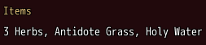
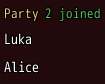

<!-- nav -->
[Mod Framework](../../README.md) › [UI components](README.md) › [Layout](README.md#layout)
<!-- /nav -->

# Group

`group` is a titled section of a column, such as the fields of a form that belong together or a
panel of details. Its title stands small in the theme's system color, and a short note may stand at
the title's right end. It draws no frame; use a [paper](paper.md) for one.

## Examples

### A titled section

<!-- example: group-title -->
```ruby
group "Items" do
  text "3 Herbs, Antidote Grass, Holy Water"
end
```


### A note beside the title

<!-- example: group-note -->
```ruby
group "Party", note: -> { "#{members.size} joined" }, note_color: :success do
  members.each { |member| text member, key: member }
end
```


## Params, events and keys

Every part also takes [the params every part takes](README.md#params-every-part-takes).

<!-- generated: group -->
A titled section of a column, such as the fields of a form that belong together, with a note at the right of its title.

Written `group title, ...` with a `do ... end` block of markup.

| Param | Takes | Default | Live | About |
|---|---|---|---|---|
| `title:` | a text |  | yes | its title |
| `title_color:` | a color name such as :primary or :rainbow, "#RRGGBB", [r, g, b] or a game text color such as 2 | `:system` |  | its title's color |
| `size:` | `:tiny`, `:small`, `:medium` | `:small` |  | the size of its title; its note is small, tiny under a tiny title |
| `dense:` | true, false | `false` |  | its title in a lower row: 14, 18 or 22 pixels high by its size |
| `note:` | a text |  | yes | a short text at the right of its title, such as "5 joined" |
| `note_color:` | a color name such as :primary or :rainbow, "#RRGGBB", [r, g, b] or a game text color such as 2 | `:dim` |  | the note's color |
| `spacing:` | `0`, `1`, `2`, `3`, `4`, `5`, `6` | `1` |  | room between its parts, 4 px a unit |

**Keys:** none of its own

**Mouse:** none of its own
<!-- /generated -->

<!-- nav -->
---

← [Drawer](drawer.md) · [All components](README.md) · [Expansion panels](expansion_panels.md) →
<!-- /nav -->
