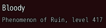
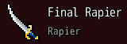
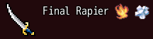
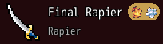
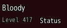
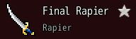
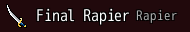

<!-- nav -->
[Mod Framework](../../README.md) › [UI components](README.md) › [Display](README.md#display)
<!-- /nav -->

# Header

`header` heads what follows, such as an item or a party member: an icon, a large title in a color
of its own, marks after the title, each with its tooltip, and a small line under the title. Parts
given as `note:` go after that line, such as a button, and a part given as `trailing:` goes at the
end of the title's row, such as a star; a part given as `title_after:` goes right after the title,
such as a chip. `dense: true` puts everything in one row.

## Examples

### A party member

<!-- example: header-member -->
```ruby
header actor.name, subtitle: "#{actor.class.name}, level #{actor.base_level}"
```


### An item with its icon and color

<!-- example: header-item -->
```ruby
header item.name, icon: item.icon_index, title_color: UI::Game.item_color(item), subtitle: UI::Game.type_name(item)
```


`title_color:` takes the game's text colors by their number too, as `\C[2]` numbers them.

### Marks after the title

<!-- example: header-marks -->
```ruby
header item.name, icon: item.icon_index, marks: [3, 4].map { |element| { icon: UI::Game.element_icon(element), tooltip: UI::Game.element_name(element) } }
```


### A chip right after the title

<!-- example: header-title-after -->
```ruby
header item.name, icon: item.icon_index, subtitle: UI::Game.type_name(item),
                  title_after: -> { chip_set { chip icons: [3, 4].map { |element| UI::Game.element_icon(element) } } }
```


`title_after:` takes markup, which goes right after the title and its marks, in one row too.

### A button after the line

<!-- example: header-note -->
```ruby
header actor.name, subtitle: "Level #{actor.base_level}", note: -> { button "Status", variant: :text, on_click: -> { toast actor.name } }
```


`note:` takes markup, which goes after the line under the title; a text, such as `note: "Leader"`,
is one line of text. A click on the icon or the title tells `on_click`.

### A star at the end of the title's row

<!-- example: header-trailing -->
```ruby
header item.name, icon: item.icon_index, subtitle: UI::Game.type_name(item), trailing: -> { icon UI::Game.favorite_icon, tooltip: "Favorite" }
```


`trailing:` takes markup, which goes at the end of the title's row; in one row it follows the line.

### In one row

<!-- example: header-dense -->
```ruby
header item.name, icon: item.icon_index, subtitle: UI::Game.type_name(item), dense: true
```


## Params, events and keys

Every part also takes [the params every part takes](README.md#params-every-part-takes).

<!-- generated: header -->
A head over what follows, such as an item's or a party member's: an icon, a large title in a color of its own, marks after the title and a small line under it.

Written `header title, ...`.

| Param | Takes | Default | Live | About |
|---|---|---|---|---|
| `title:` | a text |  |  | what it says, large |
| `title_color:` | a color name such as :primary or :rainbow, "#RRGGBB", [r, g, b] or a game text color such as 2 |  |  | the title's color; the plain text color without it |
| `icon:` | an IconSet index, a name UI.icon gave one, or { file: "Graphics/Pictures/x" } |  |  | an icon before the title, twice an icon's size; given as nil, its room stays empty, such as for an empty slot |
| `subtitle:` | a text |  |  | a small line under the title |
| `subtitle_color:` | a color name such as :primary or :rainbow, "#RRGGBB", [r, g, b] or a game text color such as 2 | `:dim` |  | the subtitle's color |
| `marks:` | an Array | `[]` |  | icons after the title, each { icon:, tooltip: }, such as the elements a weapon strikes with |
| `title_after:` | markup as a lambda, or a text for one line |  |  | parts right after the title and its marks, such as a chip of the elements a weapon strikes with |
| `dense:` | true, false | `false` |  | one row of a line's height: an icon of an icon's size, the title and the subtitle after it |
| `note:` | markup as a lambda, or a text for one line |  |  | parts after the subtitle, such as a Details button |
| `trailing:` | markup as a lambda, or a text for one line |  |  | a small part at the end of the title's row, such as a star that marks a favorite; dense, it follows the subtitle |

| Event | Tells |
|---|---|
| `on_click` | nothing; its icon or its title was clicked |

**Keys:** none of its own

**Mouse:** a mark names itself in its tooltip; a click tells on_click

**Places:** `title_after`, the parts right after the title; `note`, the parts after the subtitle; `trailing`, the part at the end of the title's row
<!-- /generated -->

<!-- nav -->
---

← [Help line](help_line.md) · [All components](README.md) · [Slot row](slot_row.md) →
<!-- /nav -->
