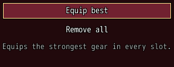
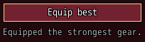
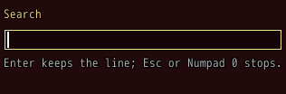

<!-- nav -->
[Mod Framework](../../README.md) › [UI components](README.md) › [Display](README.md#display)
<!-- /nav -->

# Help line

`help_line` is a small dim line that tells what the part the player is on does. It shows, in this
order:

1. what its `say` said last, until the focus moves;
2. while a text field of its window types, the field's `typing_help:`;
3. the `help:` of the part under the pointer;
4. the `help:` of the focused part, or of the nearest part holding it.

Every part takes `help:`, so the line needs no code beyond that. A text too long for its `lines:`
ends in "..." and shows whole as its tooltip.

## Examples

### What the focused part does

<!-- example: help_line-focus -->
```ruby
button "Equip best", help: "Equips the strongest gear in every slot.", on_click: -> { equip_best }
button "Remove all", help: "Takes off all gear.", on_click: -> { remove_all }
help_line
```


### Saying what just happened

<!-- example: help_line-say -->
```ruby
button "Equip best", on_click: -> { equip_best; part(:help).say("Equipped the strongest gear.") }
help_line id: :help, lines: 1
```


`say` keeps its text until the focus moves. Said right after a part took the focus, it keeps it
until the focus leaves that part. `say(nil)` clears it.

### While a field types

<!-- example: help_line-typing -->
```ruby
text_field "Search", bind: :search, help: "Finds an item by its name.", typing_help: "Enter keeps the line; Esc or Numpad 0 stops."
help_line
```


## Params, events and keys

Every part also takes [the params every part takes](README.md#params-every-part-takes).

<!-- generated: help_line -->
A small dim line that tells what the part the player is on does: what say said last, else the typing_help: of a text field of its window while it types, else the help: of the part under the pointer, else the help: of the focused part or the nearest part holding it.

Written `help_line ...`.

| Param | Takes | Default | Live | About |
|---|---|---|---|---|
| `lines:` | a whole number | `2` |  | the most lines it wraps to; the last ends in ... and the whole text becomes its tooltip |

| Call on `part(:id)` | Does |
|---|---|
| `say(text)` | says a text, such as what just happened, until the focus moves; said right after a part took the focus, until the focus leaves that part; nil clears it |

**Keys:** none

**Mouse:** none
<!-- /generated -->

<!-- nav -->
---

← [Key help](key_help.md) · [All components](README.md) · [Header](header.md) →
<!-- /nav -->
