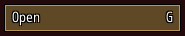
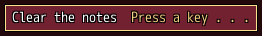

<!-- nav -->
[Mod Framework](../../README.md) › [UI components](README.md) › [Buttons and forms](README.md#buttons-and-forms)
<!-- /nav -->

# Hotkey field

`hotkey_field` lets the player bind a hotkey to another key, as Options > Mods does. It shows the
hotkey's name at its start and its key at its end. Confirm or a click makes it wait for the next
key the player presses; that key binds once it is let go.

While it waits, every other key and every hotkey stays quiet. Esc, Numpad 0, a key bound to the
game's cancel (X unless F1 binds another), the gamepad's B or a click outside the field keep the
old key. A key one of the game's buttons has, a key the game or the framework reads itself (such as
the arrows, F1, Tab, Home, End and the left Alt), or one another hotkey has, is refused with the
buzzer, and the field says why until another key is pressed. Keys let go together, such as Ctrl
and K, bind nothing.

No hotkey sits on one of the framework's own keys: `Mod_Framework::Hotkeys.define` refuses such a
default, and a key kept there from an older binding gives way to the hotkey's default. Where that
default, or any kept key, is another hotkey's, the hotkey stays unbound until the player binds it.

## Examples

### A hotkey to bind

<!-- example: hotkey_field-plain -->
```ruby
# Once, as the mod loads:
Mod_Framework::Hotkeys.define(:camp_notes_open, :key => "G", :name => "[Camp Notes] Open")

# In render:
hotkey_field :camp_notes_open
```


### Waiting for a key

<!-- example: hotkey_field-waiting -->
```ruby
# Once, as the mod loads:
Mod_Framework::Hotkeys.define(:camp_notes_clear, :key => "M", :name => "[Camp Notes] Clear")

# In render:
hotkey_field :camp_notes_clear, text: "Clear the notes", on_change: ->(key) { say("Clear is on #{key}") }
```


`text:` names the hotkey in the field; `on_change` gets the name of the key bound, such as "F5".

## Params, events and keys

Every part also takes [the params every part takes](README.md#params-every-part-takes).

<!-- generated: hotkey_field -->
A field the player presses to bind one of the hotkeys mods define to another key, as Options > Mods does: the hotkey's name at its start and its key at its end.

Written `hotkey_field hotkey, ...`.

| Param | Takes | Default | Live | About |
|---|---|---|---|---|
| `label:` | a text |  | yes | a caption above it, as MudBlazor draws an input's label |
| `hotkey:` | the name of a hotkey of Mod_Framework::Hotkeys |  |  | the hotkey it binds, as Mod_Framework::Hotkeys.define named it |
| `text:` | a text |  | yes | the name at its start; the hotkey's own name without its group by default |

| Event | Tells |
|---|---|
| `on_change` | the name of the key the player bound, such as "F5" |

**Keys:** confirm waits for one key: a free key binds as it is let go, unless another key was held with it; Esc, Numpad 0 or a key bound to cancel keeps the old key; a key one of the game's buttons, the game, the framework or another hotkey has is refused with the buzzer, the field says why and waits on; while it waits, every other key and every hotkey stays quiet

**Pad:** A waits for a key; B keeps the old one

**Mouse:** a click waits for a key; a click outside it keeps the old one
<!-- /generated -->

<!-- nav -->
---

← [Select](select.md) · [All components](README.md) · [Options list](options_list.md) →
<!-- /nav -->
