<!-- nav -->
[Mod Framework](../../README.md) › [UI components](README.md) › [Roots](README.md#roots)
<!-- /nav -->

# HUD

`hud` is a box over the map or the battle that never takes the keys, such as a gold counter or the
name of the map. Cancel, the arrows and confirm stay the game's. Show the component whose `render`
describes it with `UI.show`.

It fades in and out as it shows and hides (`fade: false` turns that off; `enter:`, `leave:` and
`motion_frames:` say how and how fast, see [a box of a battle line](#a-box-of-a-battle-line)), and the pointer passes
through it but on its buttons and the parts that show a tooltip. The HUD parts of one zone stack
away from its edge; `UI.room(:top_left)` tells the pixels they take, for a game window of
your own that keeps clear of them. `UI.room(:top)` counts the HUD parts stacked at the top
and the strips docked along the top edge, so a mod can move a bar of the game's own, such as the
boss's HP bar in battle, below them: `bar.y = UI.room(:top) + 4`. A part the player moved
elsewhere no longer counts, and the top corners count apart (`:top_left`, `:top_right`). The HUDs
of a column a mod defines stack down from a spot of its own, see
[a column of boxes](#a-column-of-boxes).

## Without a class

A HUD without state or methods of its own needs no class: `UI.show` takes its render as a block.
Once it needs state or methods of its own, make it a class.

```ruby
UI.show do
  hud anchor: :top_right do
    text -> { "#{UI::Game.gold} G" }
  end
end
```

## Examples

### In a corner

<!-- example: hud-corner -->
```ruby
hud anchor: :top_right do
  text -> { "#{UI::Game.gold} G" }
end
```
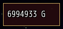

### Above the game's windows

<!-- example: hud-over -->
```ruby
hud anchor: :bottom, layer: :over do
  text "Hold A to skip messages"
end
```
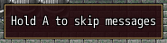

### Above every window

<!-- example: hud-notices -->
```ruby
hud anchor: :top_right, layer: :notices, min_size: [160, 32] do
  text "Saved to slot 3"
end
```
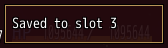

`layer: :notices` puts the box where the framework's notices lie: above every window, dialog and
menu, also the game's, such as a line that must stay in sight while the menu is open. In a zone too
full for its parts it shrinks to its `min_size:` before any part there hides.

### Without a frame

<!-- example: hud-frameless -->
```ruby
hud anchor: :bottom_left, frame: false, width: 160 do
  alert "Saved to slot 3", severity: :success
end
```
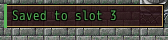

`frame: false` leaves out the box's frame and background, so only what it holds shows, such as
an alert, which has a plate of its own and takes the width it is given. The framework's toasts
are such boxes.

### A strip along an edge

<!-- example: hud-strip -->
```ruby
hud dock: :top do
  text "Iliasville", typo: :subtitle1
end
```
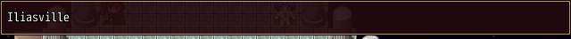

### A height that eases

<!-- example: hud-ease -->
```ruby
hud dock: :top do
  stack tail: true, height: small ? 36 : 86 do
    text "Alma Elma", typo: :subtitle2
    text "Queen Succubus, one of the Four Heavenly Knights", typo: :caption
    progress value: 68, label: "HP"
  end
end
```
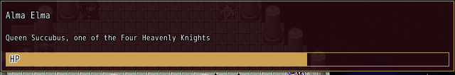

A part of a HUD whose `height:` changes from one number of pixels to another eases there over a
few frames, so the HUD and the parts docked beside it slide along instead of jumping; with
Animations off it takes the new height at once. Here the strip turns small: `tail: true` keeps
its newest rows, so the bar stays and the title gives way.

### Sliding in

<!-- example: hud-slide -->
```ruby
hud anchor: :top_left, enter: :slide, hide_while: -> { $game_player.moving? } do
  text UI::Game.map_name, typo: :subtitle1
end
```
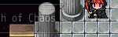

`enter: :slide` slides the HUD in from beyond the screen's edge at its zone as it fades in, and
out there again as it hides or closes, as a toast does: a zone at the left from the left, one at
the right from the right, the top from above, the bottom and the center from below, and a HUD at
a spot from the edge nearest it. It slides over the frames it fades, so with `fade: false` or
Animations off it shows and hides at once.

### A box of a battle line

<!-- example: hud-plate -->
```ruby
leader = UI::Game.leader
hud at: -> { [8, line_top] }, width: 288, enter: :move, leave: :fade, motion_frames: [15, 30],
    background: { color: [0, 0, 0, 170], fade: [:right, 48] }, border: false, padding: 2 do
  stack row: true do
    avatar face: [leader.face_name, leader.face_index], shape: :box, background: false
    stack spacing: 0, grow: 1 do
      text leader.name, color: [120, 220, 120], typo: :body2, line_height: 18
      text "Stand back, I will take this one!", typo: :body2, line_height: 18, wrap: true
    end
  end
end
```
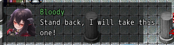

A battle message box: a plain see-through plate whose last 48 px thin out toward the battle, the
speaker's face from its face file, and lines 18 px apart.

- `enter:` is how the HUD comes, `leave:` how it goes, by default the way it came: `:fade`,
  `:slide` (slides while it fades) or `:move` (slides without fading). Here it slides in opaque and
  fades out in place.
- `motion_frames:` is how many frames each takes, one number for both or `[in, out]`; 12 by
  default. The slide eases out as it comes and in as it goes; the fade counts up as it comes and
  down in whole steps as it goes.
- `at:` given as a lambda is read every frame: the HUD jumps to a new spot the frame the answer
  changes, without a motion between the spots, and one still sliding in keeps sliding at the new
  spot. A HUD at a spot slides from the screen's edge nearest it, so a box at the right comes from
  the right.
- The handle `UI.show` answers takes it off with `hide`, after its `leave:`, or with
  `hide(at_once: true)` in the same frame, also a box still fading out after a `hide`, such as
  every box at a battle's end.

### A column of boxes

A mod defines a column once, as it loads, and each box joins it with `column:`:

```ruby
UI.column :battle_left, at: [8, 88], gap: 8
```

<!-- example: hud-column -->
```ruby
hud column: :battle_left, id: :luka_line, width: 288, enter: :move, leave: :fade,
    background: [0, 0, 0, 170], border: false, padding: 2 do
  text "Luka", color: [120, 220, 120], typo: :body2
  text "Stand back, I will take this one!", typo: :body2, wrap: true
end
```
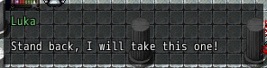

- The column stacks its boxes down from `at:`, each by the height its layout gives it plus `gap:`
  pixels, so the mod never measures a box. The newest lies on top; the others jump down by its
  height and the gap the frame it comes, without sliding, while it comes as its `enter:` says.
- A box that leaves, by `hide` or while its `hide_while:` answers true, keeps its place until its
  `leave:` ends; then the boxes below close up at once.
- `align:` says which edge of each box lies at the spot's x: `:left` (the default), `:right`, or
  `:center` for its middle, such as a strip at the top whose width the mod does not know:
  `UI.column :battle_top, at: [Graphics.width / 2, 52], gap: 2, align: :center`. A box slides in
  from the side its column lines up on.
- A box in a column leaves its `anchor:`, `dock:` and `at:` aside and does not move with Alt. One
  naming a column no `UI.column` defined shows at its own place, and the log says so; it joins the
  column once a `UI.column` defines it.
- Defining a column again, such as at another spot when the screen changes, moves the boxes shown
  in it there at once.
- Give each box an `id:` of its own: `UI.show` brings a shown box of the same id forward instead of
  showing another.

### Out of the way of a message

`hide_while:` is asked every frame. `:top_message` hides the box while the game's message shows at
the top of the screen, where it would cover the box; a lambda hides it while it answers true.

<!-- example: hud-top-message -->
```ruby
hud anchor: :top_left, hide_while: :top_message do
  text "Luka  Lv 30"
end
```
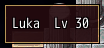

### A line the pointer passes through

<!-- example: hud-info -->
```ruby
hud anchor: :bottom_left, mouse: :none do
  text "Found 3 Herbs."
end
```
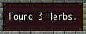

### Over a character's head

With `follow:` the box stays beside a map character: `:player`, an event, or an event's id on this
map. It lies over the head (`side: :top`), under the feet (`:bottom`) or on the character
(`:middle`), above the map's pictures, and hides while the character is gone or see-through. Boxes
that follow one tile stack upward.

<!-- example: hud-follow -->
```ruby
hud follow: :player, side: :top do
  text "Luka", plate: true
end
```
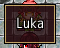

### Over the map behind a menu

<!-- example: hud-behind-menu -->
```ruby
hud follow: :player, side: :top, shown_in: [Scene_Map, Scene_Menu], mouse: :none do
  text "Luka", plate: true
end
```
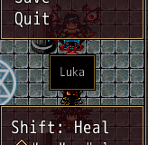

Where a scene draws the map on behind its windows, such as a menu over a map that goes on moving,
a box that follows a character shows there too once `shown_in:` names that scene. It lies on the
viewport of the character's sprite on that map, under the menu's windows, so a tone the scene puts
on that map tints the box too. Where the scene draws no such map, the character shows nowhere and
the box hides.

## Params, events and keys

Every part also takes [the params every part takes](README.md#params-every-part-takes).

<!-- generated: hud -->
A box over the map or the battle that never takes the keys, or one that follows a map character. UI.show shows a component whose top part is one.

Written `hud ...` with a `do ... end` block of markup.
Opened by `UI.show`.

| Param | Takes | Default | Live | About |
|---|---|---|---|---|
| `at:` | [x, y] |  | yes | an exact spot [x, y] on the screen instead of its zone, rarely needed; a lambda is read every frame, and it jumps to a new spot the frame the answer changes |
| `movable:` | true, false | `true` |  | false keeps the player from moving it with Alt |
| `shown_in:` | scene classes or patterns of their names |  |  | the only scenes it shows in; elsewhere it fades out without closing and keeps its place |
| `place_name:` | a text |  |  | the name the player sees for its stored place |
| `if:` | a lambda answering true or why not, or :map_free |  |  | asked every frame; anything but true closes it, the answer its reason |
| `z:` | a whole number |  |  | which root lies above which within the band of its layer, 0 by default |
| `anchor:` | `:top_left`, `:top`, `:top_right`, `:left`, `:center`, `:right`, `:bottom_left`, `:bottom`, `:bottom_right` | `:top_left` |  | the zone of the screen it stacks in with the other parts there, by order: and then the load order of their mods |
| `dock:` | `:left`, `:right`, `:top`, `:bottom` |  |  | the edge of the screen it takes the whole length of, such as a boss strip; the zones keep clear of it |
| `order:` | a whole number | `0` |  | its place in its zone's stack, lower nearer the edge; notices are 100 |
| `column:` | a Symbol or a text |  |  | the name of a column UI.column defined, which it joins as it shows: the column stacks its huds down from its spot, the newest on top, and one that leaves keeps its place until its leave: ends; anchor:, dock: and at: give way, and it does not move with Alt; a name no UI.column defined leaves it at its own place, logged |
| `layer:` | `:hud`, `:over`, `:notices` | `:hud` |  | :hud lies under the game's windows, :over above them, :notices above every window and dialog with the notices, such as a notice of your own; in a zone too full for its parts, a hud in :notices shrinks to its min_size: first |
| `resizable:` | `false`, `true`, `:width`, `:height` | `false` |  | the player resizes it with Alt |
| `hide_while:` | a lambda answering true while it hides, true, false, or :top_message |  |  | asked every frame: while it answers true it fades out without closing, keeps its place and frees its room in its zone; :top_message hides it while the game's message shows at the top of the screen |
| `mouse:` | `:parts`, `:all`, `:none` | `:parts` |  | :parts takes the pointer only on its parts that take clicks or show a tooltip and lets it through elsewhere, :all on all of it, :none nowhere, such as a line of info |
| `fade:` | true, false | `true` |  | it comes and goes by enter: and leave: as it shows and hides; false shows and hides it at once |
| `enter:` | `:fade`, `:slide`, `:move` | `:fade` |  | how it comes as it shows: :fade fades it in; :slide also slides it in from beyond the screen's edge at its zone as it fades in, as a toast does: the top left, left and bottom left from the left, the top from above, the bottom and the center from below, one at a spot from the edge nearest it; :move slides it so without fading |
| `leave:` | `:fade`, `:slide`, `:move` |  |  | how it goes as it hides or closes, the way enter: comes reversed: out there by :slide or :move; enter:'s by default |
| `motion_frames:` | a whole number of frames, or [in, out] | `12` |  | the frames its coming and its going take, one number for both or [in, out], such as [15, 30] |
| `frame:` | true, false | `true` |  | false draws neither its frame nor its background and keeps no room for them, so only what it holds shows, such as a notice that is all its alert |
| `follow:` | :player, a map character such as an event, a sprite, or an event's id on this map |  |  | the map character it lies beside, above the map's pictures and the screen's tone and flash; it hides while the character is gone, see-through or on another map, and shows over a CG; huds that follow one tile stack upward in the order they opened; with shown_in: naming a menu scene that draws the map on behind its windows, it shows on that map too; anchor:, dock: and at: give way, and it does not move with Alt |
| `side:` | `:top`, `:bottom`, `:middle` | `:top` |  | with follow:, over the character's head, under its feet or on it |
| `flip:` | true, false | `false` |  | with follow:, it takes the other side where its own leaves the screen |
| `on_screen:` | true, false | `false` |  | with follow:, it slides back onto the screen whole at the screen's edges |

| Event | Tells |
|---|---|
| `on_open` | once it shows |
| `on_close` | why it closed: :cancel, :button, :hotkey, :script, :scene, :outside or the gate's answer |

**Keys:** none: cancel, the arrows and confirm stay the game's, also after a click on its buttons

**Mouse:** as mouse: says: clicks on its buttons, while the pointer passes through the rest; Alt-drag moves it
<!-- /generated -->

<!-- nav -->
---

← [Dialog](dialog.md) · [All components](README.md) · [Popover](popover.md) →
<!-- /nav -->
