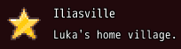

<!-- nav -->
[Mod Framework](../../README.md) › [UI components](README.md) › [Display](README.md#display)
<!-- /nav -->

# Icon

`icon` draws one icon on its own: an index of the game's IconSet, a name `UI.icon` gave one, or a
picture file as `{ file: }`, the same as every `icon:` param takes. Use it where an icon stands apart
from a text, such as the mark of a quest in a page's head; a text with an icon in front takes the
part's own `icon:` instead.

## Examples

### Beside a title

<!-- example: icon-head -->
```ruby
stack row: true do
  icon 191, size: :large
  stack spacing: 0, align_self: :center do
    text "Iliasville", typo: :subtitle1
    text "Luka's home village.", typo: :body2
  end
end
```


`size:` takes `:small` (16 pixels), `:medium` (24, the IconSet's own and the default) or `:large`
(48), or pixels. A name `UI.icon` gave stands for its icon everywhere:

```ruby
UI.icon :camp_quest, 191
icon :camp_quest, size: 32, tooltip: "A quest of the camp"
```

`UI::ICON_SIZE` is the IconSet's side, 24 pixels, and `UI::ICON_STEP` the room an icon takes in a
row with the 2 pixels after it, 26, such as to start a line under the name after an icon:
`text "Socket 1 of 2", typo: :body2, padding: [0, 0, 0, UI::ICON_STEP / 4.0]`, as `padding:`
counts in units of 4 pixels.

## Params, events and keys

Every part also takes [the params every part takes](README.md#params-every-part-takes).

<!-- generated: icon -->
An icon on its own, such as the mark of a quest in a head, drawn from the game's IconSet or a picture file.

Written `icon icon, ...`.

| Param | Takes | Default | Live | About |
|---|---|---|---|---|
| `icon:` | an IconSet index, a name UI.icon gave one, or { file: "Graphics/Pictures/x" } |  |  | the icon |
| `size:` | px, `:small`, `:medium`, `:large` | `:medium` |  | its side: :small (16 px), :medium (24 px, the IconSet's own) or :large (48 px), or pixels |
| `opacity:` | a whole number |  |  | how see-through it draws, 0 to 255, such as a star that is off; opaque without it |

| Event | Tells |
|---|---|
| `on_click` | nothing; it was clicked |

**Keys:** none

**Mouse:** a click tells on_click
<!-- /generated -->

<!-- nav -->
---

← [Image](image.md) · [All components](README.md) · [Avatar](avatar.md) →
<!-- /nav -->
