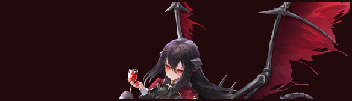
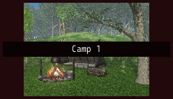
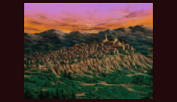

<!-- nav -->
[Mod Framework](../../README.md) › [UI components](README.md) › [Display](README.md#display)
<!-- /nav -->

# Image

`image` shows a picture scaled to its room: a picture file of the game or of your mod, or a
character's art from the game's Library, their face or their map figure.

Without `scale:` its part is as large as the picture, or as `width:` and `height:` set it, and a
map figure scales by whole steps so its pixels stay sharp. `scale: :auto` scales the picture to the
room its part gets, at any size, larger or smaller, keeping its proportions: its height follows the
width it gets, such as a grid item's or its `width:`'s, and its width its `height:`. In a stack or
a window it takes the whole width; a `width:` or `max_size:` keeps it smaller. `sampling: :sharp`
takes each pixel's nearest pixel, so a figure's pixel art stays crisp, and `sampling: :smooth` blends
them, as suits a face, art or a picture file; a figure scales sharp and the others smooth unless
you say.

## Examples

### A character's art

<!-- example: image-portrait -->
```ruby
image portrait: actor, fit: :cover, anchor: :top, height: 160
```


### A face and a figure

<!-- example: image-face -->
```ruby
stack row: true do
  image face: actor
  image figure: actor
end
```


### Scaled to a grid's items

<!-- example: image-auto-scale -->
```ruby
grid do
  grid_item(xs: 4) { image figure: actor, scale: :auto }
  grid_item(xs: 4) { image face: actor, scale: :auto }
  grid_item(xs: 4) { image figure: actor, scale: :auto, sampling: :smooth }
end
```


### A picture file with a label

<!-- example: image-file -->
```ruby
image file: "Graphics/Pictures/bg010", label: "Camp 1", width: 240, height: 135
```


### Hiding a spoiler

<!-- example: image-blur -->
```ruby
image file: "Graphics/Pictures/bg012", blur: true, width: 240, height: 135
```


## Params, events and keys

Every part also takes [the params every part takes](README.md#params-every-part-takes).

<!-- generated: image -->
A picture scaled to its room: a picture file, or a character's art, face or map figure.

Written `image ...`.

| Param | Takes | Default | Live | About |
|---|---|---|---|---|
| `file:` | a text |  |  | a picture file of the game or of your mod, such as "Graphics/Pictures/bg010" |
| `portrait:` | any value |  |  | a character whose art the game's Library shows |
| `face:` | any value |  |  | a character whose face shows |
| `figure:` | any value |  |  | a character whose map figure shows, standing |
| `fit:` | `:contain`, `:cover`, `:fill` |  |  | :contain shows all of it, :cover fills its room and cuts what sticks out, :fill stretches it to its room; without fit: a figure scales by whole steps so its pixels stay sharp, the others as :contain |
| `anchor:` | `:top`, `:center`, `:bottom` |  |  | which part stays when it is cut, and where a smaller picture sits; :bottom for a figure, else :center |
| `scale:` | `:auto` |  |  | :auto scales it to the room it gets, keeping its proportions: its height follows the width it gets, such as a grid item's or its width:'s, and its width its height:; it draws at any size, larger or smaller; without it as told under fit: |
| `sampling:` | `:sharp`, `:smooth` |  |  | with scale: :auto, how its pixels scale: :sharp takes each pixel's nearest pixel, so pixel art stays crisp, :smooth blends them; :sharp for a figure, else :smooth |
| `blur:` | true, false | `false` |  | draws a picture file blurred, such as a screenshot that spoils the story |
| `label:` | a text |  | yes | a text on a dark band across its middle |

| Event | Tells |
|---|---|
| `on_click` | nothing; it was clicked |

**Keys:** none

**Mouse:** a click tells on_click
<!-- /generated -->

<!-- nav -->
---

← [Field](field.md) · [All components](README.md) · [Icon](icon.md) →
<!-- /nav -->
