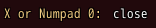
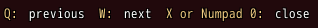

<!-- nav -->
[Mod Framework](../../README.md) › [UI components](README.md) › [Display](README.md#display)
<!-- /nav -->

# Key help

`key_help` is a line that names keys as the player bound them and what they do, as the game's own
key help does: "X or Numpad 0: close". By itself it adds the keys of the part in focus and of the
parts it lies in, such as the pane the focus is in and its window: their hotkeys, the game's buttons
they take, and the jump keys while a list with other parts around it is in focus. It follows the
focus as it moves and never names every part in view, so it stays one line. The keys it adds come
after its entries, or before the entry of cancel when that entry comes last, so the way out stays
last. A hotkey whose action an entry names already is not added again. Entries that do not fit its
width go on to the next line.

## Examples

### The close key

<!-- example: key_help-close -->
```ruby
key_help entries: [{ button: :B, text: "close" }]
```


### Keys of the screen

<!-- example: key_help-screen -->
```ruby
key_help entries: [{ key: "Q", text: "previous" }, { key: "W", text: "next" }, { button: :B, text: "close" }]
```


## Params, events and keys

Every part also takes [the params every part takes](README.md#params-every-part-takes).

<!-- generated: key_help -->
A line that names keys as the player bound them and what they do, as the game's key help does: "X or Numpad 0: close".

Written `key_help ...`.

| Param | Takes | Default | Live | About |
|---|---|---|---|---|
| `entries:` | an Array | `[]` |  | each { button:, key:, hotkey:, text: }: one of the game's buttons such as :B, a key's name or a hotkey, and what it does |
| `auto:` | true, false | `true` |  | adds the hotkeys and the game's buttons of the part in focus and of the parts it lies in, and the jump keys while a list with other parts around it is in focus, after its entries, or before its entry of cancel when that one ends them |

**Keys:** none

**Mouse:** none
<!-- /generated -->

<!-- nav -->
---

← [Tooltip](tooltip.md) · [All components](README.md) · [Help line](help_line.md) →
<!-- /nav -->
