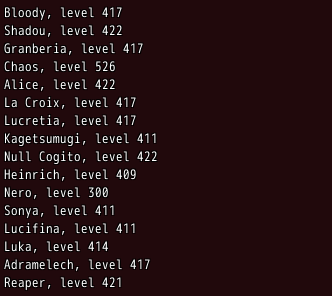
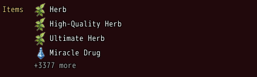
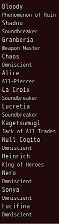
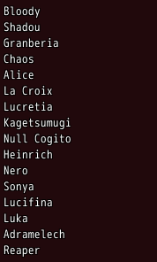

<!-- nav -->
[Mod Framework](../../README.md) › [UI components](README.md) › [Display](README.md#display)
<!-- /nav -->

# Lines

`lines` shows lines of text, as many as its room holds, and never scrolls: the last line then
tells how many more there are and names them as the pointer rests on it, such as an item's
effects in a summary. Lines come alone or in groups, each group's label beside its first line, in
one column or two. A line may have a small line under it (`detail:`), which shows while there is
room. With `on_pick` the player walks the lines and picks one.

## Examples

### The party

<!-- example: lines-party -->
```ruby
lines UI::Game.members.map { |member| "#{member.name}, level #{member.base_level}" }, columns: 2
```


### In groups, as many as fit

<!-- example: lines-groups -->
```ruby
lines [{ label: "Items", lines: $game_party.items.map { |item| { item: item } } },
       { label: "Gear", lines: $game_party.equip_items.map { |item| { item: item } } }], gutter: 48, height: 120, more_text: "+%d more"
```


### Picking a line

<!-- example: lines-pick -->
```ruby
lines UI::Game.members.map { |member| { text: member.name, detail: member.class.name } }, on_pick: ->(place) { toast UI::Game.members[place].name }
```


### Tooltips of markup

<!-- example: lines-markup -->
```ruby
lines UI::Game.members.map { |member| { text: member.name, tooltip: -> { text member.class.name; text "Level #{member.base_level}", color: :system } } }, columns: 2
```


A line's `tooltip:` takes markup as a lambda, also inside a group, as a [tooltip](tooltip.md)
does; a text, such as `tooltip: "Leader"`, is one line of text.

## Params, events and keys

Every part also takes [the params every part takes](README.md#params-every-part-takes).

<!-- generated: lines -->
Lines of text that show as many as their room holds, never scrolling, such as an item's effects: alone or in groups with their labels, in one or two columns; the last line tells how many more there are.

Written `lines lines, ...`.

| Param | Takes | Default | Live | About |
|---|---|---|---|---|
| `lines:` | an Array | `[]` |  | a line each: a text, or { text:, color:, icon:, item:, tooltip:, detail: }, tooltip: a text or markup as a lambda, detail: a small line under it; or a group { label:, lines: } |
| `columns:` | `1`, `2`, `:auto`, `:room` | `1` |  | :auto takes a second column only when one does not hold them all; :room takes two whenever every line fits a column's width |
| `span:` | true, false | `false` |  | the lines lie across the columns row by row; a line too wide for a column takes a whole row |
| `titles:` | true, false | `true` |  | each group's label stands beside its first line |
| `sort:` | true, false | `false` |  | sorts the lines in each group by their text |
| `size:` | `:tiny`, `:small`, `:medium` | `:small` |  | the size of its font; its rows are 14, 18 or 24 pixels high |
| `color:` | a color name such as :primary or :rainbow, "#RRGGBB", [r, g, b] or a game text color such as 2 |  |  | the color of every line without one of its own |
| `escapes:` | true, false | `false` |  | draws the game's text codes, such as \C[2] for a color and \I[64] for an icon |
| `gutter:` | a whole number | `0` |  | the width of the room at their left that holds each group's label, in pixels |
| `spacing:` | `0`, `1`, `2`, `3`, `4`, `5`, `6` | `3` |  | room between two columns, 4 px a unit |
| `group_spacing:` | `0`, `1`, `2`, `3`, `4`, `5`, `6` |  |  | room between two groups, 4 px a unit; 2 px without it |
| `more_text:` | a text |  |  | the last line once lines are left out, %d for how many; "+%d more" without it |
| `more_color:` | a color name such as :primary or :rainbow, "#RRGGBB", [r, g, b] or a game text color such as 2 |  |  | that line's color; dim without it |
| `empty:` | a text |  |  | a dim line that shows without lines |
| `most_rows:` | a whole number |  |  | the most rows it asks room for, such as one in a compact form; given more room it still shows what the room holds |
| `note:` | markup as a lambda, or a text for one line |  |  | parts at the end of the tooltip of each line that has one, such as "Confirm to change" |

| Event | Tells |
|---|---|
| `on_pick` | the line picked, from 0 among all of them; with on_pick: each line takes the keys |
| `on_more` | the last line, which tells how many more lines there are, was clicked: the lines left out |

| Call on `part(:id)` | Does |
|---|---|
| `pulse(lines)` | pulses those lines once, from 0, such as those a change just touched; asked as they change, they pulse as they show anew |

**Keys:** with on_pick: as it is made, Up and Down walk the lines and confirm picks one; lines whose details do not all fit take a row each, and only the line with the cursor shows its detail; without, none

**Pad:** as the keys

**Mouse:** with on_pick: a click picks a line; a click on the last line tells on_more; resting on a line shows its tooltip

**Places:** `note`, the parts at the end of each line's tooltip
<!-- /generated -->

<!-- nav -->
---

← [Stat grid](stat_grid.md) · [All components](README.md) · [Marker](marker.md) →
<!-- /nav -->
