<!-- nav -->
[Mod Framework](../../README.md) › [UI components](README.md) › [Lists](README.md#lists)
<!-- /nav -->

# List

`list` shows a row per item to pick from. It stays one part however many rows it has, and it wraps
at its ends like the game's own lists; with `leave_ends: true` Up on its first row and Down on its
last move on to the part above or below, such as a search over the list. Bind it to a state and
the list keeps that state on the picked item.

## Examples

### Bound to a state

<!-- example: list-bind -->
```ruby
list notes, bind: :picked, empty: "No notes yet"
```
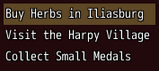

### Picking an item

<!-- example: list-submit -->
```ruby
list members, text: :name, on_submit: ->(member) { show(member) }
```
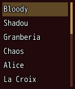

### Going on into the part beside

<!-- example: list-submit-to -->
```ruby
stack row: true do
  list $game_party.members, text: :name, bind: :member, submit_to: :slots, id: :party, width: 160
  list UI::Game.slot_rows(member), bind_index: :slot, id: :slots, width: :fill
end
```
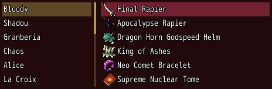

`submit_to:` names the id of another part of the window: a pick, by confirm or a click, moves the
focus there once `on_submit` heard it. The arrows still move between the two as anywhere else.
Cancel in a list moves the focus back to the part the player came from, by a pick, an arrow or a
click, with the cancel sound, before the next cancel closes the window.

### Icons and counts

<!-- example: list-icons -->
```ruby
list herbs, text: :name, icon: :icon_index, right: ->(herb) { "x#{herb.count}" }, bind: :herb
```
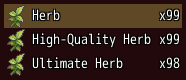

### Rows of the game

<!-- example: list-rows -->
```ruby
list UI::Game.slot_rows(actor), bind_index: :slot
```
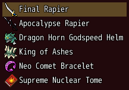

An item that is a Hash such as `{ text: "Herb", icon: 2675, right: "x1" }` is its own row; `row:`
makes one per item.

### Headings

<!-- example: list-headings -->
```ruby
list [{ text: "Look", heading: true }, "Map Display", "Now Playing",
      { text: "Rules", heading: true }, "Level Cap"], bind: :mod
```
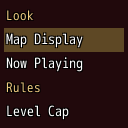

The cursor passes over a heading.

### Rows in columns

<!-- example: list-cells -->
```ruby
list [{ heading: "In battle" },
      { cells: ["Luka", { text: "Lv 42", typo: :caption }, { text: "812 / 812", align: :end }] },
      { cells: ["Alice", { text: "Lv 40", typo: :caption }, { text: "1290 / 1450", align: :end, color: :warning }] },
      { heading: "In reserve" },
      { cells: ["Tamamo", { text: "Lv 38", typo: :caption }, { text: "640 / 900", align: :end }] }],
     cells: [120, 56, nil], on_submit: ->(member) { show_status(member) }
```
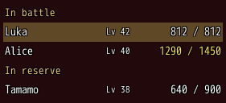

`cells:` gives the widths of the columns, in pixels, and `nil` for a column that takes the room
left (several `nil` share it). Each row's `cells:` stand in them, one per column: a text, or
`{ text:, color:, typo:, align: }` with `align: :end` for numbers at the column's right, or
`{ icons: [...] }` for icons such as a crown before a name. A cell too long for its column ends in
"...". A `{ heading: "In reserve" }` row spans the whole row, as any heading does, and the cursor
passes over it.

### Players with their leaders

<!-- example: list-avatars -->
```ruby
list players, cells: [nil, 64], bind: :player,
     row: ->(player) { { cells: [{ avatar: { character: player.leader, image: :sprite, shape: :box, width: 28, height: 28 },
                                   text: player.name },
                                 { text: "#{player.ping} ms", align: :end }] } }
```
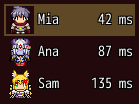

A cell's `avatar:` draws an [avatar](avatar.md) before the cell's icons and text, and takes what
`avatar` takes: `character:` with `index:`, or `face:` with `hue:`, and `image:`, `shape:`, `size:`,
`width:` and `height:`. Here a player's
`leader` is a map sprite, such as `{ sprite: "Main01_cip", index: 0 }` for Luka, when the row knows
only the sprite another player's game sent, or a database actor such as `$data_actors[1]`, which
adds nobody to the player's party. The rows grow to the highest avatar and 2 px above and below it,
so 28 px pictures give 32 px rows, and every cell's text stands in the middle of its row.

### Boxes and notes

<!-- example: list-boxes -->
```ruby
list mods, width: 302, note_at: 150, on_submit: ->(mod) { turn(mod) },
           row: ->(mod) { { text: mod.name, check: mod.on, note: mod.note, note_color: mod.note_color } }
```
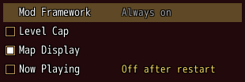

A row's `check:` draws an on/off box at its start, filled while true; `nil` draws none, as for the
framework's own row, and that row keeps the box's room so the names line up. Confirm on the row
and a click on its box tell `on_submit`; the click also puts the cursor there. The box shows its
new state once the item says so. `note:` is a small text after the row's text, dim unless
`note_color:` says otherwise; `note_at:` starts every note at the same column. A row's `right:`
takes `right_color:` the same way.

### Labels and notes in columns

<!-- example: list-labels -->
```ruby
list $game_party.members, bind: :member, note_at: $game_party.members.map(&:name),
     row: ->(actor) { { label: actor == UI::Game.leader ? "Leader" : "Member", text: actor.name, note: "Level #{UI::Game.level(actor)}" } }
```
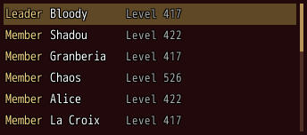

A row's `label:` is a caption in the system color in a column before its text. The column is as
wide as the widest label of all rows, the ones a search hides too, so it never moves; `label_width:`
sets it in pixels, or as texts of which the widest sets it. `note_at:` takes texts the same way:
here every name, so the levels start in one column after the longest name.

### Badges

<!-- example: list-badges -->
```ruby
list [{ text: "Browser", badge: 2 }, { text: "List", badge: true, badge_color: :warning }, { text: "Configuration" }],
     bind: :picked
```
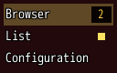

A row's `badge:` is a count on a plate at its end, "9+" above 9, nothing at 0, or a dot for `true`,
gold unless `badge_color:` says otherwise. The row keeps the badge's room while it shows nothing, so
the texts keep their width as a count comes and goes.

### Rows to read

<!-- example: list-read -->
```ruby
list [{ text: "Level Cap 1.5.2", right: "turns on", right_color: :warning },
      { text: "Party Sheet", right: "the save used 1.5.0, you have 1.5.2", right_color: :dim },
      { text: "My_Script", right: "not on the site", right_color: :dim, faint: true,
        tooltip: "Get it from its author and put it into the Patch folder." }], width: 420
```
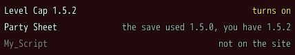

A list without `bind:`, `bind_index:` or a handler is there to read, as the save's mods dialog
lists the mods of a save. The keys pass over it, it shows no cursor, and the pointer neither
lights a row nor picks one; a row's `tooltip:` still shows under the pointer. `faint: true` draws
a row half see-through, for one the player can do nothing about.

### Toggles

<!-- example: list-toggles -->
```ruby
list mods, text: :name, toggles: ->(mod) { [{ text: "On", on: mod.on }] },
           on_toggle: ->(mod, _toggle) { mod.on = !mod.on }
```
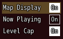

Right moves the cursor onto a row's toggles and Left back; confirm or a click presses one. The
toggle shows its new state once the item says so.

### Moving rows

<!-- example: list-reorder -->
```ruby
list mods_by_tag, text: :name, reorder: :within_group,
                  on_reorder: ->(mod, to) { move(mod, to) }
```
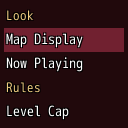

The player drags a row to another place, but only among the rows under the same heading; `group:`
names other groups. `on_reorder` gets the item and its new place among the items, and the rows show
the new order once the items have it. The framework's hotkeys Move Up and Move Down (I and K) move
rows only on the framework's own mod list.

### Cards

<!-- example: list-cards -->
```ruby
list mods, look: :cards, columns: 3, text: :name, bind: :mod,
           picture: ->(mod) { { file: mod.shot, blur: mod.spoiler } },
           lines: ->(mod) { ["by #{mod.author}", mod.summary] }
```
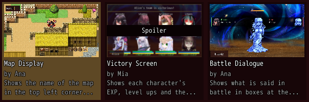

Each card shows its picture across its top at 16:9, its text, then its lines, the last one wrapped
to two lines. `blur: true` blurs a picture that spoils the story and marks it "Spoiler". Two lines of cards show before
the list scrolls (`lines_shown:`); with `height:` each line takes its share of it.

### Fewer cards across beside a drawer

<!-- example: list-columns -->
```ruby
stack row: true do
  drawer bind: :filters_open, width: 160 do
    list ["Quality of Life", "Story", "Battle"], row: ->(tag) { { text: tag, check: tag == "Story" } }, bind: :tag
  end
  list mods, look: :cards, columns: filters_open ? 2 : 3, text: :name, bind: :mod, grow: 1,
             picture: ->(mod) { { file: mod.shot } }, lines: ->(mod) { ["by #{mod.author}", mod.summary] }
end
```
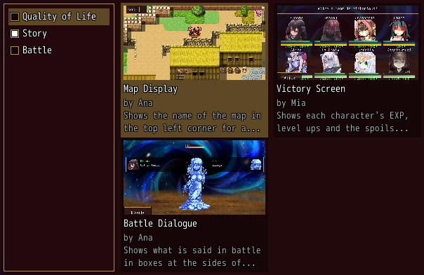

`columns:` may change while the list shows, as the mod browser shows two cards across while its
filters are open and three while they are shut. The cursor stays on its item and scrolls into
sight. A card wider than before keeps its texts whole: its picture is cut from its middle where the
card has no room for it at 16:9.

### A mod card with its badge and upvotes

<!-- example: list-mod-cards -->
```ruby
list mods, look: :cards, columns: 3, text: :name, right: :version, bind: :mod,
           picture: ->(mod) { { file: mod.shot, badge: mod.badge } },
           lines: ->(mod) { [{ text: "by #{mod.author}", right: [{ icon: { file: UI.graphic("thumb_up") }, text: mod.upvotes.to_s }] },
                             mod.summary] }
```
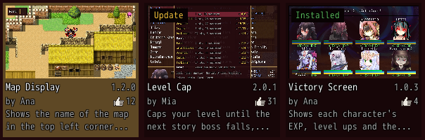

The mod browser's card: `badge:` puts a small text on a dark plate at the picture's top left, such
as `{ text: "Installed", color: :success }`; the row's `right:` stands at the end of the name line,
here the version; a line `{ text:, right: }` puts its right part at the line's end, a text or parts
`[{ text:, icon:, color: }]`, each its icon then its text, such as the upvotes with their thumb.
A click on a card other than the cursor's only moves the cursor there; with `click_picks: true` it
picks the card at once, as the mod browser opens a mod's page in one click.

### Rows with a picture

<!-- example: list-pictures -->
```ruby
list mods, rows_shown: 3, height: 240, text: :name, right: :version, bind: :mod,
           picture: ->(mod) { { file: mod.shot, badge: mod.badge } },
           lines: ->(mod) { ["by #{mod.author}  #{mod.summary}"] }
```
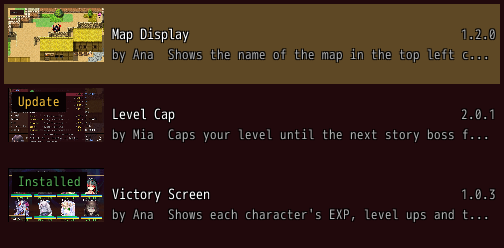

The mod browser's list view. Without `look: :cards`, a row's `picture:` lies at its left,
`picture_width:` wide (96) and 16:9 high, its name and `lines:` beside it; a row is as high as its
picture or its lines. `rows_shown:` names how many rows share the list's height: here three rows
share 240 pixels; with `height: :fill` they share the room the list's column leaves. A row is never
lower than its own height; more rows than that scroll. Rows with lines but no picture, such as the
browser's collections, work the same way.

### Values

<!-- example: list-values -->
```ruby
list herbs, describe: true, on_side: ->(herb, step) { give(herb, step) },
            row: ->(herb) { { item: herb.item, value: "#{given[herb]} / #{herb.count}",
                              less: given[herb] > 0, more: given[herb] < herb.count } }
```
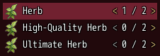

A row with `value:` shows it at its right end between two arrows. Left and Right step it and stay
in the row; a click on the value's left or right half does the same. `on_side` gets the item and
-1 or 1, and the row shows its new value once the items say so. `less: false` or `more: false`
dims that arrow, and a step that way buzzes and tells `on_refuse` the item and the step, the place
to say why. `describe: true` shows the game's description of a row's `item:` as its tooltip.

### Dense rows

<!-- example: list-dense -->
```ruby
list towns, bind: :town, dense: true, most_rows: 8
```
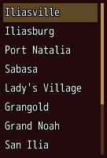

### Kept by a filter

<!-- example: list-filter -->
```ruby
text_field bind: :search, placeholder: "Search by name", steer: :bag
list items, id: :bag, text: :name, icon: :icon_index, filter: ->(item) { item.name.downcase.include?(search.downcase) }, no_match: "No item matches"
```
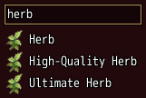

`filter:` keeps the items it answers true for; a row with `search: false`, such as a Remove row,
always shows. Once it keeps none of the items it was asked about, `no_match:` shows in a dim row
that takes no pick. A pick hands back the item, as without a filter.

### A search highlighted

<!-- example: list-highlight -->
```ruby
list UI::Game.members.map { |actor| actor.name }, highlight: "a", most_rows: 4
```
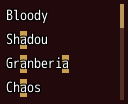

`highlight:` draws a text on the theme's primary color, its letters in their own color and outline,
wherever it occurs in the rows' texts, their cells and the names on cards, ignoring case, such as
the words a search typed.

## Params, events and keys

Every part also takes [the params every part takes](README.md#params-every-part-takes).

<!-- generated: list -->
Rows to pick from, one per item; it stays one part however many rows it has.

Written `list items, ...`.

| Param | Takes | Default | Live | About |
|---|---|---|---|---|
| `items:` | an Array | `[]` |  | the items, one row each |
| `bind:` | the name of a state |  |  | the state that holds the picked item, both ways |
| `bind_index:` | the name of a state |  |  | the state that holds the picked row's place, both ways |
| `text:` | a lambda of one item, or its method name |  |  | an item's row text; the item itself by default |
| `icon:` | a lambda of one item, or its method name |  |  | an item's icon before its text: an IconSet index, a name UI.icon gave one, or { file: } |
| `right:` | a lambda of one item, or its method name |  |  | what an item's row says at its right end, such as a count; on a card, at the end of its name line, such as its version |
| `row:` | a lambda of one item, or its method name |  |  | an item's whole row, a Hash of :text, :icon, :right (a text, or parts [{ text:, icon:, color: }]), :right_color, :color, :disabled, :tooltip, :item (a game item shown as the game's menus show it), :faint, :label (a caption in the system color in a column before its text, see label_width:), :check (true or false draws an on/off box at its start, filled while true, nil none; confirm and a click on the box tell on_submit), :note and :note_color (a small text after its text, from the column note_at:, dim unless told), :badge and :badge_color (a count above 0 on a plate at its end, "9+" above 9, true a dot, gold unless told; its room kept while it shows nothing), and :value with :less and :more (a value at its right end that Left and Right step, see on_side; less: false or more: false dims that arrow and buzzes a step that way, see on_refuse), :cells (its texts in the list's columns, see cells:); a row { heading: "Online (2)" } heads the rows under it across the whole row and the cursor passes over it; an item that is such a Hash is its own row |
| `cells:` | an Array |  |  | the widths of the columns the rows' cells: stand in, such as [52, 172, nil, 64], each in pixels or nil to share the room left; a cell is a text, { text:, color:, typo:, align: :start, :center or :end } or { icons: [...] }, each cut with "..." to its column; a cell's avatar: { character:, index:, face:, hue:, image:, shape:, size:, width:, height: } draws that avatar before its text, and the rows grow to the highest avatar and 2 px above and below it |
| `describe:` | true, false | `false` |  | a row of a game item (its :item) shows the item's description as its tooltip, unless the row has a tooltip: of its own |
| `escapes:` | true, false | `false` |  | the rows draw the game's text codes |
| `dense:` | true, false | `false` |  | lower rows, as high as the theme's dense row |
| `click_picks:` | true, false | `false` |  | a click on any row picks it at once, such as a card that opens its page; else a click on another row only moves the cursor there |
| `leave_ends:` | true, false | `false` |  | Up on its first row and Down on its last move the focus to the part above or below instead of wrapping, Up to the text field that steers it when one does, as a search over a list |
| `empty:` | a text |  |  | what it says without items |
| `filter:` | a lambda of one item, or its method name |  |  | keeps only the items it answers true for, such as those the toggles over the list allow; a row with search: false, such as a Remove row, always shows |
| `no_match:` | a text |  |  | a dim row that shows once filter: keeps none of the items it was asked about, such as "No item matches" |
| `submit_to:` | a Symbol or a text |  |  | the id: of another part of its window that a pick moves the focus to once on_submit heard it, such as the slots of the character picked |
| `note_at:` | pixels, or an Array of texts of which the widest sets it |  |  | where the rows' notes start, so they stand in one column: pixels from a row's left, or texts, of which the widest fits before the notes after a row's box, label and icon; half the row by default; a long text pushes its note on |
| `label_width:` | pixels, or an Array of texts of which the widest sets it |  |  | the width of the rows' label: column: pixels, or texts of which the widest sets it; the widest label of all rows by default, so a filter never moves it |
| `most_rows:` | a whole number | `6` |  | the most rows it shows before it scrolls |
| `rows_shown:` | a whole number, `:fill` |  |  | instead of most_rows:, a count of rows that share its height between them, each at least as high as its own, such as 6 rows of mods that fill a box; :fill shows as many whole rows as the room its column leaves holds |
| `toggles:` | a lambda of one item, or its method name |  |  | an item's toggles, small on/off buttons at its row's end: an Array of { text:, on:, tooltip:, color: }, filled while on; a row Hash takes toggles: too |
| `reorder:` | `false`, `:within_group` | `false` |  | :within_group lets the player move a row within its group by a drag |
| `group:` | a lambda of one item, or its method name |  |  | an item's group, which reorder: keeps it within; by default the heading row above it |
| `look:` | `:rows`, `:cards` | `:rows` |  | :cards shows each item as a card on a dark plate: its picture across its top, its text, then its lines |
| `columns:` | a whole number |  |  | how many rows or cards stand side by side; 3 for cards, else 1; it may change while the list shows, such as 2 cards across beside an open drawer, and the cursor stays on its item, scrolled into sight |
| `spacing:` | `0`, `1`, `2`, `3`, `4`, `5`, `6` |  |  | room between two columns of rows or cards, 4 px a unit; 2 for rows, else the cards' own |
| `lines_shown:` | a whole number | `2` |  | how many lines of cards show before it scrolls; with height: each line takes its share |
| `picture:` | a lambda of one item, or its method name |  |  | an item's picture: { file:, blur:, label:, badge: { text:, color: } }, blur: for a picture that spoils the story, marked Spoiler unless label: says otherwise, badge: a small text on a dark plate at its top left, such as Installed; a card shows it across its top, a row at its left; a row Hash takes picture: too |
| `picture_width:` | a whole number | `96` |  | the width of a picture at a row's left, its height 16:9 of it; a row Hash takes picture_width: too |
| `lines:` | a lambda of one item, or its method name |  |  | an item's lines under its text on a card or a row, such as ["by Ana", summary], on a card the last wrapped to two lines; a line is a text or { text:, color:, right: }, its right a text or parts [{ text:, icon:, color: }] at the line's end; a row Hash takes lines: too |
| `on_button:` | { z: -> { ... } }: a lambda or a method name, or nil, for each of the game's buttons :a, :x, :y and :z it takes |  |  | what the game's buttons :a, :x, :y and :z (Shift, A, S and D on the keyboard) do while the focus is on it or inside it, such as { z: -> { open_filter } }; only where a screen mirrors the game's own |
| `button_help:` | { z: "Filter" }: what each button of on_button: does, for the key help |  |  | what each button of on_button: does, which the key help names, such as { z: "Filter" }; nil leaves a button out, such as on a row it does nothing on |
| `highlight:` | a text |  | yes | a text drawn on the theme's primary color, its letters in their own color and outline, wherever it occurs, ignoring case, such as the words a search typed |

| Event | Tells |
|---|---|
| `on_change` | the item the cursor moved to |
| `on_submit` | the item picked; without on_submit: the pick goes to the nearest on_submit: around the list |
| `on_toggle` | the item and the place of its toggle the player pressed, from 0; the toggle shows its new state once the items say so |
| `on_reorder` | the item the player moved and its new place among the items; the rows show the new order once the items have it |
| `on_side` | Left or Right stepped the value of an item's row: the item and -1 or 1; the row shows its new value once the items say so |
| `on_refuse` | the item of a row with disabled: true the player tried to pick, or the item and -1 or 1 of a step of a dim arrow, which buzzed |
| `on_page` | Q or W, or a gamepad's shoulder without tabs in view, reached it from the focus upward: -1 for the page before, 1 for the next |

**Keys:** Up/Down, Page Up/Down and Home/End move; confirm picks; Left and Right walk a row's toggles and confirm presses one; on a row with a value Left and Right step it and stay in the row at its end; the keys skip a list without bind:, bind_index:, on_submit:, on_change:, on_toggle:, on_side: or reorder:, which shows rows to read: no cursor, and the pointer neither lights nor picks them, while their tooltips show

**Pad:** the d-pad moves; A picks

**Mouse:** a click moves the cursor there, and a click on the cursor's row picks it, with click_picks: a click on any row; a click on a row's box moves the cursor there and picks at once; a click on a toggle presses it; a click on the left or right half of a row's value steps it; with reorder:, a drag moves a row within its group; the wheel scrolls
<!-- /generated -->

<!-- nav -->
---

← [Drawn](drawn.md) · [All components](README.md) · [Log](log.md) →
<!-- /nav -->
