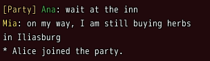
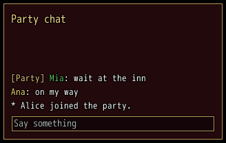

<!-- nav -->
[Mod Framework](../../README.md) › [UI components](README.md) › [Lists](README.md#lists)
<!-- /nav -->

# Log

`log` shows rows of colored parts, the newest at the bottom, such as a chat, a battle log or a feed.
Long rows wrap at their words, and whole lines stand on its bottom edge. It stays at the newest row
until the player scrolls up; rows that come meanwhile keep the view still. A part with `data:`
draws lighter under the pointer, and a click on it tells `on_click`, such as a name that opens a
menu. A log is no key stop: the mouse wheel scrolls it, and a `text_field` whose `steer:` names it
scrolls it while the player types.

## Examples

### Colored parts and names to click

<!-- example: log-parts -->
```ruby
log [[{ text: "[Party] ", color: :info }, { text: "Ana", color: :success, data: :ana }, ": wait at the inn"],
     [{ text: "Mia", color: :own, data: :mia }, ": on my way, I am still buying herbs in Iliasburg"],
     "* Alice joined the party."],
    rows_shown: 4, on_click: ->(_row, part) { whisper_to(part[:data]) }
```


A row is a text, or an Array of parts, each a text or `{ text:, color:, data: }`. `on_click` gets
the row and the part clicked; the click first stops the typing of a line in the same window and
takes the focus off it, so on_click can open a menu that takes the keys.

### A chat with its line

<!-- example: log-chat -->
```ruby
window "Party chat", width: 320, height: 200, resizable: true do
  log -> { lines }, id: :talk_log
  text_field bind: :line, steer: :talk_log, placeholder: "Say something", on_submit: ->(text) { say(text) }
end
```


`rows:` may be a lambda: the log reads it while it shows, also an Array your mod adds rows to.
With `rows_shown: :fill`, the default, the log takes the room its window leaves, so give the window
a `height:`. While the line types, Up, Down, Page Up and Page Down scroll the log. Scroll it back to
the newest row with `part(:talk_log).scroll_to_end`, such as when the chat opens.

## Params, events and keys

Every part also takes [the params every part takes](README.md#params-every-part-takes).

<!-- generated: log -->
Rows of colored parts that wrap at their words, the newest at the bottom, such as a chat, a battle log or a feed; a part with data: lights under the pointer and tells a click.

Written `log rows, ...`.

| Param | Takes | Default | Live | About |
|---|---|---|---|---|
| `rows:` | an Array | `[]` | yes | its rows, oldest first: each a text, or an Array of parts, each a text or { text:, color:, data: }; a row { parts:, opacity: } draws see-through |
| `keep_place:` | true, false | `true` |  | rows that come while the player scrolled up keep the view still; false scrolls to the newest row |
| `wheel_rows:` | a whole number | `3` |  | the lines a notch of the mouse wheel scrolls |
| `scrollbar:` | true, false | `true` |  | a scrollbar shows at its right while lines are hidden |
| `rows_shown:` | a whole number, `:fill` | `:fill` |  | how many lines high it is, or :fill for the room its stack leaves; whole lines stand on its bottom edge |

| Event | Tells |
|---|---|
| `on_click` | the row and the part the player clicked, a part with data: |

| Call on `part(:id)` | Does |
|---|---|
| `scroll_to_end` | scrolls to the newest row, such as when its chat opens or another tab shows |

**Keys:** none: it is no key stop; a text_field whose steer: names it scrolls it by Up, Down, Page Up and Page Down while it types

**Mouse:** the wheel scrolls it; a part with data: draws lighter under the pointer and a click on it stops the typing of a field in its window, takes the focus off that field and then tells on_click
<!-- /generated -->

<!-- nav -->
---

← [List](list.md) · [All components](README.md) · [Table](table.md) →
<!-- /nav -->
