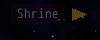
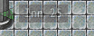

<!-- nav -->
[Mod Framework](../../README.md) › [UI components](README.md) › [On the map](README.md#on-the-map)
<!-- /nav -->

# Marker

`marker` points at a map character or a tile while it lies off the screen: an arrow at the
screen's edge, 14 pixels in, along the line from the player, with a text on a plate beside it,
inside the screen. Once the target comes onto the screen the marker fades out, and it fades back in
as the target leaves it. It slides in from the edge as it fades in, keeps clear of a hud docked at
the top, and never takes the keys or the pointer. Show the component whose `render` describes it
with `UI.show`, one marker per target.

Its `margin:` is the room it keeps from the screen's edges, 3.5 units (14 pixels) by default, each
side its own as `[top, right, bottom, left]`.

## Examples

### Toward a tile

<!-- example: marker-tile -->
```ruby
marker target: [$game_player.x + 30, $game_player.y], text: "Shrine", color: :gold
```


### A live text

`target:` also takes a map character, such as an event or `:player`, or an event's id on this map. A
lambda keeps the text live, such as the tiles left to walk, and `hide_while:` hides the marker while
a screen of your mod lies over the map.

<!-- example: marker-live -->
```ruby
marker target: inn, text: -> { "Inn #{tiles_to(inn)}" }, color: :ally, hide_while: -> { wheel_open? }
```


## Params, events and keys

Every part also takes [the params every part takes](README.md#params-every-part-takes).

<!-- generated: marker -->
An arrow at the screen's edge that points at a map character or a tile while it lies off the screen, with a text on a plate beside it, such as where a party member went; it fades out once that comes onto the screen. UI.show shows a component whose top part is one.

Written `marker ...`.
Opened by `UI.show`.

| Param | Takes | Default | Live | About |
|---|---|---|---|---|
| `target:` | :player, a map character such as an event, a sprite, an event's id on this map, or a tile [x, y] |  | yes | what it points at; it hides while that is gone, see-through or on another map |
| `text:` | a text |  | yes | on a plate inside the screen beside the arrow, such as "Inn 12" |
| `color:` | a color name such as :primary or :rainbow, "#RRGGBB", [r, g, b] or a game text color such as 2 |  | yes | the arrow's color; the theme's text color by default |
| `from:` | :player, a map character such as an event, a sprite, or an event's id on this map | `:player` |  | where the line toward the target starts, which the arrow follows |
| `hide_while:` | a lambda answering true while it hides, true, false, or :top_message |  |  | asked every frame: while it answers true it fades out without closing; :top_message hides it while the game's message shows at the top of the screen |
| `if:` | a lambda answering true or why not, or :map_free |  |  | asked every frame; anything but true closes it, the answer its reason |
| `z:` | a whole number |  |  | which marker or hud lies above which under the game's windows, 0 by default, under the huds |

| Event | Tells |
|---|---|
| `on_open` | once it shows |
| `on_close` | why it closed: :cancel, :button, :hotkey, :script, :scene, :outside or the gate's answer |

**Keys:** none

**Mouse:** none: the pointer passes through it
<!-- /generated -->

<!-- nav -->
---

← [Lines](lines.md) · [All components](README.md) · [Bubble](bubble.md) →
<!-- /nav -->
