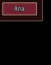
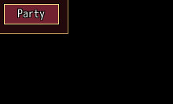
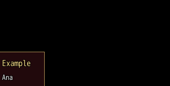

<!-- nav -->
[Mod Framework](../../README.md) › [UI components](README.md) › [Navigation](README.md#navigation)
<!-- /nav -->

# Menu

`menu` is a button that opens a menu of items beside it, as MudBlazor's `MudMenu`, such as the
actions on a party member. Up and Down pick an item and go round, confirm or a click takes it,
and cancel or a click outside closes the menu. An item may hold items of its own: taking it opens
them in a menu beside its row, and cancel there steps back. A menu lies above every window and
dialog, also one opened after it; it moves with the window it was opened from as the player
Alt-drags it and closes with it, and one menu opens at a time.

`UI.menu` opens the same menu from your code, at a spot, at the pointer, beside a row of a list or
under a part, such as when the player clicks a name.

## Examples

### Items behind a button

<!-- example: menu-items -->
```ruby
menu "Ana", items: ["Invite", "Trade", { text: "Duel", disabled: true, tooltip: "Not in a battle." }],
            on_submit: ->(item) { act_on("Ana", item) }
```


An item is a text or `{ text:, disabled:, tooltip:, data:, items: }`. `on_submit` gets the item as you
gave it; an item with `disabled: true` is greyed out, buzzes and tells `on_refuse` instead.

### Items of an item

<!-- example: menu-sub -->
```ruby
menu "Party", items: [{ text: "Leader", items: ["Luka", "Alice"] }, { text: "Formation", items: ["Save", "Load"] }, "Status"],
              on_submit: ->(item) { party(item) }
```


### A menu of your own: UI.menu

<!-- example: menu-pointer -->
```ruby
text "Ana", on_click: -> { UI.menu(["Invite", "Trade", "Whisper"], at: :pointer, title: "Ana") { |choice, _index| act_on("Ana", choice) if choice } }
```


`UI.menu(choices, ...)` takes the choices as `items:` does and answers a handle (`open?`, `close`,
`id`), or false while another menu is open. Its block gets the choice taken and its place, or nil
when the menu closed without one. Where it opens:

| Param | Where |
|---|---|
| none | in the middle of the screen |
| `at: [x, y]`, `at: :pointer` | its bottom at that spot, or at the pointer |
| `beside: "#members", row: 2` | beside that row of a list, or of a game window such as `"Window_MenuCommand"` |
| `under: "#ana_name"` | under that part or game window |

It also takes `title:` (a line over the choices), `most_rows:` (the rows it shows before it
scrolls, 10) and `width:` (pixels; as wide as its choices otherwise). It always stays on the screen.
A choice with `disabled: true` is greyed out: taking it buzzes and its `tooltip:` says why, and
`on_refuse: ->(choice, index) { ... }` hears it with its place, such as to log it; the menu stays
open.

```ruby
UI.menu(["Invite", { text: "Duel", disabled: true, tooltip: "Not in a battle." }], at: :pointer,
        on_refuse: ->(choice, _index) { Mod_Framework.log("Duel refused: " + choice[:tooltip]) }) { |choice, _index| act_on(choice) if choice }
```

It is a dialog of the UI layer above every window and dialog, and closes with the window it opens from: the part
`under:` or `beside:` names, else the part whose click or confirm your code handles, such as the
log a name was clicked in; `from: "#chat_log"` names another. A choice with `items:` opens them in a
menu beside its row, whose cancel steps back. `UI.patch` reaches the menu by its id, `#mf_menu`, and
its parts `#mf_menu_title`, `#mf_menu_list` and `#mf_menu_keys`; the menu of items after it is
`#mf_menu_2`, then `#mf_menu_3`.

## Params, events and keys

Every part also takes [the params every part takes](README.md#params-every-part-takes).

<!-- generated: menu -->
A button that opens a menu of items beside it, such as the actions on a player; an item may hold items of its own, which open in a menu beside its row.

Written `menu label, ...`.

| Param | Takes | Default | Live | About |
|---|---|---|---|---|
| `label:` | a text |  | yes | the text of the button that opens it |
| `icon:` | an IconSet index, a name UI.icon gave one, or { file: "Graphics/Pictures/x" } |  | yes | an icon on the button that opens it, before its label: |
| `items:` | an Array of items, each a text or { text:, disabled:, tooltip:, data:, items: }, items: making a menu of its own, or a lambda without arguments answering them | `[]` |  | its items, each a text or { text:, disabled:, tooltip:, data:, items: }: disabled: true greys it out, items: opens a menu of its own; a lambda is asked as it opens |
| `side:` | `:bottom`, `:top`, `:right`, `:left` | `:bottom` |  | the side of its button it opens on, lined up with the button's left or top |

| Event | Tells |
|---|---|
| `on_submit` | the item the player took, as given |
| `on_refuse` | the item with disabled: true the player tried to take, which buzzed |

**Keys:** confirm on its button opens it; Up and Down move and go round; confirm takes an item or opens its items; cancel closes it, or steps back from the items of an item

**Pad:** A opens it and takes; B closes it or steps back

**Mouse:** a click on its button opens it; pointing picks an item and a click takes it; a click outside closes it
<!-- /generated -->

<!-- nav -->
---

← [Tabs](tabs.md) · [All components](README.md) · [Breadcrumbs](breadcrumbs.md) →
<!-- /nav -->
