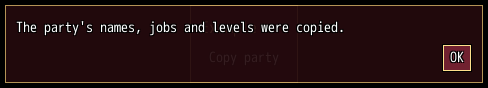
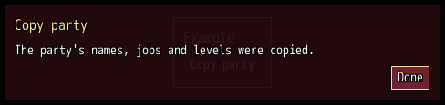

<!-- nav -->
[Mod Framework](../../README.md) › [UI components](README.md) › [Services](README.md#services)
<!-- /nav -->

# Message

`UI.message` shows a message in a small dialog above every other screen: its text, wrapped to the
dialog's width, and an OK button. Confirm, cancel, Numpad 0 or a click on OK close it, and so does
a change of the scene. The block runs once as it closes.

## Examples

### A message

<!-- example: message-plain -->
```ruby
button "Copy party", on_click: -> { UI.message("The party's names, jobs and levels were copied.") }
```


### A title and a button of your own

<!-- example: message-title -->
```ruby
button "Copy party", on_click: -> { UI.message("The party's names, jobs and levels were copied.", title: "Copy party", ok: "Done") { party_copied } }
```


`UI.message` answers a handle: `open?` tells whether it still shows, `close` closes it and runs
its block, and `id` tells its place id.

The message is a dialog of the UI layer, so `UI.patch` reaches it by its id, `#message_box` (or the
`id:` the call gives), and its parts `#message_box_text` and `#message_box_ok`.

## Params

| Param | Takes | Default | About |
|---|---|---|---|
| `ok:` | a text | `"OK"` | the button's text |
| `wrap:` | true, false | `true` | false keeps the text on one line, cut with "..." |
| `title:` | a text | | a title over the text |
| `id:` | a Symbol | `:message_box` | its place id, under which the player's Alt-moved place is kept |

**Keys:** confirm on the button, cancel and Numpad 0 close it

**Pad:** A on the button and B close it

**Mouse:** a click on the button closes it; Alt-drag moves it and changes its width

<!-- nav -->
---

← [Confirm](confirm.md) · [All components](README.md) · [Task](task.md) →
<!-- /nav -->
