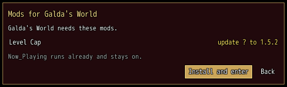

<!-- nav -->
[Mod Framework](../../README.md) › [UI components](README.md) › [Services](README.md#services)
<!-- /nav -->

# Needed mods

`Mod_Framework::Mods.ask_needed` asks the player to make ready the mods a place needs before your
mod goes on, such as the mods of a shared world your mod enters. The framework compares them with
the mods installed and, where any differs, opens the dialog "Mods for <place>" over your screen:
each mod with what happens to it, the mods the place leaves out of this session, and a first button
that does what can be done and goes on.

## Examples

### The mods of a world

<!-- example: needed_mods-world -->
```ruby
button "Enter Galda's World", on_click: -> {
  Mod_Framework::Mods.ask_needed("Galda's World", [{ name: "Level Cap", version: "1.5.2" }, { name: "Party Sheet" }],
                                 leaves_out: ["Now_Playing"]) { |result| enter_world if result == :ready }
}
```


Each mod is `{ name:, version: }`, its name as in the Patch folder or on the website, and the
version the place needs; leave the version out where any will do. A row says what happens:

| Row | When |
|---|---|
| `install 1.5.2` | it is missing, and the website has that version |
| `update 1.5.1 to 1.5.2` | an older version is installed, and the lists have the one needed |
| `change 1.6.0 to 1.5.2` | a newer version is installed, and the lists have the one needed |
| `install by hand` | it is a Data mod that is missing or in another version, which the player installs by hand from its page on the website; the line under the list says so |
| `turn on` | it is installed but off |
| `from its author only` | the lists do not offer that version, or `differs: true` said this game's copy is not the place's; its tooltip and the line under the list say to put it into the Patch folder |

The first button reads "Install and enter", "Turn on and enter", "Install, turn on and enter", or
"Install, restart and enter" where a mod that runs already changes, which loads anew only once the
game starts again; `verb:` replaces "enter". It hides while a mod comes from its author only or is installed by hand. While
it installs, a bar shows how far it came and cancel waits; a failed install says why and gives the
buttons back. Back and cancel go back.

`leaves_out:` names the mods the place leaves out of this session: the dialog names those that stay
off, and in lines of their own those that are part of the framework or run already and so stay
on. Without a mod to change and without one left out, no dialog opens.

The block hears `:ready` (go on), `:back`, or `:restarting` when the game starts again: give
`restart: ["my_mod.enter", world_id]` an action your mod registered with `Mods.after_restart`, so
the game that starts again goes on where the player was.

To start the game again yourself, such as once your mod has left a world or finished a save of
its own, give `restart: :caller`: the block then hears `:restart_needed` once the mods are ready,
and the game starts again only when your mod calls `Mods.restart`:

```ruby
Mod_Framework::Mods.ask_needed("Galda's World", world_mods, restart: :caller) do |result|
  enter_world(world_id) if result == :ready
  leave_then_restart(world_id) if result == :restart_needed
end

# later, once the mod is ready
Mod_Framework::Mods.restart("Galda's World needs its mods", "my_mod.enter", world_id)
```

The dialog's id is `mods_needed` (or
`id:`), its parts `#mods_needed_rows`, `#mods_needed_first` and `#mods_needed_back`, which
`UI.patch` reaches.

<!-- nav -->
---

← [Task](task.md) · [All components](README.md) · [Replace window](replace_window.md) →
<!-- /nav -->
