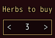
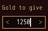
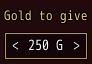
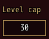
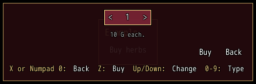

<!-- nav -->
[Mod Framework](../../README.md) › [UI components](README.md) › [Buttons and forms](README.md#buttons-and-forms)
<!-- /nav -->

# Numeric field

`numeric_field` is a number the player types, as MudBlazor's numeric field, between arrows that step
it within its bounds, such as how much gold to give. Its first value, `label:`, is a caption above it,
as on every input.

- Confirm or a click between the arrows starts typing, as in a [text field](text_field.md) typed
  into only once confirmed: a caret shows and the game's buttons stay quiet.
- While it types, the digit row and the numpad type digits, a minus goes in front only while `min:`
  lies below 0, Backspace takes a digit away, Left and Right move the caret, and Ctrl+V pastes a
  number whole or buzzes. Any other key buzzes.
- Enter, a key bound to confirm or the focus leaving keeps the number. A number past `max:` becomes
  `max:` and one below `min:` becomes `min:`, as MudBlazor's numeric field clamps it once typing
  ends; an empty text keeps the number it had. `on_change` and the bound state get the number as a
  whole number.
- The first cancel while it types puts the number back and stops typing; the next cancel goes on.
- While it does not type, Up and Right step it up by `step:`, Down and Left down; the arrow at a
  bound dims and a step past it buzzes. The wheel and a click on an arrow step it too.
  `arrows: false` shows no arrows.
- While it types, Up and Down step the number typed, as in MudBlazor's numeric field: the text
  becomes the number it gives within the bounds, one step on.
- The arrow keys never leave it. Tab walks on to the next part and Shift+Tab back, typing or not;
  cancel, once it no longer types, goes back the way the window's cancel goes. Ctrl with an arrow
  (on a gamepad, the game's A held with the d-pad) or a click moves on too; in a [form](form.md)
  Enter moves on to the next field, or sends the form from its last.
- Enter tells `on_submit` the number; in a [form](form.md) it moves on, or sends the form from its
  last input.


## Examples

### Bound to a state

<!-- example: numeric_field-bind -->
```ruby
numeric_field "Herbs to buy", bind: :herbs, min: 1, max: 99
```


### Typing

Confirm starts typing; the caret stands after the number typed so far.

<!-- example: numeric_field-typing -->
```ruby
numeric_field "Gold to give", bind: :gold, min: 0, max: 99999, adornment: "G"
```


### A step and a unit

<!-- example: numeric_field-step -->
```ruby
numeric_field "Gold to give", bind: :gold, min: 0, max: 1000, step: 50, adornment: "G"
```


### Without arrows

<!-- example: numeric_field-plain -->
```ruby
numeric_field "Level cap", bind: :level, min: 1, max: 99, arrows: false
```


### The number box: `UI.number`

<!-- example: numeric_field-ask -->
```ruby
button "Buy herbs", on_click: -> { UI.number(1, max: 20, note: "10 G each.", ok: "Buy") { |herbs, _shown| buy_herbs(herbs) if herbs } }
```


`UI.number(value, params) { |number, shown| }` asks for a number in a small dialog of its own: a
numeric field, a note under it, an OK and a Back button and a key line. Its block runs once: with
the number kept within `min:` and `max:`, or with nil when the player went back, clicked outside or
the scene changed. `shown` is the number the box showed, so a question that must be answered can
open again later with it. It answers a handle: `open?`, `close` (the block gets nil) and `id`. The
box is a dialog of the UI layer, so `UI.patch` reaches it by its id, `#mf_number` (or the `id:` the
call gives), and its parts `#mf_number_digits`, `#mf_number_note`, `#mf_number_ok`,
`#mf_number_back` and `#mf_number_keys`.

| Param | Takes | Default | About |
|---|---|---|---|
| `min:`, `max:` | whole numbers | `0`, none | the least and the most it gives |
| `adornment:` | a text | | a text after the number, such as `"G"` |
| `title:` | a text | | a title over it |
| `note:` | a text | | a line under the number |
| `ok:`, `cancel:` | texts | `"OK"`, `"Back"` | the buttons' texts, which the key line names too |
| `id:` | a Symbol | `:mf_number` | its place id, under which the player's Alt-moved place is kept |

## Params, events and keys

Every part also takes [the params every part takes](README.md#params-every-part-takes).

<!-- generated: numeric_field -->
A number the player types, as MudBlazor's numeric field, between arrows that step it within its bounds, such as how much gold to give.

Written `numeric_field label, ...`.

| Param | Takes | Default | Live | About |
|---|---|---|---|---|
| `label:` | a text |  | yes | a caption above it, as MudBlazor draws an input's label |
| `bind:` | the name of a state |  |  | a state that holds its number, both ways |
| `min:` | a whole number |  |  | the least number; a number typed below it becomes it, the left arrow dims there and a minus types only while it is below 0 |
| `max:` | a whole number |  |  | the largest number; a number typed past it becomes it and the right arrow dims there |
| `step:` | a whole number | `1` |  | what a step adds or takes away |
| `arrows:` | true, false | `true` |  | false shows no arrows; the arrow keys and the wheel still step it |
| `adornment:` | a text |  | yes | a text after the number, such as "G" or "%" |
| `required:` | any value |  |  | true, or the error to show, such as "Name the formation": an empty value is an error, "Required" by default |
| `validate:` | a lambda of one item, or its method name |  |  | a lambda of its value answering the error to show, or nil while the value is fine, such as ->(name) { "Too short" if name.size < 3 }; a method name calls that method of the component |

| Event | Tells |
|---|---|
| `on_change` | its number, as the player stepped it or as typing it ended |
| `on_submit` | its number within its bounds, as Enter gave it |

**Keys:** Up and Right step it up, Down and Left down, buzzing at a bound; confirm starts typing: the digit row, the numpad, a minus where min: allows one, Backspace, Left and Right; Ctrl+V pastes a number whole or buzzes; Up and Down step the number typed; any other key buzzes; Enter keeps the number within its bounds and submits; the first cancel puts the number back. The arrows never leave it: Tab walks on to the next part and Shift+Tab back, cancel goes back the way the window's cancel goes, the jump key held with an arrow or a click moves on, and in a form Enter moves on to the next field or sends it from its last

**Pad:** the d-pad steps it; A starts typing and A again submits; the game's A held with the d-pad moves on

**Mouse:** a click on an arrow steps it, a click elsewhere starts typing; the wheel steps it
<!-- /generated -->

<!-- nav -->
---

← [Autocomplete](autocomplete.md) · [All components](README.md) · [Checkbox](checkbox.md) →
<!-- /nav -->
