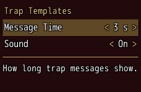
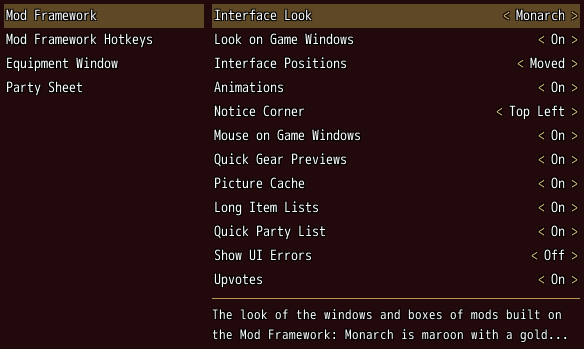
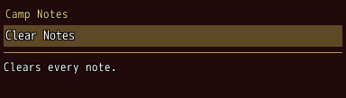
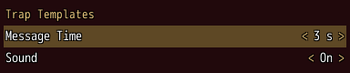
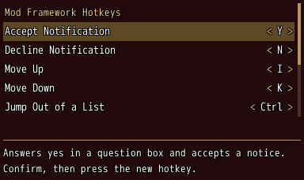
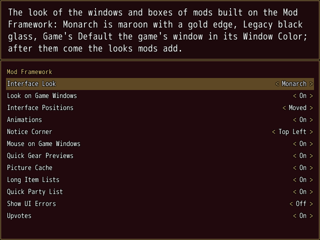
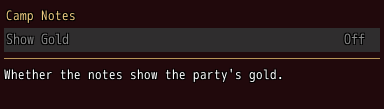

<!-- nav -->
[Mod Framework](../../README.md) › [UI components](README.md) › [Buttons and forms](README.md#buttons-and-forms)
<!-- /nav -->

# Options list

`options_list` shows the options rows mods add with `Mod_Framework::Options`, as Options > Mods
shows them, also inside the game's own Options: a heading per mod, each row with its value, a mod's
hotkey rows after its other rows, under a small "Hotkeys" caption when it has other rows, and a help
line under them that tells the row under the cursor. Left and Right step a value, confirm
steps it on, and a hotkey row waits for its key as a [hotkey field](hotkey_field.md) does. Every
change is kept at once.

## Examples

### A mod's own rows

<!-- example: options_list-mod -->
```ruby
# Once, as the mod loads:
Mod_Framework::Options.add(:trap_message_time, "[Trap Templates] Message Time", "How long trap messages show.",
                           { 2 => "2 s", 3 => "3 s", 5 => "5 s" }, 3)
Mod_Framework::Options.add(:trap_sound, "[Trap Templates] Sound", "Whether a trap plays a sound.",
                           { 1 => "On", 0 => "Off" }, 1)

# In render:
options_list mod: "Trap Templates"
```


`mod:` names the mod by the name in brackets its rows start with; the indented rows under them
belong to it too, and "Global" names the rows of no mod. Without it the list shows every mod's
rows; `only:` keeps the rows its lambda answers true for.

### Beside the list of the mods

<!-- example: options_list-beside-mods -->
```ruby
stack row: true do
  list Mod_Framework::Options.mods, bind: :picked, submit_to: :mod_rows, id: :mods, width: 200
  options_list mod: picked, headings: false, id: :mod_rows, width: :fill
end
```


This is how the game's Options > Mods shows them: `Mod_Framework::Options.mods` lists the mods that
have rows that show, the framework's own first, and the rows of the mod the cursor points at show
on the right at once, without their heading (`headings: false`). Confirm or Right goes into the
rows, cancel comes back to the mod, and Left on a row without a value does too. `on_enter` and
`on_leave` tell when the focus comes onto the rows and leaves them; `help:` is what the help line
says while the rows lack the focus, such as "The options and hotkeys of Camp Notes. Confirm to
change them.", the help of the row under the cursor without it.

A mod's hotkey rows come after its other rows under the caption Hotkeys, whichever the mod defined
first, here and in the game's Options > Mods. A group of hotkeys only, such as Mod Framework Hotkeys,
starts with its hotkey rows, without the caption.

### Button rows

<!-- example: options_list-press -->
```ruby
# Once, as the mod loads:
NWConst::Config::MOD_CONTENTS.insert(-2, { key: :camp_clear, name: "[Camp Notes] Clear Notes", sub: false, help: "Clears every note." })

# In render:
options_list mod: "Camp Notes", on_press: ->(key) { key == :camp_clear && clear_notes }
```


A row without a value (`sub: false`), as mods made for the Mod Config Menu add, is a button row:
confirm on it tells `on_press` its key with the confirm sound; an answer of false, or no
`on_press`, buzzes.

### Hearing a change

<!-- example: options_list-change -->
```ruby
options_list mod: "Trap Templates", help_line: false,
             on_change: ->(key, value) { say("#{key} is now #{value}") }
```


`on_change` gets the row's key and its value now. Read a value anywhere with
`Mod_Framework::Options.value(:trap_message_time)`.

### The hotkeys of mods not loaded

<!-- example: options_list-hotkeys -->
```ruby
options_list hotkeys: :remembered, only: ->(row) { Mod_Framework::Options.key_row?(row) }, height: 220
```


`hotkeys: :remembered` adds a row for every hotkey the framework remembers from an earlier game for
a mod that is on but not loaded now, such as a Default mod at the title, as the title's Mod
Configuration does; here `only:` keeps the hotkey rows alone, grouped by mod. Confirm on a row
waits for a key, as a [hotkey field](hotkey_field.md) does, and the help says "Press the new key
for Chat. Esc keeps F5."; a key another hotkey has is refused with the buzzer and "F5 is already the
key of [Level Cap] Open. Press another key, or Esc to keep F5."; Esc, Numpad 0, the pad's B or a
click outside keeps the old key; while a row waits nothing else acts. A key bound for a mod not
loaded applies once the mod loads.

### The help in a game window

<!-- example: options_list-help-window -->
```ruby
options_list mod: "Mod Framework", help_window: SceneManager.scene.instance_variable_get(:@help_window)
```


`help_window:` names a game window that shows a text, here the help window of the game's Options,
which then tells the row under the cursor in place of the help line. Lines past the window's last
one are joined onto that line, since the untranslated game's help window has two lines and the
translation's four.

### Rows that grey out, hide or stay the player's own

<!-- example: options_list-rules -->
```ruby
# Once, as the mod loads:
Mod_Framework::Options.add(:camp_show_gold, "[Camp Notes] Show Gold", "Whether the notes show the party's gold.",
                           { 1 => "On", 0 => "Off" }, 0, if: -> { $game_party.members.size > 1 },
                           disabled: -> { !$game_switches[12] }) { |value| show_gold(value == 1) }

# In render:
options_list mod: "Camp Notes"
```


`Options.add(key, name, help, values, default, params) { |value| }` and `Options.keep(key, name,
help, values, read, write, params)` take these params last:

| Param | Takes | About |
|---|---|---|
| `disabled:` | a lambda | while it answers true the row is greyed out and a change buzzes |
| `if:` | a lambda | the row shows only while it answers true, in Options > Mods, the Mod Configuration and the game's own options; the cursor and the help line follow |

The block of `Options.add` runs with the new value after the save took it. The help may be a lambda
too, asked each time the help line shows it.

## Params, events and keys

Every part also takes [the params every part takes](README.md#params-every-part-takes).

<!-- generated: options_list -->
The options rows mods add with Mod_Framework::Options, as Options > Mods shows them: under a heading per mod, each with its value, a mod's hotkey rows after its other rows, under a small Hotkeys caption when it has other rows, and a help line under them that tells the row under the cursor.

Written `options_list ...`.

| Param | Takes | Default | Live | About |
|---|---|---|---|---|
| `mod:` | a text |  |  | the mod whose rows it shows, by the name in brackets its rows start with, such as "Camp Notes", with the indented rows under them, or "Global" for the rows of no mod, as Options.rows_of reads them; every mod's by default |
| `headings:` | true, false | `true` |  | false leaves out the heading over each mod's rows, such as beside a list of the mods |
| `only:` | a lambda of one item, or its method name |  |  | a lambda of a row answering whether it shows, such as ->(row) { row[:key] != :camp_debug } |
| `hotkeys:` | `:remembered` |  |  | :remembered adds a hotkey row for every hotkey remembered from an earlier game of the mods that are on and not loaded now, such as the Default mods' at the title, as the title's Mod Configuration shows them |
| `help_line:` | true, false | `true` |  | the help line under the rows |
| `help_window:` | a game window that shows a text with set_text, such as the scene's help window |  |  | a game window that shows the row's help in place of the help line, such as the help window of the game's Options |
| `empty:` | a text |  |  | what it says without rows |

| Event | Tells |
|---|---|
| `on_change` | the key of the row the player changed and its value now, a hotkey row's key code |
| `on_press` | the key of a button row the player confirmed; answering false buzzes, and without on_press a button row buzzes |
| `on_enter` | nothing; the focus came onto its rows |
| `on_leave` | nothing; the focus left its rows |

**Keys:** Up and Down move; Left and Right step a row's value, dimmed at its end, and on a row without a value move to the part beside; confirm steps a value on, presses a button row or has a hotkey row wait for its key, as hotkey_field does: the help says "Press the new key for Chat. Esc keeps F5.", a key another hotkey has is refused with the buzzer and the help names that hotkey, and Esc or Numpad 0 keeps the old key; while a row waits nothing else acts

**Pad:** as the keys; B keeps a waiting row's key

**Mouse:** a click on a value's arrows steps it; a click on a row picks it; a click outside a waiting row keeps its key
<!-- /generated -->

<!-- nav -->
---

← [Hotkey field](hotkey_field.md) · [All components](README.md) · [Text](text.md) →
<!-- /nav -->
