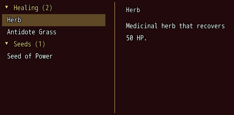
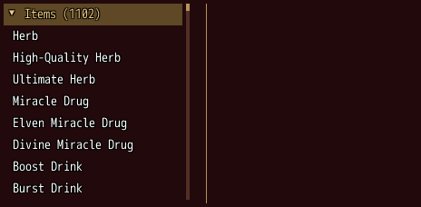
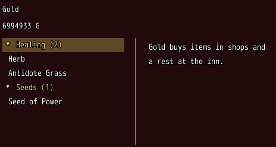
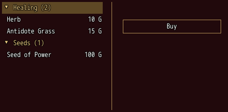
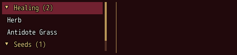

<!-- nav -->
[Mod Framework](../../README.md) › [UI components](README.md) › [Lists](README.md#lists)
<!-- /nav -->

# Page view

`page_view` is a page of a head, a list of items in groups that fold, and a reading pane beside the
list that shows the item picked, such as a page of a shop's items or of what a level brings.
`page_head` holds the head over the list and the pane, `page_pane` what the pane shows. The list
stays one part with its items as data; the pane scrolls.

## Examples

### Groups and a pane

<!-- example: page_view-groups -->
```ruby
page_view items, group: :kind, text: :name, bind: :picked, height: 220 do
  page_pane do
    text picked ? picked.name : "", typo: :subtitle2
    text picked ? picked.description : "", wrap: true
  end
end
```


`group:` names the group an item stands under, such as "Seeds"; its row says how many items
it holds. Confirm or a click on a group folds it open or shut and tells `on_fold`. `bind:` holds the
item picked, and the page renders the pane anew for it.

An entry's `row:` takes a `label:` too, a caption in the system color in a column before its text,
as a [list](list.md#labels-and-notes-in-columns)'s rows do; `label_width:` sets that column in
pixels or by texts of which the widest sets it, else the widest label of all entries does.

### Groups the owner keeps

<!-- example: page_view-owner-groups -->
```ruby
# The party's items under "Items", its key items under "Key Items", a dim line under a group with none.
items = $game_party.items
groups = [["Items", items.reject { |item| item.key_item? }], ["Key Items", items.select { |item| item.key_item? }]]
rows = groups.flat_map { |group, kept| [[:group, group, kept.size]] + (kept.empty? ? [[:none]] : kept) }
shown = lambda do |row|
  next row.name if row.is_a?(RPG::BaseItem)
  next { none: "None right now." } if row == [:none]

  { group: row[1], text: "#{row[1]} (#{row[2]})", open: !shut.include?(row[1]) }
end
page_view rows, row: shown, bind: :picked, height: 220,
                on_fold: ->(group, open) { self.shut = open ? shut - [group] : shut + [group] } do
  page_pane { text picked.is_a?(RPG::BaseItem) ? picked.description : "", wrap: true }
end
```


Without `group:` the owner lays its groups out itself through `row:`: a group's row
`{ group:, text:, open: }` folds the entries after it, up to the next group, and a `{ none: }` line
is a dim line the cursor passes, such as under a group with no entries. `open:` wins over the
player's fold, so keep it with `on_fold`, as the owner here keeps the groups shut for the session.

### A head the keys pick

<!-- example: page_view-head -->
```ruby
page_view items, group: :kind, text: :name, bind: :picked, height: 240 do
  page_head pick: :gold do
    text "Gold", typo: :subtitle2
    text "#{UI::Game.gold} G", typo: :body2
  end
  page_pane do
    text picked == :gold ? "Gold buys items in shops and a rest at the inn." : picked.description, wrap: true
  end
end
```


With `pick:` the head is a stop of the keys over the list: Ctrl and Up from the list reach it, and
as it takes the focus the bound state holds its pick.

### Into the pane

<!-- example: page_view-pane -->
```ruby
page_view items, group: :kind, text: :name, right: ->(item) { item.price }, bind: :picked, height: 220 do
  page_pane do
    text picked ? picked.description : "", wrap: true
    button "Buy", variant: :outlined, on_click: -> { buy(picked) }
  end
end
```


Confirm on an entry moves the focus onto the first part of the pane that takes the keys, such as
Buy, or onto the part marked `autofocus: true`, such as a list under a button; cancel goes back to
the list. Page Up and Page Down scroll the pane a page while the list keeps
the focus. Q and W never scroll it: they reach the window's `on_page` only, such as the
characters of a window that switches them. A gamepad's shoulders step the tabs in view, else the
window's `on_page`, else they scroll the pane.

### Reading a long pane

<!-- example: page_view-read -->
```ruby
page_view items, group: :kind, text: :name, bind: :picked, height: 100 do
  page_pane do
    text picked ? picked.name : "", typo: :subtitle2
    text picked ? picked.description : "", wrap: true
    text picked ? "Sells for #{picked.price}." : "", typo: :caption
  end
end
```


A pane that holds no part that takes the keys, such as one of text, takes the focus itself on
confirm: it shows a frame, Up and Down scroll it a line, and cancel goes back to the list. So a
gamepad, whose shoulders turn the pages, still reads the whole pane with the d-pad.

## Params, events and keys

Every part also takes [the params every part takes](README.md#params-every-part-takes).

<!-- generated: page_view -->
A page of a head, a list of items in groups that fold, and a reading pane beside the list that shows the item picked, such as a page of a shop's items: page_head holds the head, page_pane what the pane shows.

Written `page_view items, ...` with a `do ... end` block of markup.

| Param | Takes | Default | Live | About |
|---|---|---|---|---|
| `items:` | an Array | `[]` |  | the items, one entry each |
| `group:` | a lambda of one item, or its method name |  |  | an item's group, such as "Seeds": its items stand under its row, which counts them, "Seeds (2)"; the groups in the order of their first items, items without one above every group; an owner who keeps the folds or shows empty groups lays its groups out through row: instead |
| `text:` | a lambda of one item, or its method name |  |  | an item's entry text; the item itself by default |
| `icon:` | a lambda of one item, or its method name |  |  | an item's icon before its text |
| `right:` | a lambda of one item, or its method name |  |  | what an item's entry says at its right end, such as "68%" |
| `row:` | a lambda of one item, or its method name |  |  | an item's whole entry, a list row such as { text:, right:, gauge: 0.68, faint: true }, its label: a caption in the system color in a column before its text; for groups the owner lays out itself, a group's row { group: key, text: "Passed (3)", open: false }, which folds the entries after it up to the next group and whose open: wins over the player's fold, or a dim line the cursor passes, { none: "None right now." }, such as under a group without entries |
| `label_width:` | pixels, or an Array of texts of which the widest sets it |  |  | the width of the entries' label: column: pixels, or texts of which the widest sets it; the widest label of all entries by default |
| `bind:` | the name of a state |  |  | the state that holds the picked item, or the pick: of page_head, both ways |
| `head:` | markup as a lambda |  |  | markup of the head over the list and the pane, as page_head holds it |
| `pane:` | markup as a lambda |  |  | markup of what the pane shows, as page_pane holds it |

| Event | Tells |
|---|---|
| `on_change` | the item the cursor moved to, or the pick: of page_head as the head took the focus |
| `on_fold` | the group the player folded or opened, and whether it is open now |

**Keys:** Up and Down pick an entry or a group and wrap at the ends on a fresh press; confirm folds a group, or moves the focus into the pane onto its first part that takes the keys, or onto the pane itself while it holds none, where Up and Down scroll it; cancel there goes back to the list; Page Up and Page Down scroll the pane a page, also from the list; Q and W never scroll it, they reach the window's on_page only; Ctrl and Up from the list reach a head with pick:; the cursor passes a none: line

**Pad:** the d-pad picks; A folds or goes into the pane, where the d-pad scrolls a pane that holds no part that takes the keys; B comes back; the shoulders step the tabs in view, else the window's on_page, else scroll the pane a page

**Mouse:** a click picks an entry or folds a group, a click on the picked entry goes into the pane; the wheel scrolls the list or the pane under the pointer

**Places:** `page_head` (the head over the list and the pane), `page_pane` (what the pane shows)
<!-- /generated -->

### Head and pane

<!-- generated: page_head -->
The head of a page view over its list and its pane, such as what the page is about.

Written `page_head ...` with a `do ... end` block of markup.
It goes inside `page_view`.

| Param | Takes | Default | Live | About |
|---|---|---|---|---|
| `pick:` | any value |  |  | what the head stands for: it is then a stop of the keys over the list, and taking the focus or a click tells on_change of its page view with it, such as the party's gold the pane then shows |
| `spacing:` | `0`, `1`, `2`, `3`, `4`, `5`, `6` | `1` |  | room between its parts, 4 px a unit |
<!-- /generated -->

<!-- generated: page_pane -->
What the pane of a page view shows, such as the item picked in its list; it scrolls.

Written `page_pane ...` with a `do ... end` block of markup.
It goes inside `page_view`.

| Param | Takes | Default | Live | About |
|---|---|---|---|---|
| `spacing:` | `0`, `1`, `2`, `3`, `4`, `5`, `6` | `2` |  | room between its parts, 4 px a unit |
<!-- /generated -->

<!-- nav -->
---

← [Pagination](pagination.md) · [All components](README.md) · [Command](command.md) →
<!-- /nav -->
