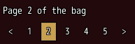
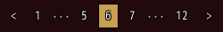

<!-- nav -->
[Mod Framework](../../README.md) › [UI components](README.md) › [Lists](README.md#lists)
<!-- /nav -->

# Pagination

`pagination` shows numbered pages to pick one from, with a button back and one on, such as under a
long log or a set of pages your mod shows itself. The page shown is filled. A [table](table.md)
with `rows_per_page:` makes its own.

## Examples

### Bound to a page

<!-- example: pagination-bind -->
```ruby
text "Page #{page} of the bag"
pagination count: 5, bind: :page
```


`bind:` holds the page shown, 1 for the first. Left and Right walk the buttons, confirm picks.

### Many pages

<!-- example: pagination-many -->
```ruby
pagination count: 12, bind: :page, on_change: ->(page) { load_page(page) }
```


With more than seven pages it shows the first, the last and those around the page shown.

## Params, events and keys

Every part also takes [the params every part takes](README.md#params-every-part-takes).

<!-- generated: pagination -->
Numbered pages to pick one from, with a button back and one on, such as under a long list; the page shown is filled.

Written `pagination ...`.

| Param | Takes | Default | Live | About |
|---|---|---|---|---|
| `count:` | a whole number |  | yes | how many pages there are |
| `bind:` | the name of a state |  |  | the state that holds the page shown, both ways: 1 for the first |

| Event | Tells |
|---|---|
| `on_change` | the page the player picked: 1 for the first |

**Keys:** Left and Right walk its buttons, confirm picks the page

**Pad:** the d-pad walks, A picks

**Mouse:** a click picks a page
<!-- /generated -->

<!-- nav -->
---

← [Table](table.md) · [All components](README.md) · [Page view](page_view.md) →
<!-- /nav -->
