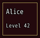
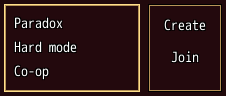
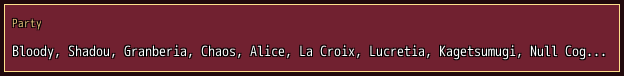
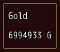
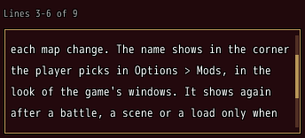
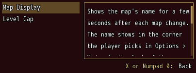

<!-- nav -->
[Mod Framework](../../README.md) › [UI components](README.md) › [Layout](README.md#layout)
<!-- /nav -->

# Paper

`paper` is a framed box around its parts. With `enter: true` the arrows stop on the box as a whole
first, and from it pick the box that lies below, above or beside it whole too; confirm goes inside
and cancel comes back out, as the world screen's boxes do. With `clickable: true` the box is one
part that confirm or a click presses, such as a summary that opens the screen it sums up.

`padding:` changes the room inside its frame, 6 pixels by default, and `border: false` drops the
frame, so `paper border: false, padding: 0` is a plain area, such as one that scrolls a grid.

## Examples

### A framed box

<!-- example: paper-plain -->
```ruby
paper do
  text "Alice"
  text "Level 42", typo: :caption
end
```


### A box the keys enter

<!-- example: paper-enter -->
```ruby
stack row: true do
  paper enter: true do
    list worlds, bind: :world
  end
  paper enter: true do
    button "Create", on_click: -> { create }
    button "Join", on_click: -> { join }
  end
end
```


While a box is only picked, the cursor of a list inside it hides. `on_enter` and `on_leave` tell
when the keys go inside the box and come back out, such as to name the keys inside it.

### A box pressed as one part

<!-- example: paper-clickable -->
```ruby
paper clickable: true, on_click: -> { SceneManager.call(Scene_Status) } do
  text "Party", typo: :caption, color: :system
  text $game_party.members.map { |actor| actor.name }.join(", "), most_lines: 1
end
```


With `clickable: true` the box is one key stop: the arrows stop on it, confirm or a click anywhere
on it tells `on_click`, and the parts it holds take neither the keys nor the pointer. The focus on
it lights the whole box. Give `clickable:` a value that turns off where the box has nothing to
open, such as `clickable: !$game_party.members.empty?`; then the keys pass over it.

### Pulsing as it changes

<!-- example: paper-pulse -->
```ruby
paper pulse: -> { UI::Game.gold } do
  text "Gold"
  text "#{UI::Game.gold} G", typo: :body2
end
```


`pulse:` takes any value, or a lambda read as live values are. Each time the value changes, the
part turns see-through for a moment and fades back, so a change the player did not make is seen,
such as gold an event gave. It does not pulse as it first shows, nor while the
player turned Animations off. Every part takes `pulse:`, not only a paper.


### A text that scrolls

<!-- example: paper-scroll -->
```ruby
text in_sight ? "Lines #{in_sight[:first]}-#{in_sight[:last]} of #{in_sight[:total]}" : "", typo: :caption, color: :dim
paper scroll: :vertical, focusable: true, height: 120, key: mod.name, on_scroll: ->(lines) { self.in_sight = lines } do
  text "About", typo: :caption, color: :system
  text mod.description, typo: :body2, wrap: true
end
```


The Mod List's About text and the mod browser's page text. `scroll: :vertical` scrolls what the
paper holds once it is higher than the paper, by the wheel and a scrollbar at its right. With
`focusable: true` the keys stop on it: Up and Down scroll it a line, Page Up and Page Down a page,
and at its ends they do nothing; Left and Right leave it. `on_scroll` tells which lines of its texts
are in sight, `{ first:, last:, total: }`, counted over every line of every text it holds. Give it a
`key:` of what it shows, here the mod, so the next mod's text starts at its top.

### Reading beside a list

<!-- example: paper-reading -->
```ruby
stack row: true do
  list ["Map Display", "Level Cap"], bind: :mod, width: 160
  paper scroll: :vertical, focusable: true, height: 120, grow: 1, key: mod,
        on_enter: -> { self.reading = true }, on_leave: -> { self.reading = false } do
    text about(mod), typo: :body2, wrap: true
  end
end
key_help entries: [{ button: :B, text: reading ? "Back" : "Close" }], auto: !reading
```


The Mod List's side. Right from the list goes onto the paper; `on_enter` and `on_leave` tell
when the focus comes onto it and leaves it, here so the key help names only Back while the player
reads. Cancel on the paper goes back to the part the focus came from, the list, and the next
cancel closes the window.

## Params, events and keys

Every part also takes [the params every part takes](README.md#params-every-part-takes).

<!-- generated: paper -->
A framed box around its parts. With enter: true the keys stop on it as a whole first; with clickable: true it is one part that confirm or a click presses; with scroll: it scrolls what it holds, such as a text the player reads.

Written `paper ...` with a `do ... end` block of markup.

| Param | Takes | Default | Live | About |
|---|---|---|---|---|
| `enter:` | true, false | `false` |  | the arrows stop on it as a whole; confirm goes inside onto the part picked there last, cancel inside comes back out |
| `clickable:` | true, false | `false` |  | one key stop that confirm or a click anywhere on it presses, telling on_click, what it holds taking neither the keys nor the pointer, such as a box of the party that opens the party's screen |
| `scroll:` | `false`, `:vertical` | `false` |  | :vertical scrolls what it holds up and down when it is higher than the paper, by the wheel and its scrollbar; give it a key: of what it shows, such as the mod, so another text starts at its top |
| `focusable:` | true, false | `false` |  | with scroll:, the keys stop on it and scroll it, such as a description the player reads |
| `on_button:` | { z: -> { ... } }: a lambda or a method name, or nil, for each of the game's buttons :a, :x, :y and :z it takes |  |  | what the game's buttons :a, :x, :y and :z (Shift, A, S and D on the keyboard) do while the focus is on it or inside it, such as { z: -> { open_filter } }; only where a screen mirrors the game's own |
| `button_help:` | { z: "Filter" }: what each button of on_button: does, for the key help |  |  | what each button of on_button: does, which the key help names, such as { z: "Filter" }; nil leaves a button out, such as on a row it does nothing on |

| Event | Tells |
|---|---|
| `on_page` | Q or W, or a gamepad's shoulder without tabs in view, reached it from the focus upward: -1 for the page before, 1 for the next |
| `on_submit` | a list inside it without on_submit: picked an item, nearest first: the item |
| `on_click` | nothing; with clickable: true, confirm or a click on it pressed it |
| `on_enter` | nothing; with enter: true, the focus went inside it; with scroll: and focusable: true, the focus came onto it |
| `on_leave` | nothing; with enter: true, the focus came out of it; with scroll: and focusable: true, the focus left it |
| `on_scroll` | with scroll:, the lines of its texts in sight changed: { first:, last:, total: }, counted from 1 over every line of every text it holds, 0 for none, such as for "Lines 1-12 of 40" |

**Keys:** with enter: true, the arrows stop on it whole and from it pick the box below, above or beside it whole by where it lies, confirm goes in and cancel comes back out; cancel on it whole closes the window; with clickable: true, the arrows stop on it as one part and confirm presses it; with scroll: and focusable: true, Up and Down scroll it a line and Page Up and Page Down a page, at its ends nothing, Left and Right leave it, and cancel goes back to the part the focus came from

**Pad:** as the keys

**Mouse:** a click on a part inside goes straight in; with clickable: true, a click anywhere on it presses it; with scroll:, the wheel over it scrolls it and its scrollbar drags
<!-- /generated -->

<!-- nav -->
---

← [Grid](grid.md) · [All components](README.md) · [Card](card.md) →
<!-- /nav -->
