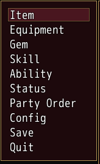
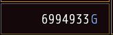
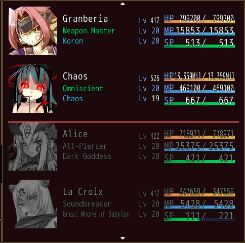
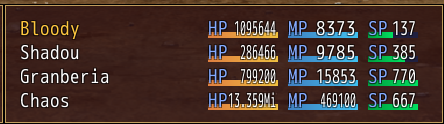

<!-- nav -->
[Mod Framework](../../README.md) › [UI components](README.md) › [Services](README.md#services)
<!-- /nav -->

# Patch

`UI.patch(selector) { |t| ... }` changes a window of another mod, one of the framework's screens
or one of the game's windows, by the ids, classes and types its owner gave, without touching its
code. The block runs each time such a part renders, after its owner's render, so the changes stay.
PARTS.md, shipped in `Patch/Mod_Framework`, lists the ids of the framework's screens and of the game's title and menu.

## Examples

### The game's menu, renamed and trimmed

<!-- example: patch-menu -->
```ruby
UI.patch "Window_MenuCommand" do |menu|
  menu.set "#formation", text: "Party Order"
  menu.hide "#library"
end
```


A game window is named by its class, and a command by its symbol inside it. `set` on a command
changes its `text:`, `disabled:`, `visible:`, `icon:` and `badge:`; `hide` takes it off the list,
and the window is as tall as the commands left. [Command](command.md) adds commands of your own.

### The gold window see-through

<!-- example: patch-gold -->
```ruby
UI.patch("Window_Gold") { |gold| gold.set opacity: 160 }
```


`set` on a game window itself takes `opacity:`, `anchor:`, `at:`, `width:`, `height:`, `theme:` and
`movable: true`, and keeps them when the game's scene moves the window again. `hide` with no
selector hides the whole window, which the game's scripts still see as they set it.

### A pick let through only sometimes

```ruby
UI.patch "Window_MenuCommand" do |menu|
  menu.on "#save", :click do |original|
    original.call if UI::Game.switch(12)
  end
end
```

`on` wraps the handler of a pick, the game's own too: `original.call` runs it, and a block that
does not call it refuses the pick, which the log names, while the menu keeps the keys. `on :cancel`
with no selector wraps the window's cancel.

### The members who stay out of battle greyed in the formation list

<!-- example: patch-formation-rows -->
```ruby
UI.patch "Window_MenuStatus" do |formation|
  formation.rows do |rows|
    fighting = $game_party.battle_members.size
    rows.map do |row|
      next row if row[:index] < fighting

      row.merge(grey: true, line_above: row[:index] == fighting ? :error : nil)
    end
  end
end
```


### The party leader's name in gold in the battle's status

<!-- example: patch-battle-name -->
```ruby
UI.patch "Window_BattleStatus" do |status|
  status.rows do |rows|
    rows.map { |row| row[:index] == 0 ? row.merge(name_color: :gold) : row }
  end
end
```


`rows` on a game list window, such as the menu's status list or the battle's, gets one `{ index: }`
per row each time the window draws its rows, and the looks you merge into a row apply to it:

| Look | Does |
|---|---|
| `name_color:` | draws the character's name in that color: a color name, `"#RRGGBB"`, `[r, g, b]` or a game text color such as 16 |
| `name:` | shows that text in place of the character's name |
| `grey: true` | greys the row's texts, faces and icons |
| `line_above:` | draws a line of that color along the row's top edge |

The name is what the game draws with its `draw_actor_name` methods. On a command window, `rows` gets
the commands, and a command takes `name_color:`, `grey:` and `line_above:` the same way; its text is
its name. A window of a nested class is named by its whole class name, such as
`"Foo::PTEdit::Window_PartyMember"`, the party edit's list, and a patch reaches a class that
is defined after it once a window of it is made. `read` on a game window reads a value it keeps,
such as `party.read(:actors)`, the ids of the characters the party edit holds while the player
edits it.

### A button in another mod's window

```ruby
UI.patch "#ew_equipment_window" do |w|
  w.set "#ew_stats stat_grid", size: :small
  w.append "#ew_buttons" do
    button "Compare", variant: :outlined, on_click: -> { compare(w.read(:actor)) }
  end
end
```

This adds a Compare button to the Equipment Window and draws its stats small, by the ids it gives,
which start with its prefix `ew_`. `read` takes a value the
owner exposed with `expose :actor`. A part your patch adds keeps its focus and state as the owner
renders again, and mods loaded after yours patch it by the `id:` you give it, such as
`#Gear_Compare/compare` for `id: :compare` in a mod named Gear_Compare.

## Selectors

| Selector | Names |
|---|---|
| `#id` | a part by its id |
| `#Owner/id` | one mod's part of that id, when two mods share an id |
| `.name` | the parts with `class: :name` |
| `list`, `"Party_Picker::MemberCard"` | the parts of a built-in or of a component class |
| `"#camp_notes list"` | a space means inside, `>` directly inside; at most three steps |
| `Window_MenuCommand`, `Window_Command` | a game window by its class; `Window_Command` names every command window |
| `"Foo::PTEdit::Window_PartyMember"` | a game window of a nested class by its whole name |
| `"Window_MenuCommand #equip"` | a command of a game command window by its symbol |

## Operations

Each operation takes a selector of parts inside the named part, or none for the named part itself.

| Operation | Does |
|---|---|
| `t.set "#title", text: "..."` | sets params, which win over the owner's and are checked like markup |
| `t.before`, `t.after`, `t.prepend`, `t.append` | add the markup of their block next to the parts or inside them |
| `t.hide "#close"` | hides parts; hiding wins over a set |
| `t.replace "#badge", BigBadge` | puts your component in a part's place; not on a game window, whose place [Replace window](replace_window.md) takes |
| `t.on "#clear", :click do \|original\| ... end` | wraps a handler; not calling `original.call` refuses the event |
| `t.rows "#notes" do \|rows\| ... end` | changes the rows of a list or an options list after the owner made them; on a game window, its commands or its rows' looks |
| `t.read(:count)` | reads a value the owner exposed with `expose`; on a game window, a value it keeps, such as `:actors` |

## Order and failures

- Patches apply in the load order of their mods. When two mods set the same param of a part, the
  one loaded last wins, and the log names both.
- Inside the block `self` is your mod's own, so its methods work, but an `@variable` belongs to the
  block's helper: use methods or local variables there.
- A patch that raises is logged with your file and line and stays off for that window for the rest
  of the session; the window shows without it. A selector that matches nothing is logged once with
  the ids and types found there.

<!-- nav -->
---

← [Replace scene](replace_scene.md) · [All components](README.md) · [Toast](toast.md) →
<!-- /nav -->
