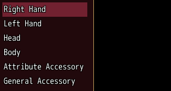
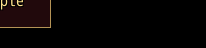

<!-- nav -->
[Mod Framework](../../README.md) › [UI components](README.md) › [Roots](README.md#roots)
<!-- /nav -->

# Popover

`popover` is a framed box beside a part of a window or beside the pointer, such as more about a
slot. It takes the keys while it is open; cancel closes it and the focus goes back to its target.

## Examples

### Beside a list

<!-- example: popover-beside -->
```ruby
list slots, id: :slots, bind: :slot, on_submit: -> { self.more = true }
popover target: "#slots", side: :right, bind: :more do
  text "Holds one weapon."
end
```


### At the pointer

<!-- example: popover-pointer -->
```ruby
popover target: :pointer, open: hint_open, on_close: -> { self.hint_open = false } do
  text "Click a slot to change it."
end
```


## Params, events and keys

Every part also takes [the params every part takes](README.md#params-every-part-takes).

<!-- generated: popover -->
A framed box beside a part or the pointer, over the window it lies in, such as more about a slot.

Written `popover ...` with a `do ... end` block of markup.

| Param | Takes | Default | Live | About |
|---|---|---|---|---|
| `target:` | a selector, such as "#slots", or :pointer |  |  | the part it sits next to, or :pointer for where the pointer is as it opens |
| `side:` | `:top`, `:bottom`, `:left`, `:right` | `:bottom` |  | the side of target: it sits on, lined up with its left edge or its top |
| `open:` | true, false | `false` |  | it opens as this turns true and closes as it turns false |
| `bind:` | the name of a state |  |  | a state that holds whether it is open, both ways, instead of open: |
| `close_outside:` | true, false | `true` |  | a click outside closes it |
| `flip:` | true, false | `true` |  | it takes the other side where its own has no room |
| `z:` | a whole number |  |  | which root lies above which within the dialogs' band, 0 by default |

| Event | Tells |
|---|---|
| `on_close` | why it closed: :cancel, :outside, :script or :scene |

**Keys:** it takes the keys while open; cancel closes it and the focus goes back to target:

**Pad:** B closes it

**Mouse:** a click outside closes it
<!-- /generated -->

<!-- nav -->
---

← [HUD](hud.md) · [All components](README.md) · [Wheel](wheel.md) →
<!-- /nav -->
