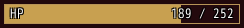
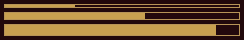
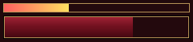
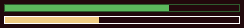
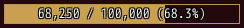
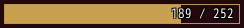
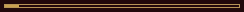

<!-- nav -->
[Mod Framework](../../README.md) › [UI components](README.md) › [Display](README.md#display)
<!-- /nav -->

# Progress

`progress` is a bar of a value between a least and a most, such as a character's HP or the
experience to the next level, as MudBlazor's `MudProgressLinear`. It can show a text at its left, its value at its right and
a text in its middle, and what it just lost can drain away.
When its value falls, its fill drains down smoothly (at once while the player's Animations row is
Off); a rise shows at once.

## Examples

### A value with its texts

<!-- example: progress-value -->
```ruby
progress value: 189, max: 252, label: "HP", value_text: "189 / 252"
```


Its texts draw in the plain text color with the black outline. With `contrast: true` each part of a
text takes the dark or the light text, whichever reads better on the fill or on the empty part
under it.

### Sizes

Without texts, `size:` sets the height: 4, 8 or 12 pixels. With texts it sets their font.

<!-- example: progress-sizes -->
```ruby
progress value: 30, size: :small
progress value: 60, size: :medium
progress value: 90, size: :large
```


### Colors

`color:` fills it in one color, the theme's primary color without it, and `colors:` runs two from
left to right. With `vertical: true` two or three colors run from top to bottom, and `border: :theme,
border_width: 2` draws the theme's frame two pixels thick around it.

<!-- example: progress-colors -->
```ruby
progress value: 35, colors: [:error, :warning]
progress value: 70, colors: [[156, 32, 50], [110, 16, 30], [70, 8, 18]], vertical: true, border: :theme, border_width: 2, height: 30
```


### A border of its own color

`border:` draws the bar's edge in a color of its own, one pixel inside its size unless `border_width:`
says otherwise, and `border: :shade` takes a darker shade of its fill, so a thin bar keeps its edge
in its own color. `background:` fills the bar's well, and `border: false` leaves the edge out.

<!-- example: progress-border -->
```ruby
progress value: 70, size: :medium, color: :success, border: :shade
progress value: 40, size: :medium, color: :info, border: :text
```


### The text that fits

`text:` takes ever shorter texts; the first that fits the bar shows.

<!-- example: progress-texts -->
```ruby
progress value: 68_250, max: 100_000, text: ["68,250 / 100,000 (68.3%)", "68,250 / 100,000", "68.3%"]
```


### What was just lost

With `trail: true` what the value lost in the last two seconds stays in a darker shade, then drains
away. A rise shows at once.

<!-- example: progress-trail -->
```ruby
progress value: -> { hp }, max: 252, trail: true, value_text: -> { "#{hp} / 252" }
```


### A wait of unknown length

<!-- example: progress-indeterminate -->
```ruby
progress indeterminate: true, size: :small
```


## Params, events and keys

Every part also takes [the params every part takes](README.md#params-every-part-takes).

<!-- generated: progress -->
A bar of a value between a least and a most, such as a character's HP, with a text at its left, its value at its right and a text in its middle; what it just lost can drain away.

Written `progress ...`.

| Param | Takes | Default | Live | About |
|---|---|---|---|---|
| `value:` | any value |  | yes | how far it is, between min: and max:; its fill drains down as it falls, a rise shows at once |
| `min:` | any value | `0` |  | the value of an empty bar |
| `max:` | any value | `100` |  | the value of a full bar |
| `color:` | a color name such as :primary or :rainbow, "#RRGGBB", [r, g, b] or a game text color such as 2 |  | yes | its fill's color; the theme's primary color by default |
| `colors:` | an Array |  |  | two colors its fill runs between from left to right, or with vertical: true two or three from top to bottom |
| `size:` | `:small`, `:medium`, `:large` |  |  | the font of its texts, tiny, small or normal, and without texts its height, 4, 8 or 12 pixels; without size: 12 pixels and the small font |
| `label:` | a text |  | yes | a text inside it at its left, such as "HP" |
| `value_text:` | a text |  | yes | a text inside it at its right, such as "189 / 252" |
| `text:` | a text, or an Array of ever shorter texts |  | yes | a text in its middle, or an Array of ever shorter texts of which the first that fits shows |
| `trail:` | true, false | `false` |  | what the value lost in the last two seconds stays in a darker shade, then drains away; a rise shows at once |
| `vertical:` | true, false | `false` |  | its colors: run from top to bottom |
| `indeterminate:` | true, false | `false` |  | a stripe sweeps along it in place of a value, for a wait whose length nobody knows |

**Keys:** none

**Mouse:** none; its tooltip: shows on hover
<!-- /generated -->

<!-- nav -->
---

← [Alert](alert.md) · [All components](README.md) · [Arrow](arrow.md) →
<!-- /nav -->
